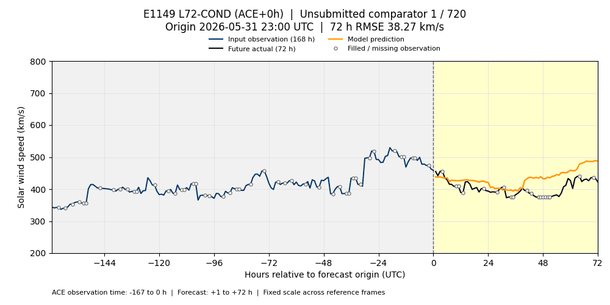
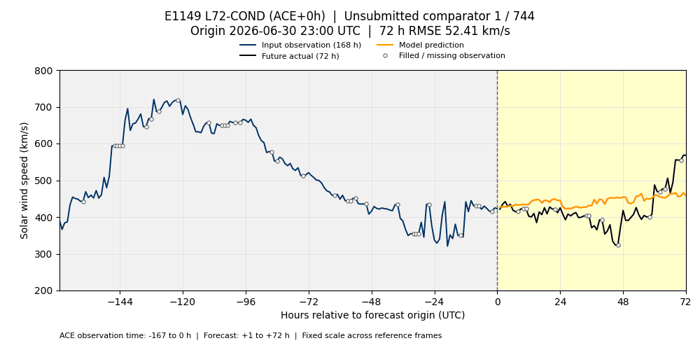
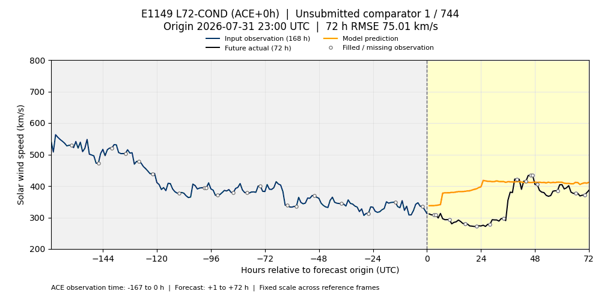
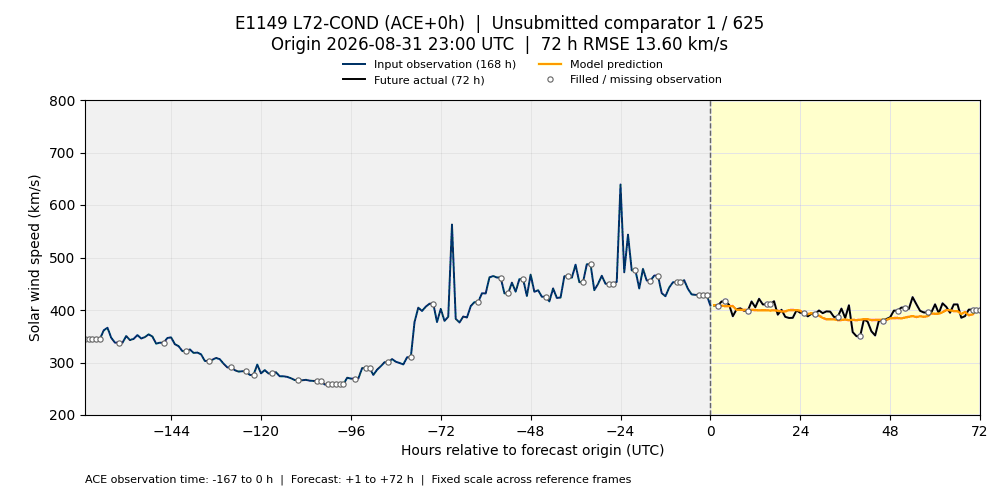
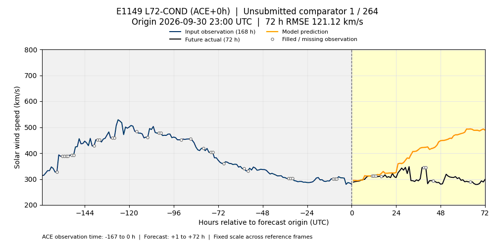

# E1149 L72-COND — ACE 지연 없는 재학습 비교

E1149 레시피에서 **ACE +2시간 지연을 학습부터 제거**한 seed 0 비교 결과입니다. 기존 +2시간 모델에 최신 입력만 넣은 결과가 아닙니다. 시간순 OOF 수준 추정기와 최종 모델을 다시 학습했습니다. 실험명은 편의상 `E1149_NO_DELAY`로 표시하며, **새로운 공식 실험 번호나 리더보드 제출 결과를 뜻하지 않습니다.**

변경은 ACE 속도·ACE 피처의 가용 시각 이동 제거, 잔차 계산 및 hindcast 정렬 **14시간 → 12시간**, 이에 맞춘 미래값 교란 검증입니다. 혼합 가중치·트리 설정·OOF 기간·학습 타깃 마감(2026-05-29 이전)·타깃 성숙 여유는 E1149와 같습니다. 관측의 실제 배포 지연을 무시한 참고 비교이므로 실시간 운영 성능으로 해석하지 않습니다.

두 버전이 고정한 입력 파일 66개의 목록과 SHA256이 모두 일치함을 확인했습니다. 재학습의 차이에 데이터 버전 차이가 섞이지 않도록 각각 별도 작업 폴더와 체크포인트를 사용했습니다.

6~9월 동일 검증 구간의 참고 MSE는 **3279.115543548658**입니다. 비교 대상인 원 E1149 seed 0의 MSE는 **3383.173808352058**입니다. 이 숫자는 같은 203,976개 예측·실제값 쌍의 비교이며, 지연 없는 버전의 공식 리더보드 제출 점수를 뜻하지 않습니다.

파란 선은 최근 **168시간 관측(−167~0시간)**, 검은 선은 **+1~+72시간 실제값**, 주황 선은 예측입니다. 빈 원은 원본 결측 채움 표시이며, 채움 값도 프레임별 RMSE에 포함합니다. 추가 보간은 하지 않았습니다. 그림은 모델의 모든 특성을 나타내지는 않습니다.

첫 예측 시각(`origin + 1h`)의 UTC 월로 나눴습니다. 6~9월은 E1149와 동일한 2,833개 시작점의 고정 검증 구간을 사용한 **미제출 비교**이고, 10월은 최신 로컬 v2 입력을 사용한 참고 추론입니다. 각 GIF는 1000×500, 프레임당 100ms, 무한 반복입니다.

| 월 | 시작점 수 | 재생 시간 | 파일 |
| --- | ---: | ---: | --- |
| 2026-06 | 720 | 72초 | [6월 GIF](validation_2026-06.gif) |
| 2026-07 | 744 | 74.4초 | [7월 GIF](validation_2026-07.gif) |
| 2026-08 | 744 | 74.4초 | [8월 GIF](validation_2026-08.gif) |
| 2026-09 | 625 | 62.5초 | [9월 GIF](validation_2026-09.gif) |
| 2026-10 | 264 | 26.4초 | [10월 GIF](validation_2026-10.gif) |

## 6월



## 7월



## 8월



## 9월



## 10월



첫 예측 시각은 **10월 1일 00:00~10월 11일 23:00 UTC**이며, 미래 72시간 실제값이 확보된 264개 시작점만 포함합니다. 마지막 실제값은 **10월 14일 22:00 UTC**입니다. v2 입력의 공식 전환 검증은 아직 대기 상태이며, 이 결과를 기존 공식 점수에 합산하지 않습니다.

10월 참고 MSE는 **11439.070621577315**입니다. 19,008개 시작점×예측시간 쌍 중 2,559개는 원본의 결측 채움 표시가 있는 실제값이며, 겹치는 예측 구간에서 같은 관측이 반복 집계됩니다. 채움 값도 동일하게 RMSE에 포함합니다.

## 재현과 출처

생성 코드는 [predict_e1149_visualization.py](../../../scripts/predict_e1149_visualization.py)와 [visualize_enlil_validation.py](../../../scripts/visualize_enlil_validation.py)입니다. 원 연구 저장소와 로컬 입력, `model_release/requirements.txt`의 Python 환경이 필요합니다. Matplotlib·Pillow로 GIF를 렌더링합니다.

```bash
/home/t-lab01/sunrun/leaderboard/.venv-fusion/bin/python scripts/predict_e1149_visualization.py \
  --latency-hours 0 --threads 4 \
  --leaderboard-root /home/t-lab01/sunrun/leaderboard \
  --reference-input-dir /home/t-lab01/sunrun/visualization-reference-20261017/inputs \
  --output-dir /home/t-lab01/sunrun/visualization-e1149-20261017-ace0h
```

새 작업 폴더에서 학습하며, 중단 후에는 같은 설정과 `--resume`으로 이어갑니다. 6~9월 예측 파일을 `origin + 1h`의 월로 나눈 뒤 렌더러의 `--experiment E1149_ACE0H --ace-latency-hours 0 --reference-month YYYY-MM`으로 월별 GIF를 생성합니다. 월별 영수증은 통합 예측의 원 해시를 유지하고 `predictions_sha256`을 해당 월 파일의 해시로 지정합니다. `--history`는 6~9월에 원 ACE 파일, 10월에 고정 v2 ACE 파일을 사용합니다. 구체적인 입력 경로와 해시는 각 manifest에 기록되어 있습니다.

월별 `manifest_YYYY-MM.json`에 학습 레시피·입력 스냅샷·모델 상태·예측·GIF 해시, 교란 검증 결과 및 재학습 설정을 기록합니다. 원시 데이터·학습 모델·중간 예측은 GitHub에 포함하지 않습니다.

[원 E1149 ACE+2시간 결과](../e1149_l72cond_ace2h/README.md)
