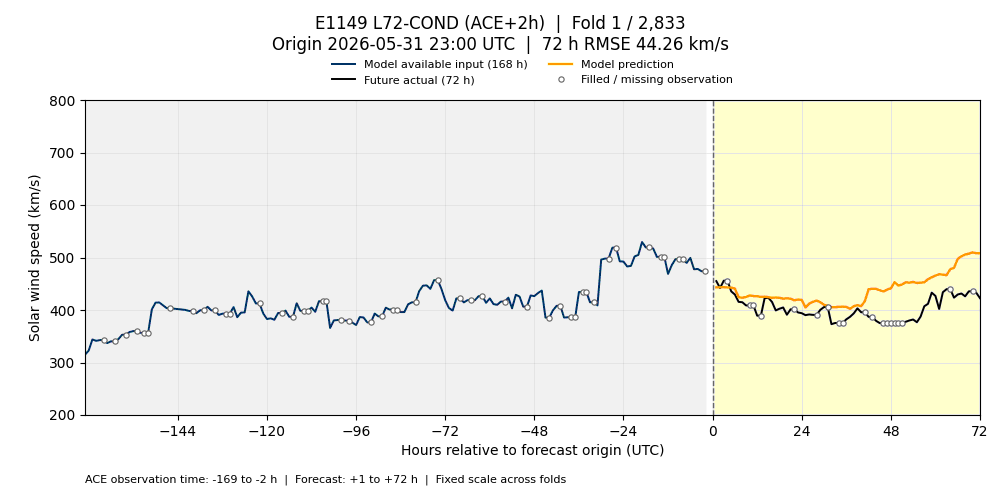
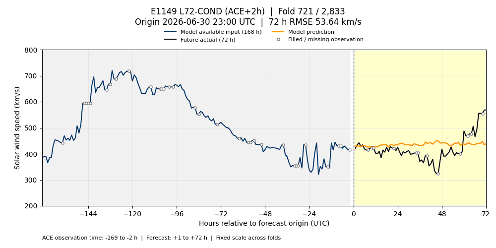
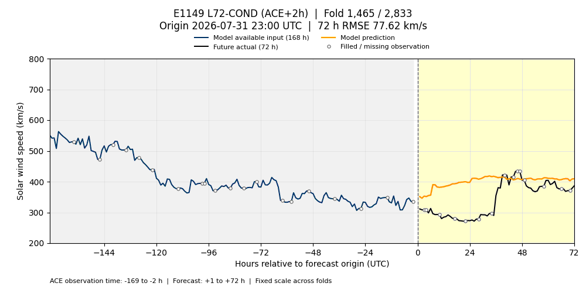
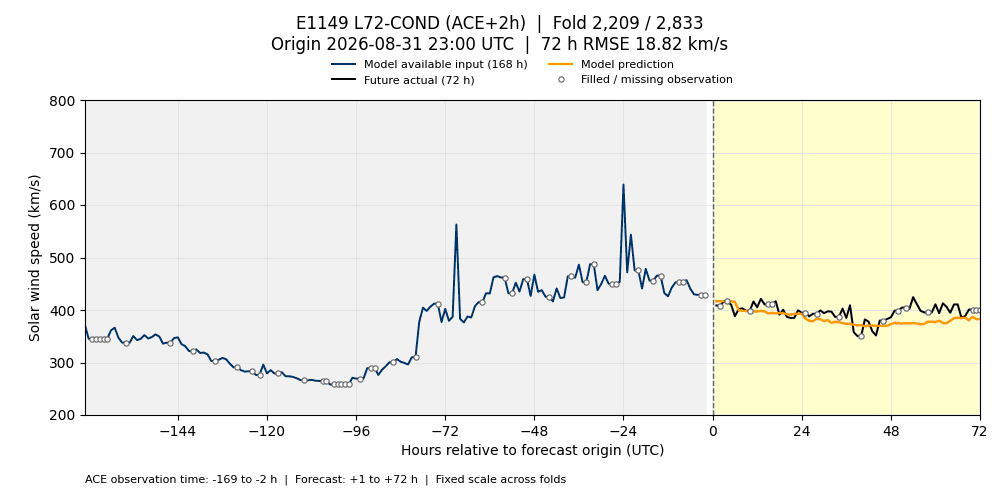

# E1149 L72-COND — ACE +2시간 검증 폴드 GIF

E1149 **seed 0의 저장 예측**을 재학습 없이 표시합니다. 고정 검증 스냅샷의 **2,833개 시작점 × 72시간**을 모두 포함하며 MSE는 **3383.173808352058**입니다. 앞서 보고한 3-seed 평균 MSE **3387.662496**과는 집계 범위가 다릅니다. 원 실험 결과의 시각화이며 새로운 제출이나 모델 채택은 아닙니다.

E1149는 기존 XGBoost 혼합·잔차·analog 모델에 시간순 OOF로 예측한 72시간 평균 풍속 수준(`level72_hat`)을 추가한 모델입니다. 독립 seed 재현은 확인됐지만 전체 SOTA 채택 gate를 통과한 것은 아닙니다. E0472와는 ACE 관측 가용 시점 계약도 다릅니다.

파란 선은 모델이 이용할 수 있는 최근 **168시간 관측(시작점 기준 −169~−2시간)**입니다. ACE 관측 후 2시간 지연을 적용합니다. 검은 선은 **+1~+72시간 실제값**, 주황 선은 예측입니다. 빈 원은 원 관측의 결측 채움 표시이며, 실제값에 추가 보간을 하지 않았습니다. 제목에는 시작점 UTC와 해당 72시간의 RMSE가 표시됩니다. 그림은 CH·SUVI·DONKI·회귀·수준 추정값 등 전체 입력을 보여주지는 않습니다.

첫 예측 시각(`origin + 1h`)의 UTC 월로 구분합니다. 모든 GIF는 **1000×500**, **100ms/프레임**, 무한 반복, 동일한 **200~800 km/s** Y축을 사용합니다. 기존 E0472 시각화와 같은 재생 형식입니다.

| 월 | 시작점 수 | 재생 시간 | 파일 |
| --- | ---: | ---: | --- |
| 2026-06 | 720 | 72초 | [6월 GIF](validation_2026-06.gif) |
| 2026-07 | 744 | 74.4초 | [7월 GIF](validation_2026-07.gif) |
| 2026-08 | 744 | 74.4초 | [8월 GIF](validation_2026-08.gif) |
| 2026-09 | 625 | 62.5초 | [9월 GIF](validation_2026-09.gif) |

## 6월



## 7월



## 8월



## 9월



## 재현과 검증 근거

[manifest.json](manifest.json)에 원 예측·고정 검증 스냅샷·관측 이력·렌더러의 SHA-256, 월별 프레임 수, 기간, GIF 해시 및 전체 프레임 디코딩 검증을 기록했습니다. 검증 스냅샷 revision은 `bcf5d5417d99eaa331ddca40581d48953e09a58e`입니다. 원 레시피 SHA-256은 `d8271c4c9bbb02734abaf1399393183143cfe318e7551e35f6119e0086105eb9`입니다.

생성 코드는 [visualize_enlil_validation.py](../../../scripts/visualize_enlil_validation.py)입니다. NumPy·pandas·PyArrow·Matplotlib·Pillow가 필요합니다. 아래 경로는 생성 당시 로컬 환경 기준이며, 비공개 입력이 있는 환경에서 각 경로를 지정해야 합니다.

```bash
python scripts/visualize_enlil_validation.py \
  --experiment E1149 --ace-latency-hours 2 \
  --predictions /home/t-lab01/sunrun/research/expos/runs/E1149/predictions_official_s0.parquet \
  --folds /path/to/bcf5d541/folds.parquet \
  --truth /path/to/bcf5d541/truth.parquet \
  --history /home/t-lab01/sunrun/leaderboard/store/ch-v1/ace.parquet \
  --output-dir docs/visualizations/e1149_l72cond_ace2h
```

이 페이지는 6~9월 고정 검증 구간만 포함합니다. 원시 입력·학습 모델·중간 예측 파일은 저장소에 포함하지 않습니다.
