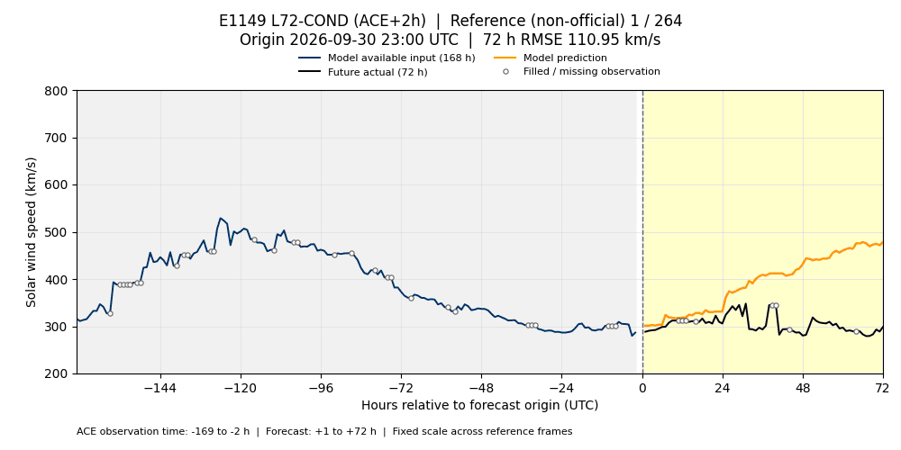

# E1149 L72-COND — ACE +2시간

E1149 seed 0의 시간별 72시간 예측입니다. 6~9월은 원 실험의 저장 예측을 그대로 사용하며, 고정 검증 스냅샷의 **2,833개 시작점 × 72시간**에서 MSE는 **3383.173808352058**입니다. 10월은 동일 레시피를 복원한 모델에 최신 로컬 v2 입력을 넣은 별도 참고 추론입니다.

파란 선은 모델이 이용할 수 있는 최근 168시간 관측으로, 시작점 기준 **−169~−2시간**입니다. ACE 관측 +2시간 지연을 적용하므로 마지막 두 시간의 관측은 입력에 표시하지 않습니다. 검은 선은 **+1~+72시간 실제값**, 주황 선은 예측이며 빈 원은 원본의 결측 채움 표시입니다. 각 프레임에 UTC 시작점과 해당 72시간의 RMSE를 표시합니다. 이 그림은 CH·SUVI·DONKI·회귀 입력 및 학습된 수준 특성을 모두 보여주지는 않습니다.

첫 예측 시각(`origin + 1h`)의 UTC 월로 나눴습니다. 각 GIF는 1000×500, 프레임당 100ms, 무한 반복입니다. 실제값은 기존 채움 정책을 유지하며 추가 보간하지 않았습니다.

| 월 | 시작점 수 | 재생 시간 | 파일 |
| --- | ---: | ---: | --- |
| 2026-06 | 720 | 72초 | [6월 GIF](validation_2026-06.gif) |
| 2026-07 | 744 | 74.4초 | [7월 GIF](validation_2026-07.gif) |
| 2026-08 | 744 | 74.4초 | [8월 GIF](validation_2026-08.gif) |
| 2026-09 | 625 | 62.5초 | [9월 GIF](validation_2026-09.gif) |
| 2026-10 (참고) | 264 | 26.4초 | [10월 GIF](validation_2026-10.gif) |

## 6월


## 7월


## 8월


## 9월


## 10월 참고 추론



미래 72시간의 실제값이 있는 시작점만 포함합니다. 첫 예측 시각은 **10월 1일 00:00~10월 11일 23:00 UTC**, 시작점은 9월 30일 23:00~10월 11일 22:00 UTC, 마지막 실제값은 **10월 14일 22:00 UTC**입니다. 입력은 로컬 v2 ACE·CH·SUVI·DONKI 스냅샷이며, v2의 공식 전환 검증은 대기 상태입니다. 10월 결과는 기존 공식 평가에 합산하지 않습니다.

10월 참고 MSE는 **11651.634560649161**입니다. 19,008개 시작점×예측시간 쌍 중 2,559개는 원본의 결측 채움 표시가 있는 실제값이며, 겹치는 예측 구간에서 같은 관측이 반복 집계됩니다. 채움 값도 RMSE에 포함합니다.

## 레시피와 재현

E1149는 기존 혼합 모델과 잔차 보정에, 시간순 OOF로 학습한 72시간 평균 수준 추정값(`level72_hat`) 한 열을 추가합니다. 수준 타깃은 72시간 중 실측이 54시간 이상인 구간의 실측 평균이며, 타깃 성숙 여유 72시간을 추가합니다. 학습 타깃은 2026-05-29 이전으로 제한합니다. 비교용 [지연 없는 버전](../e1149_l72cond_ace0h/README.md)은 ACE +2시간 적용을 학습부터 제거해 별도로 적합한 결과입니다.

원 레시피 SHA256: `d8271c4c9bbb02734abaf1399393183143cfe318e7551e35f6119e0086105eb9`.

생성 코드는 [predict_e1149_visualization.py](../../../scripts/predict_e1149_visualization.py)와 [visualize_enlil_validation.py](../../../scripts/visualize_enlil_validation.py)입니다. 복원에는 원 연구 저장소와 로컬 입력이 필요하며, Python 환경은 `model_release/requirements.txt`의 고정 버전을 사용합니다. GIF 렌더링에는 Matplotlib·Pillow도 필요합니다.

저장소 루트에서 실행하는 복원 명령입니다. `--output-dir`에는 새 작업 폴더를 지정하며, 중단 후 같은 설정으로 이어갈 때는 `--resume`을 붙입니다. 아래 입력 경로는 생성 당시 로컬 환경 기준입니다.

```bash
/home/t-lab01/sunrun/leaderboard/.venv-fusion/bin/python scripts/predict_e1149_visualization.py \
  --latency-hours 2 --threads 4 \
  --leaderboard-root /home/t-lab01/sunrun/leaderboard \
  --reference-input-dir /home/t-lab01/sunrun/visualization-reference-20261017/inputs \
  --output-dir /home/t-lab01/sunrun/visualization-e1149-20261017-ace2h
```

학습 체크포인트는 작업 폴더에만 저장합니다. +2시간 복원은 원 E1149 저장 예측과 최대 절대 차이 `1e-5 km/s` 이내인지 검사하고, 미래값 교란 및 양성 대조 검증 후 10월 예측을 생성합니다. 복원한 203,976개 검증 예측은 원 저장 예측과 최대 절대 차이 **0.0 km/s**로 일치했고 교란 검증도 통과했습니다. 출력은 `predictions_official_s0.parquet`, `predictions_october_s0.parquet`, `provenance_official.json`, `provenance_october.json`, `final_model_state.joblib`입니다.

6~9월 GIF는 렌더러의 `--experiment E1149 --ace-latency-hours 2`와 고정 검증 스냅샷의 `--folds`, `--truth`를 사용합니다. 10월은 `--reference-month 2026-10`을 추가하고, `--history`는 고정한 v2 ACE 파일로 지정합니다. `--model-file`과 `--provenance`에 작업 폴더의 모델 상태와 해당 기간 영수증을 지정하면 해시를 함께 검증합니다.

[manifest.json](manifest.json)은 원 저장 예측과 고정 검증 스냅샷을 기록하고, [manifest_2026-10.json](manifest_2026-10.json)은 복원 검증·10월 입력·모델 상태·예측·GIF 해시를 별도로 기록합니다. 원시 데이터·학습 모델·중간 예측은 GitHub에 포함하지 않습니다.
