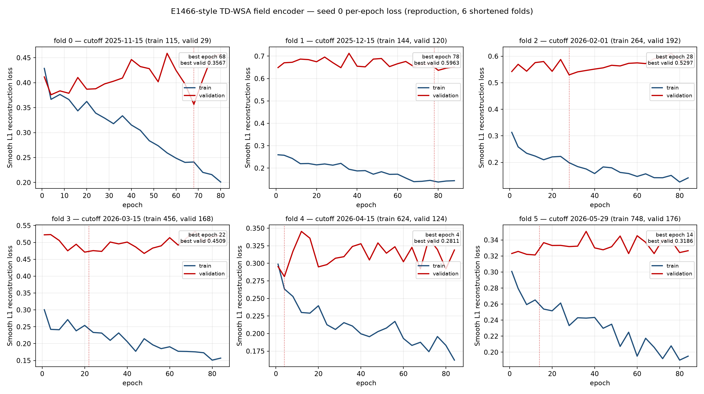

# E1466-style TD-WSA field encoder — seed 0 epoch loss (reproduction)

원본 E1466의 `curves_s0.json`(epoch별 train/validation reconstruction loss)은 원 run 디렉터리와 함께 삭제되어 복구할 수 없습니다. 이 폴더는 **남아 있는 hourly GONG snapshot으로 같은 encoder 구조를 seed 0 하나만 다시 학습한 재현 곡선**입니다. 원본 E1466의 9-fold 곡선이 아닙니다.

## 무엇을 학습했나

- 모델: E1466 `td_field_encoder.py`의 `FieldEncoder` (lead-conditioned 2D CNN autoencoder, latent 16)
- loss: Smooth L1 reconstruction loss (`beta=1.0`)
- optimizer: AdamW(lr 1e-3, weight decay 1e-4), gradient clip 5.0
- epoch: 최대 1000, 최소 240초 + 12 epoch stale이면 early stop, 4 epoch마다 기록
- seed: **0만**
- fold: 원본 9개(2023-01~2026-05) 대신, 남아 있는 profile 범위에 맞춘 **6개 단축 fold**
  (2025-11-15, 2025-12-15, 2026-02-01, 2026-03-15, 2026-04-15, 2026-05-29)

## 데이터 차이

| 항목 | 원본 E1466 | 이 재현 |
|---|---|---|
| GONG map | 5,956개 6-hourly (2022-10~2026-10) | 5,382개 hourly 생존 snapshot (2025-09-30~2026-09-26) |
| PFSS/WSA profile | 원본 5,956개 | 생존한 5,382개 |
| state origin | 34,968 hourly | 3,761 (6-hourly 학습 964 + official hourly 2,833) |
| encoder fold | 9 (2023-01~2026-05) | 6 (2025-11~2026-05) |

원본 2022–2025 profile cache는 삭제되어, 원본과 같은 9-fold 일정을 재현할 수 없습니다. 이 재현은 **2025-10 이후 경계 이력만 사용**합니다.

## 결과

| fold | cutoff | train origins | valid origins | epochs | best epoch | best valid loss |
|---:|---|---:|---:|---:|---:|---:|
| 0 | 2025-11-15 | 115 | 29 | 82 | 68 | 0.3567 |
| 1 | 2025-12-15 | 144 | 120 | 90 | 78 | 0.5963 |
| 2 | 2026-02-01 | 264 | 192 | 85 | 28 | 0.5297 |
| 3 | 2026-03-15 | 456 | 168 | 84 | 22 | 0.4509 |
| 4 | 2026-04-15 | 624 | 124 | 87 | 4 | 0.2811 |
| 5 | 2026-05-29 | 748 | 176 | 84 | 14 | 0.3186 |

- [e1466_epoch_loss_seed0.csv](e1466_epoch_loss_seed0.csv) — `fold, epoch, train_loss, valid_loss, elapsed_seconds` (4 epoch 간격 기록이라 best epoch가 CSV에 없을 수 있음; best 값은 `encoder_receipts.json` 기준)
- 각 fold는 별도 모델로 순차 학습되며, epoch은 fold마다 1부터 다시 시작합니다.
- fold 1의 validation loss가 가장 높은 것은 2025-11~12 창의 분포 차이와 작은 train set(144 origins)에 기인합니다.

## 왜 validation이 안 떨어지는가

진단 그림은 [validation_diagnostics.png](validation_diagnostics.png), 수치는 [validation_diagnostics.csv](validation_diagnostics.csv)에 있습니다. 결론부터 말하면 **버그가 아니라 (1) 미래 시간 블록의 분포 shift, (2) 작은 train set 대비 큰 모델의 overfitting, (3) 이미 강한 constant baseline, (4) 240초 floor 이후의 overtrain**입니다.

| fold | train origins | train model | val model | val baseline | Δ (model−baseline) | val z mean / std |
|---:|---:|---:|---:|---:|---:|---:|
| 0 | 115 | 0.2942 | 0.3537 | 0.4026 | −0.0488 | −0.071 / 0.959 |
| 1 | 144 | 0.1462 | 0.5729 | 0.5312 | **+0.0418** | +0.097 / 1.218 |
| 2 | 264 | 0.1833 | 0.5281 | 0.5928 | −0.0647 | −0.096 / 1.200 |
| 3 | 456 | 0.2345 | 0.4179 | 0.4694 | −0.0515 | −0.275 / 0.982 |
| 4 | 624 | 0.2849 | 0.2836 | 0.3084 | −0.0248 | −0.020 / 0.837 |
| 5 | 748 | 0.2364 | 0.3347 | 0.3977 | −0.0630 | −0.088 / 0.935 |

1. **Validation은 미래 시간 블록이라 분포가 다릅니다.** fold 1은 validation field std가 53.7 km/s로 train 44.0보다 크고 q99도 564 vs 508입니다. fold 3은 validation 평균이 383.3 km/s로 train 397.8보다 낮습니다(z mean −0.275). fold 2는 validation z std가 1.20입니다. train의 global mean/std로 정규화한 validation 입력이 이미 off-distribution입니다.

2. **Constant baseline이 이미 강합니다.** validation에서 train 평균(정규화 공간의 0)만 예측해도 Smooth L1이 0.31–0.59입니다. model은 5개 fold에서 0.025–0.065만 개선하고, fold 1에서는 baseline보다 **0.042 더 나쁩니다**. 즉 loss의 대부분은 field 자체의 공간 분산과 계절 shift이며, model이 줄일 수 있는 부분이 작습니다.

3. **Overfitting입니다.** train model loss는 0.146–0.285까지 내려가지만 validation은 0.284–0.573입니다. 모델은 178,353 params인데 train origins는 115–748개뿐입니다. fold 1은 train 0.146 vs validation 0.573으로 train을 사실상 외웠고, train origins가 많은 fold 4/5에서 validation이 상대적으로 낮습니다.

4. **240초 floor 때문에 best epoch 이후에도 계속 학습합니다.** best epoch는 68, 78, 28, 22, 4, 14입니다. fold 2–5는 epoch 4–28에서 best인데 84–90까지 학습하므로 곡선의 validation은 그 이후 상승하거나 정체합니다. 최종 checkpoint는 best state를 복원하지만, 그려진 곡선은 overfitting 구간을 포함합니다.

5. **학습 loop의 validation sample은 12개**라 epoch 곡선이 noisy합니다. 다만 full validation(32–176 origins)으로 다시 계산해도 같은 패턴이 나옵니다([model_lead_diagnostics.json](model_lead_diagnostics.json)).

6. **fold 1이 worst인 이유**는 train window(2025-10-01~11-14, 144 origins)가 validation window(11-15~12-15)의 고속 stream(q99 564 km/s)을 보지 못했기 때문입니다. 이 fold는 모든 72 lead에서 model이 baseline보다 나쁩니다.

## 상태와 한계

- state build: 671.8초, field shape `(3761, 72, 130, 128)`, official 2,833 origins coverage 확인.
- encoder seed 0: 6 fold, 각 240초 이상, 총 1,464초 학습.
- **production poison probe는 완료되지 않았습니다.** 원본 `source_poison_fields.npz`의 `dense` probe origin이 단축 fold 시작(2025-11-15)보다 앞서서 `dense source poison probe predates the causal encoder folds`로 중단됐습니다. 따라서 이 곡선은 **진단용 재현**이며, 제출·승격·공식 점수 주장이 아닙니다.
- 원본 E1466의 gate 실패 기록은 그대로 유효합니다.

## 재현 코드

- [code/tdwsahuxt_state.py](code/tdwsahuxt_state.py) — state builder (profile manifest 호환을 위해 내부 `body_sha256`/`cache_key` 검증만 완화)
- [code/td_field_encoder.py](code/td_field_encoder.py) — encoder (FOLDS 6개로 단축, 30분 floor를 15분으로 완화)
- [code/build_manifest.py](code/build_manifest.py) — 생존 hourly snapshot에서 source/profile manifest 생성
- [code/plot_epoch_loss.py](code/plot_epoch_loss.py) — 그림 재생성
- [encoder_curves_s0.json](encoder_curves_s0.json) — 4 epoch 간격으로 기록된 원본 curve
- [encoder_receipts.json](encoder_receipts.json) — fold별 checkpoint receipt (best epoch/loss 포함)
- [code/diagnose_validation.py](code/diagnose_validation.py) — fold별 field 분포·constant baseline 진단
- [code/diagnose_model.py](code/diagnose_model.py) — checkpoint별 per-lead model vs baseline 진단
- [validation_diagnostics.csv](validation_diagnostics.csv) / [model_lead_diagnostics.json](model_lead_diagnostics.json) — 위 진단의 수치

이 재현은 원본 E1466의 학습 곡선을 대체하지 않습니다.
