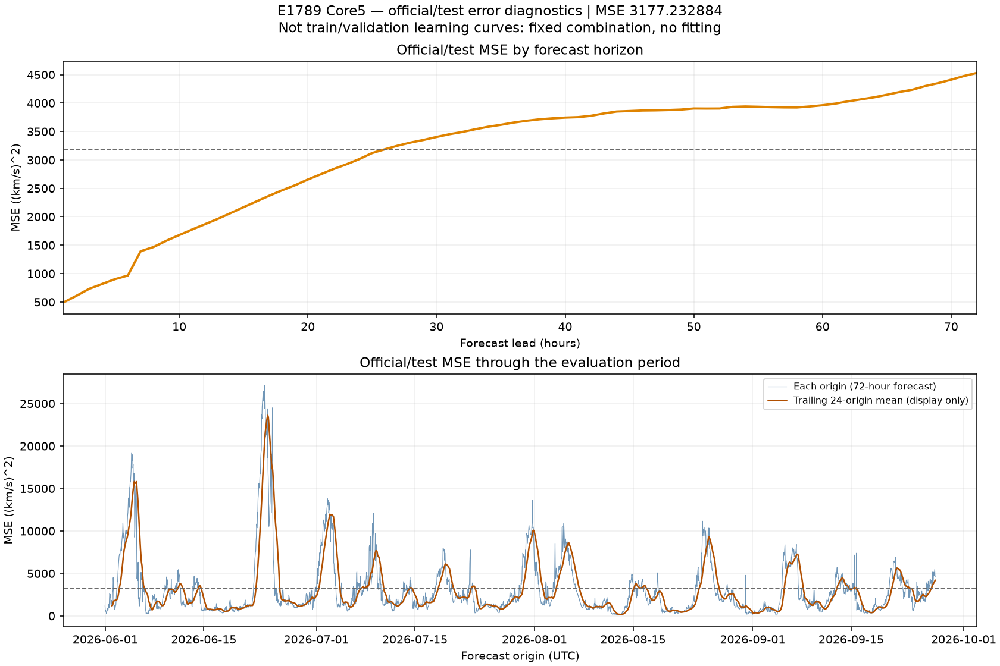
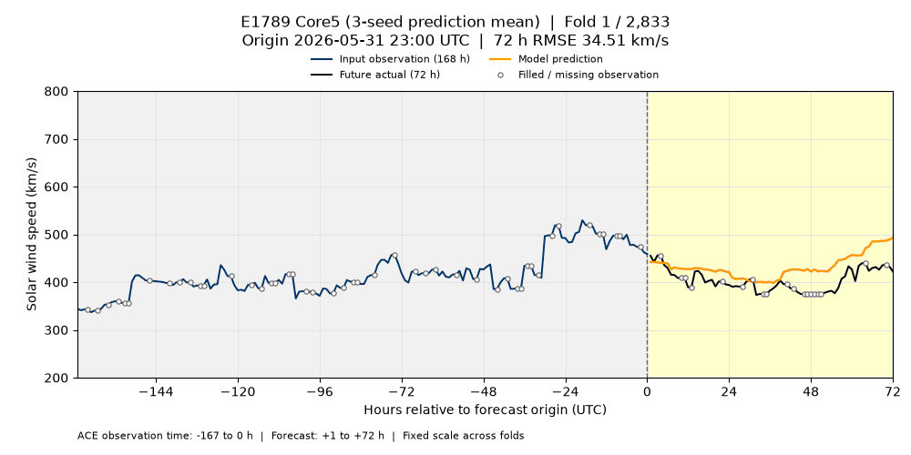
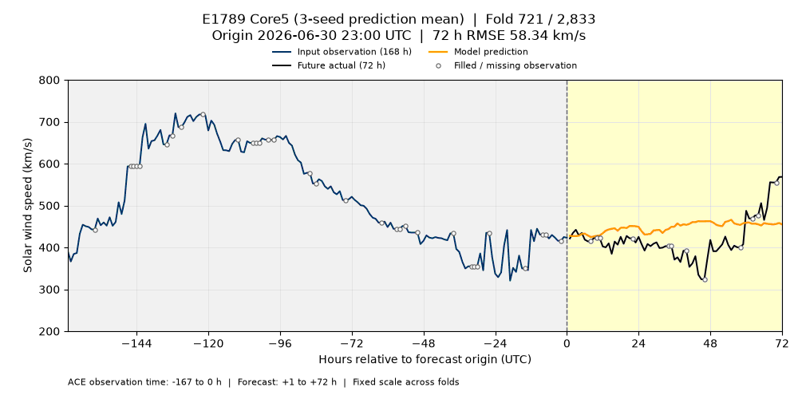
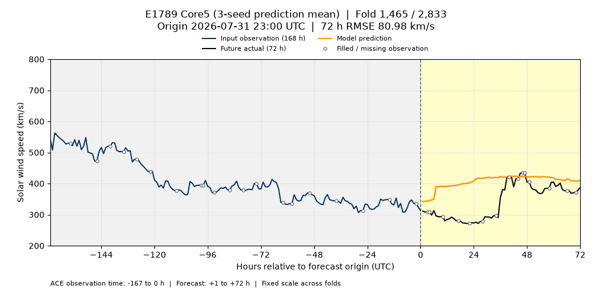
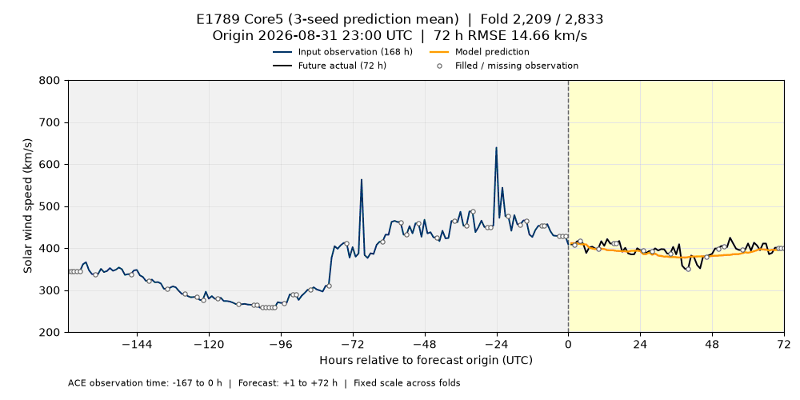

# E1789 Core5 — 평가 오차와 월별 예측 GIF

2026-10-25 게시 기준 리더보드 **1위**, 공식 MSE **3177.232883758485**인 `e1789_core5_prediction_mean`의 실제 제출 예측입니다. 원래 시드 0·1·2의 **예측 평균을 먼저 계산한 뒤 채점**했습니다. 설정 SHA256은 `0daed7e8ff871de91e68c48983ad5031c2e27dd6894bfb6e8dfd757247675503`입니다.

## Train / validation loss 이력

**[Train·validation 두 곡선 함께 보기](component_losses/paired_train_validation/):** E1725·E1711의 저장된 과거 fold 3 모델을 단계별 재평가해 train/validation MSE를 같은 그림에 추가했습니다. 재학습이나 단계 선택 없이 재생한 사후 진단이며 당시 저장된 로그와 구분했습니다.

**추가 조사:** [구성 모델별 원본 loss 이력](component_losses/)을 각각 게시했습니다. 직접 구성 모델의 로그·평가 기록뿐 아니라, E1769의 하위 E1725에서 **실제 공식 학습 모델의 300-round × 3시드 training objective trace**를 찾아 [학습 그래프와 JSON/CSV](component_losses/upstream_E1725/)로 추가했습니다. 반복별 validation loss는 저장되어 있지 않습니다.

**E1789에는 별도 학습 단계가 없어 train/validation 학습 곡선이 존재하지 않습니다.** 이미 저장된 E1604-public, E1593, E1595, E0472, E1769 예측을 고정 가중치 **2:1:2:1:1**로 합칩니다. 학습 반복, optimizer, epoch가 없으며, 원본 실행 로그에는 결합 완료 요약만 있습니다. 구성 실험의 원본 실행 자료에서도 당시의 반복별 train/validation loss 이력을 찾지 못했습니다.

따라서 아래 그림은 **공식 평가 구간의 예측 오차**이며 학습 곡선이 아닙니다. 재학습하거나 과거 학습 곡선을 추정해 그리지 않았습니다. [이력 확인 결과](loss_history_audit.json)와 원래 [결합 영수증](../../../releases/e1789/original-combination-receipt.json)을 함께 보존했습니다.

## 실제 제출 예측의 평가 MSE

위 패널은 리드타임 1~72시간별 MSE, 아래 패널은 각 시작점의 72시간 예측 MSE입니다. 점선은 전체 MSE **3177.232884**입니다. 아래 패널의 주황색 선은 표시용 최근 24개 시작점 평균이며 예측에는 적용하지 않았습니다. 원 관측이 없어 보호 평가기가 채운 target도 기존 리더보드와 동일하게 포함합니다. 이 구간은 이미 평가에 노출된 공식/test 구간으로 독립적인 학습 validation 구간이 아닙니다.



계산값: [리드타임별 MSE](evaluation_mse_by_horizon.csv), [시작점별 MSE](evaluation_mse_by_origin.csv). CSV에는 집계 오차만 있으며 원본 관측·정답은 포함하지 않습니다.

## 월별 GIF

기존 시각화와 동일한 **1000×500**, **200~800 km/s 고정 Y축**, **100ms/프레임**, 무한 반복입니다. 각 프레임은 공식 시작점 하나이며, 파란 선은 최근 **168시간 관측**, 검은 선은 이후 **72시간 실제값**, 주황 선은 제출 예측입니다. 빈 원은 원 관측이 없어 채워진 지점입니다. 제목에 전체 폴드 번호, UTC 시작 시각, 해당 72시간 RMSE를 표시합니다. 관측 7일은 표시 구간이며 구성 모델들의 전체 입력 특성을 뜻하지 않습니다.

첫 예측 시각(`origin+1h`)의 UTC 월로 나누고 시간순으로 재생합니다. 파일명의 `validation`은 기존 GIF의 이름 규칙이며 여기서 학습 validation을 뜻하지 않습니다.

| 월 | 프레임 수 | 한 번 재생 시간 | 파일 |
| --- | ---: | ---: | --- |
| 2026-06 | 720 | 72초 | [6월 GIF](validation_2026-06.gif) |
| 2026-07 | 744 | 74.4초 | [7월 GIF](validation_2026-07.gif) |
| 2026-08 | 744 | 74.4초 | [8월 GIF](validation_2026-08.gif) |
| 2026-09 | 625 | 62.5초 | [9월 GIF](validation_2026-09.gif) |

### 2026년 6월



### 2026년 7월



### 2026년 8월



### 2026년 9월



## 평가 계약과 재현

이 결과는 기존 평가 계약의 비교 기록입니다. E1789는 현재 직접 예측 모델 제한을 충족하지 않는 앙상블이며, 구성 예측은 origin 시각 ACE와 과거 학습 cutoff를 포함합니다. 현재 ACE 관측 +2시간 지연 및 정확한 원천 바이트 공개 시각 조건의 적격성은 인증되지 않았습니다. 시각화는 기존 제출 예측을 변경하지 않으며 이 판정을 바꾸지 않습니다.

고정 평가 스냅샷은 `bcf5d5417d99eaa331ddca40581d48953e09a58e`입니다. [manifest.json](manifest.json)은 입력 및 출력 SHA256, 점수 일치, 전체 2,833개 시작점과 203,976개 쌍, 모든 GIF 프레임 디코딩 결과를 기록합니다. 원본 정답·관측 parquet는 게시하지 않습니다.

[생성 스크립트](../../../scripts/visualize_e1789.py)는 기존 [GIF 렌더러](../../../scripts/visualize_enlil_validation.py)를 재사용합니다. pandas, numpy, pyarrow, Matplotlib, Pillow가 필요합니다. 저장된 예측과 평가 자료만 읽으며 학습·모델 추론·예측 변경을 수행하지 않습니다.

```bash
python scripts/visualize_e1789.py \
  --experiment E1789 \
  --predictions releases/e1789/predictions.parquet \
  --folds /path/to/bcf5d541/folds.parquet \
  --truth /path/to/bcf5d541/truth.parquet \
  --history /path/to/ch-v1/ace.parquet \
  --output-dir docs/visualizations/e1789_core5_prediction_mean
```
