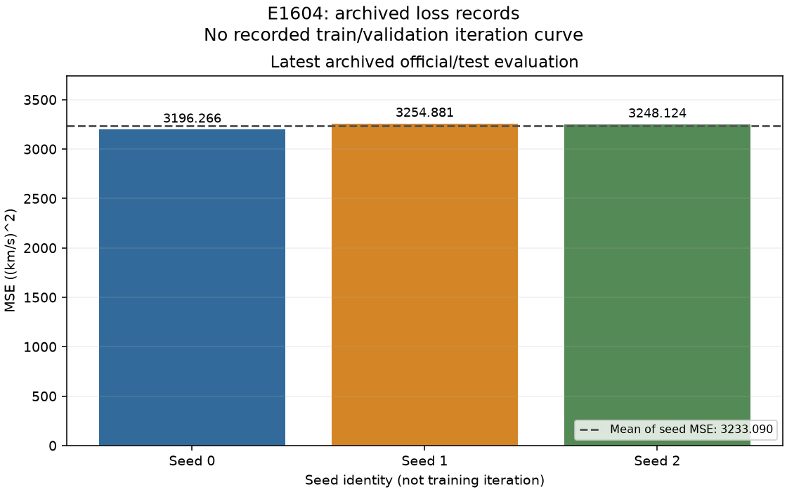

# E1604 — 보존된 loss 기록

HSSPEAK25의 반복별 train/validation loss가 원본 실행 산출물에 저장되어 있지 않습니다.

원본 실행 로그, 저장된 공식/test 평가 이벤트 및 이용 가능한 OOF 검증 손실을 가져왔습니다. 새로 학습하거나 예측·평가를 다시 실행하지 않았습니다.

E1789에 실제로 들어간 것은 **E1604-public: 세 시드 예측을 평균한 공개 예측**입니다. 공개 MSE는 **3222.882998441**입니다. 아래 막대는 그 기반 모델의 개별 시드 MSE이며 평균 예측의 MSE와 다릅니다.

**이전 평가 기록 주의:** 첫 이벤트는 MIN_LEAD import 오류 수정 이전의 결과입니다. 뒤의 수정 결과와 동일한 예측 버전으로 취급하지 않습니다. 5개 이벤트를 모두 보존했으며 반복 평가 이벤트는 학습 epoch가 아닙니다. 그래프에는 마지막 기록만 표시합니다.

## 저장된 값의 그래프

막대는 마지막 공식/test 평가 이벤트의 개별 시드 MSE입니다. 학습 반복별 loss가 아니며 점선은 **시드별 MSE의 산술 평균**입니다. 공개 리더보드의 **시드 평균 예측을 채점한 MSE**와 구별해야 합니다.

마지막 평가 시각: `2026-10-20T07:20:54+00:00`, graph sequence: `6291`.

| Seed | 공식/test MSE |
| --- | ---: |
| 0 | 3196.265751285 |
| 1 | 3254.880537195 |
| 2 | 3248.123998491 |
| 시드별 MSE 평균 | 3233.090095657 |

[전체 평가 loss CSV](loss_history.csv)는 모든 원본 평가 이벤트의 시각과 sequence를 보존합니다. 동일 값의 재평가도 제거하지 않았으며 각 행의 `is_training_iteration`은 `False`입니다.

## 원본과 검증 근거

- [run1.log](run1.log)
- [receipt.json](receipt.json)
- [ExpOS 공식 평가 이벤트 JSON](official_evaluation_events.json)
- [원본 graph 행 JSONL](official_evaluation_events.jsonl)
- [복사 원본 SHA256 및 상태](audit.json)

원본 파일은 바이트 그대로 복사했습니다. JSONL은 원본 append-only graph의 해당 이벤트 행입니다. 기존 평가 구간의 노출·입력 계약 제한은 그대로이며, 이 자료가 현재 계약 적격성을 추가 인증하지 않습니다.
