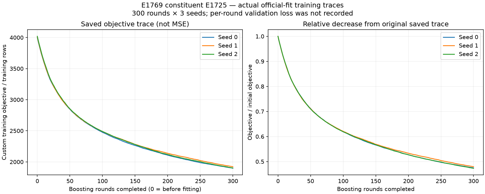

# E1789 구성 모델별 원본 loss 이력

**Train과 validation을 같은 그림에 보는 자료:** [E1725·E1711의 paired loss 곡선](paired_train_validation/). 저장된 과거 fold 3 모델의 단계별 사후 재평가이며, 기존 원본 로그와 구별해 추가했습니다.

E1789의 직접 구성 모델 **E1604-public·E1593·E1595·E0472·E1769**의 기존 loss 기록을 각각 가져왔습니다. 실제 학습 이력이 남은 하위 모델까지 추적했습니다. 새 학습·추론·공식 채점 없이 원본 로그, 평가 이벤트와 저장 모델의 trace를 읽었습니다.

## 실제 반복별 학습 loss

**E1769의 하위 모델 E1725에서 공식 제출 예측에 실제 사용된 3개 모델의 300-round 학습 이력을 복구했습니다.** 아래 그림은 저장된 `model.trace`를 그대로 사용한 것으로 재학습이나 추정 결과가 아닙니다. **Custom objective이며 MSE와 다릅니다.** 반복별 validation loss는 저장되어 있지 않습니다.

[E1725 학습 그래프·원본 JSON/CSV·계보 검증](upstream_E1725/)

## 직접 구성 모델별 기록

| 구성 모델 | 반복별 train / validation 기록 | 가져온 자료 |
| --- | --- | --- |
| [E1604](E1604/) | 원본에 저장되지 않음 | 실행 로그, 평가 이벤트 5건, 시드별 공식/test MSE, CSV·그래프 |
| [E1593](E1593/) | 원본에 저장되지 않음 | 실행 로그, 평가 이벤트 2건, 시드별 공식/test MSE, CSV·그래프 |
| [E1595](E1595/) | 단발 최소제곱 적합; 반복 이력 없음 | 실행 로그·적합 계수, 공식/test MSE, CSV·그래프 |
| [E0472](E0472/) | 반복 이력 없음; OOF 검증값 보존 | W0·W1·W2 및 pooled OOF MSE 12개 값, 공식/test MSE, CSV·그래프 |
| [E1769](E1769/) | 자체는 고정 결합, 학습 없음 | 실행 로그·원본 조합 영수증·공식/test MSE; 하위 E1725의 실제 학습 trace 연결 |

위 직접 구성 모델의 막대그래프는 원본에 기록된 **시드별 최종 공식/test MSE**입니다. epoch별 학습 손실이나 학습 validation 곡선으로 해석하지 않습니다. 공개 리더보드의 평균 예측 MSE와 시드별 MSE 평균도 구별했습니다.

## 원본 보존 및 조사 범위

각 폴더에는 `run1.log`, 원본 영수증, `official_evaluation_events.json`/`.jsonl`, `loss_history.csv`와 원본 SHA256을 담은 `audit.json`이 있습니다. E1604의 수정 전 평가와 반복 채점 이벤트도 원래 시각·sequence와 함께 보존했고 학습 iteration으로 연결하지 않았습니다.

E1769의 공식 하위 모델 9종 × 3시드, 총 **27개**의 실제 저장 모델도 확인했습니다. E1725 AnchorBoost 3개에만 반복별 trace가 남았습니다. 나머지 XGBoost 21개에는 저장된 평가/학습 이력 속성이 없고, LightGBM 3개의 평가 이력은 비어 있습니다. 따라서 기록이 없는 train 또는 validation 선을 생성하지 않았습니다.

[E1789 GIF와 평가 시각화로 돌아가기](../)
