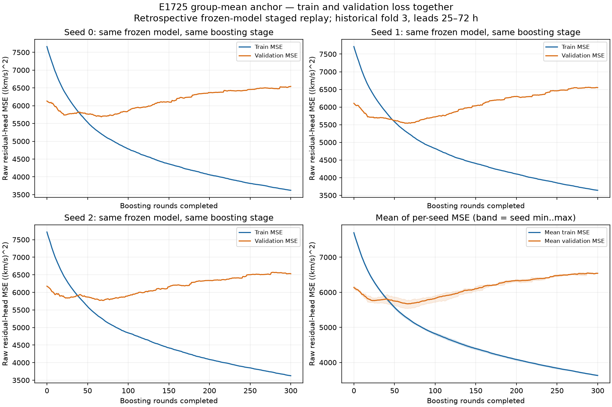
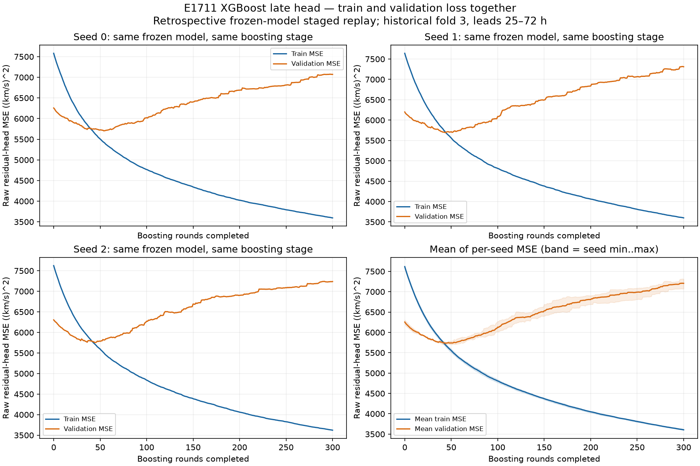

# Train · validation 두 곡선

E1789 → E1769 하위의 **E1725와 E1711**에서 저장된 모델의 학습 단계별 예측을 재생해 **train MSE와 validation MSE를 같은 그림에** 표시했습니다. 각 모델은 시드 0·1·2, 300개 고정 boosting 단계이며, 초기 단계 0도 포함합니다.

**이 곡선은 원래 학습 중 기록된 validation 로그가 아니라, 저장 모델의 사후 단계별 재평가입니다.** 재학습·가중치 변경·early stopping·학습 횟수 선택은 하지 않았습니다. 원래 300단계 모델의 마지막 예측과 저장된 validation 예측이 모든 시드에서 정확히 일치합니다.

## 동일한 train / validation 정의

- 두 선 모두 **보정 전 raw residual-head의 관측 셀 MSE**이며 단위는 `(km/s)²`입니다. E1725의 custom objective나 최종 E1789 앙상블의 전체 리더보드 MSE와는 다른 지표입니다.
- Train: 당시 fold 3 모델에 실제 사용된 **193,442개 행**. 입력 행·피처의 해시가 원래 학습 영수증과 같습니다. Train target 마지막 시각은 **2026-01-26 00:00 UTC**, 모델 cutoff는 **2026-01-29 00:00 UTC**이며 72시간 target maturity를 지킵니다.
- Validation: 당시 fold 3의 **2026-02-01~2026-05-28 23:00 UTC**, 2,808개 시작점의 **25~72시간** 구간에서 원 관측이 있는 **106,503개 셀**. 결측 또는 target ≥ 2026-05-29 조건으로 평가할 수 없는 28,281개 셀은 제외합니다. Train target과 겹치지 않습니다.
- 이 validation fold는 과거 연구에서 이미 평가된 구간입니다. 새로운 독립 holdout 인증으로 제시하지 않습니다. 공식 리더보드 구간인 2026년 6~9월은 여기 사용하지 않았습니다.
- Raw head만 표시하므로 후속 alpha 보정·다른 모델과의 결합은 적용하지 않습니다. Train과 validation 표본의 기간·분포가 달라 초기 validation MSE가 train보다 작을 수도 있습니다.

## E1725 — group-mean anchor

파란색은 train, 주황색은 validation입니다. 하단 오른쪽은 **시드별 MSE의 평균**이며 음영은 시드 최솟값~최댓값입니다.



마지막 단계의 시드 평균: **train 3630.479548 / validation 6541.137787**. Train은 계속 감소하지만 validation은 초반 감소 후 증가합니다. 이 사후 진단을 근거로 학습 단계를 바꾸지 않았습니다.

원본 수치: [Seed 0](E1725/curves_s0.csv), [Seed 1](E1725/curves_s1.csv), [Seed 2](E1725/curves_s2.csv), [평균](E1725/curves_mean.csv).

재평가 영수증: [Seed 0](E1725/receipt_s0.json), [Seed 1](E1725/receipt_s1.json), [Seed 2](E1725/receipt_s2.json), [추가 입력·분리 검증](E1725/supplemental_input_audit.json). E1725는 모든 단계의 train objective가 당시 저장된 trace와도 일치합니다.

## E1711 — XGBoost late head



원본 수치: [Seed 0](E1711/curves_s0.csv), [Seed 1](E1711/curves_s1.csv), [Seed 2](E1711/curves_s2.csv), [평균](E1711/curves_mean.csv).

재평가 영수증: [Seed 0](E1711/receipt_s0.json), [Seed 1](E1711/receipt_s1.json), [Seed 2](E1711/receipt_s2.json). 초기값은 저장된 booster의 원래 base score이며, 임의로 0으로 바꾸지 않았습니다.

## 범위와 재현

위는 **과거 preofficial fold 3의 저장 모델**입니다. 앞서 게시한 `upstream_E1725`의 공식 최종 refit 모델 학습 objective와 모델·평가 구간이 다릅니다. E1789 자체와 E1769 결합 단계에는 학습 곡선이 없고, 다른 직접 구성 모델의 원래 반복별 모델이 보존되지 않은 경우에는 train/validation 선을 만들지 않았습니다. [구성 모델 원본 기록](../)은 그대로 보존합니다.

PNG는 게시된 CSV만으로 재생성할 수 있습니다.

```bash
python scripts/plot_paired_component_losses.py \
  --directory docs/visualizations/e1789_core5_prediction_mean/component_losses/paired_train_validation/E1725 \
  --model 'E1725 group-mean anchor'
```

동일 명령의 디렉터리와 모델명을 E1711로 바꾸면 E1711 그림을 생성합니다. 계산 코드 스냅샷은 [E1725](E1725/replay_original_model.py), [E1711](E1711/replay_original_model.py)에 있습니다. 해당 재평가 코드는 원래 작업 공간의 저장 모델·학습 자료가 필요하며, 모델 및 원본 target은 게시하지 않았습니다. [E1725 plot manifest](E1725/plot_manifest.json), [E1711 plot manifest](E1711/plot_manifest.json)에 그림·CSV 해시가 있습니다.
