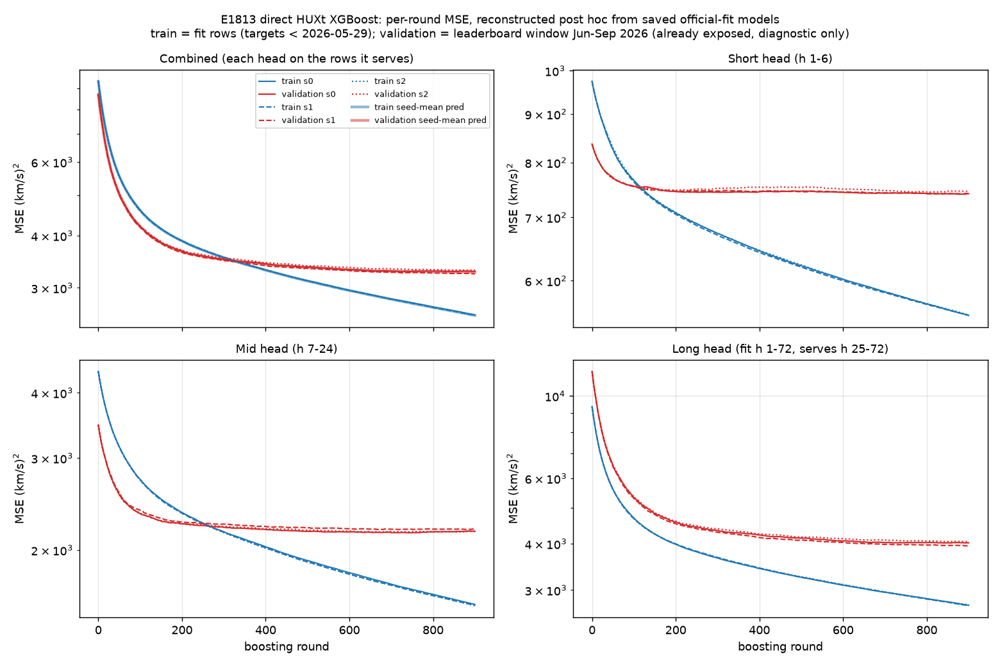

# E1813 · Direct HUXt XGBoost — 라운드별 train·validation MSE

E1813(D_DIRECTHUXT_20261024)은 단일 직접 예측 3-head XGBoost(short h1–6 / mid h7–24 / long h25–72, 각 900 rounds)이며 공식 MSE는 시드별 3285.89 / 3239.88 / 3305.58(평균 **3277.12**)입니다. 원 학습은 라운드별 loss를 기록하지 않았습니다. 이 곡선은 **저장된 공식 학습 모델로 사후 재구성**한 것이며, 원 학습 로그가 아닙니다.

## 재구성 방법

- 모델: 공식 fit에 쓰인 `model_s{0,1,2}_{short,mid,long}.json`, 9개. 새로 학습하지 않았습니다.
- 라운드 k 예측은 `base_score + 앞 k개 트리 leaf 값 합`입니다. 마지막 라운드 값은 booster 예측과 1e-3 이내로 일치하는지 검사했습니다.
- **train**: 공식 fit 행 613,993개(target 시점 < 2026-05-29). 학습 target은 `y − v_lag0`이고, 오차는 km/s 단위로 같습니다. head별 파일은 각 head의 학습 행을 쓰고, 통합 곡선은 각 head가 실제로 담당하는 horizon 행을 씁니다.
- **validation**: 리더보드 평가 기간(2,833 origins × 72h = 203,976쌍)과 snapshot truth입니다. 이미 공개되어 채점된 구간이므로 **진단용**이며 모델 선택에 쓰지 않습니다.

## 재현 검증 ([reproduction-check.json](reproduction-check.json))

| 항목 | 재구성 | 리더보드 평가 |
|---|---:|---:|
| seed 0 MSE (900 rounds) | 3285.89 | 3285.89 |
| seed 1 MSE | 3239.88 | 3239.88 |
| seed 2 MSE | 3305.58 | 3305.58 |
| 저장된 공식 예측과 최대 차이 | ≤ 3.2e-4 km/s | — |

`mse_seedmean` 3277.12는 시드별 MSE 평균입니다. 세 시드 예측을 평균한 예측의 MSE는 3271.09입니다.

## 관찰

| round | 0 | 100 | 300 | 500 | 900 |
|---|---:|---:|---:|---:|---:|
| train (시드 평균 예측) | 9359 | 4591 | 3542 | 3114 | 2577 |
| validation (시드 평균 예측) | 8699 | 4200 | 3506 | 3359 | 3271 |

- validation은 약 300 round 이후 완만한 평탄 구간이고, train만 계속 감소합니다. 900 round에서 차이는 약 700입니다.
- short·mid head의 validation은 약 150 round 이후 거의 변하지 않습니다. 남은 오차의 대부분은 long head(h25–72, validation ≈ 4020)입니다.
- validation 최소점은 895 round(3271.0)이므로 round 수 축소로 얻을 이득은 없습니다.

## 파일

- `loss_history_s{seed}.csv`: 통합 곡선(`step,train_mse,validation_mse`)
- `loss_history_s{seed}_{short,mid,long}.csv`: head별 곡선
- `e1813_loss_history_long.csv`: 전체 long-format(split/seed/head/round/mse/rows, seed-mean 포함)
- `code/reconstruct.py`, `code/plot.py`: 재구성·그림 코드

입력 데이터: 원래의 `leaderboard/store`는 2026-10-25에 삭제됐습니다. 그래서 2026-10-24 inventory의 해시 61개와 바이트 단위로 일치하는 pinned 사본을 private mount namespace로 연결해 재구성했습니다. E1813의 등록 runner와 공유 코드는 수정하지 않았습니다.
