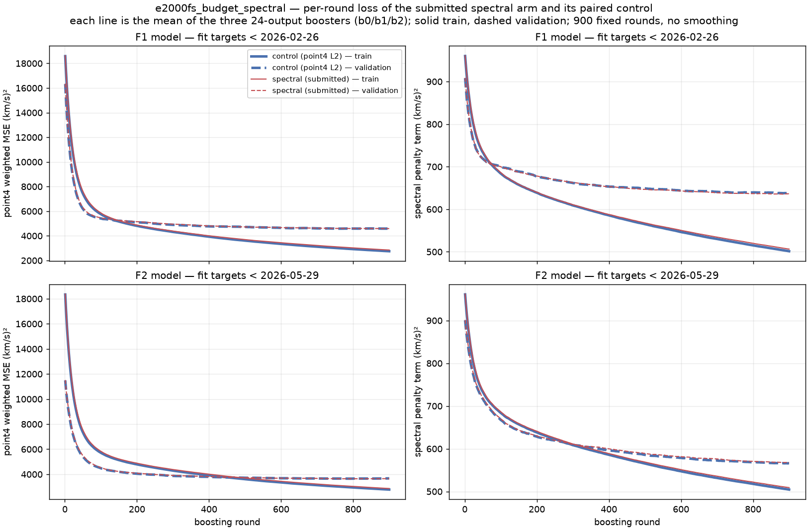
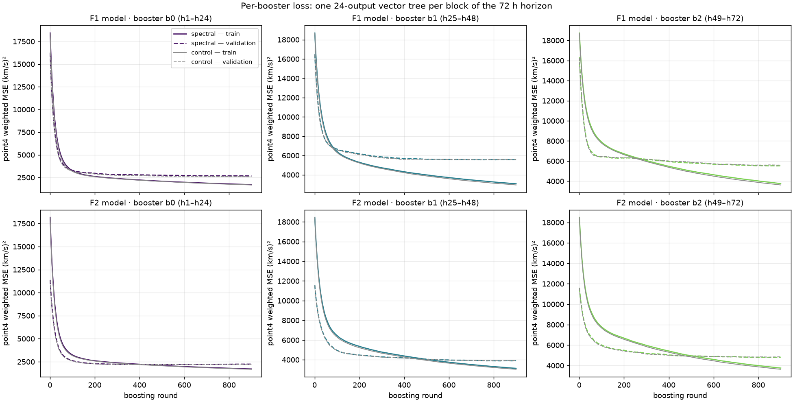
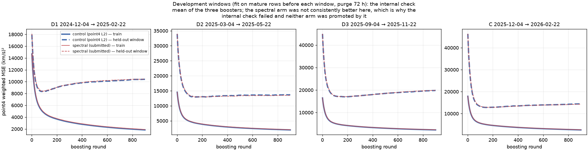
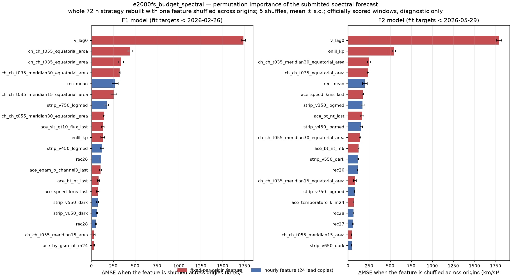

# E2000FS Budget-Spectral — Train·validation loss, permutation importance, F1+F2 월별 예측 GIF

2026-10-29 게시한 리더보드 제출 **`e2000fs_budget_spectral`**(작성자 **seongeun**)입니다. E2000 입력(Top30 features, ACE lag 0)에 고정 XGBoost recipe(900 rounds, depth 3, lr 0.03, seed 42)를 쓰고, 72시간을 24시간 블록 3개로 나눠 블록마다 24-output vector tree booster 하나(부스터 3개)로 직접 예측합니다. 손실은 550 km/s 이상 목표에 4배 가중한 **point4 L2**에 24시간 잔차의 단위 FFT(unitary) 크기에 대한 **radial pseudo-Huber** 항(λ=0.10, scale 50 km/s)을 더한 형태입니다. 같은 행·같은 cutoff로 학습한 **paired control**(point4 L2만 사용)과 함께 기록했고, **제출 예측은 spectral arm**입니다.

학습 커트오프는 라벨 성숙도 규칙 `origin + 144h ≤ cutoff`(타깃 +72h + 72h purge)를 따릅니다. F1은 2026-02-26(9,905 origins), F2는 2026-05-29(10,641 origins)로 학습했습니다. Top30 특징은 이미 채점된 F1/F2 구간의 permutation으로 **사후 선택**되었으므로 fresh holdout이 아닙니다.

| 지표 | 제출 (spectral) | paired control | Δ (spectral − control) |
| --- | ---: | ---: | ---: |
| **MSE (F1 + F2, 순위 기준)** | **3495.593477** | 3494.210802 | +1.382675 |
| F1 MSE (2026-03..05, 2,137 folds) | 4028.972970 | 4056.929804 | −27.956834 |
| F2 MSE (2026-06..09, 2,833 folds) | 3093.252503 | 3069.738332 | +23.514171 |
| MSE, 목표 ≥ 550 km/s (48,456 pairs) | 5727.173109 | 5769.472792 | −42.299683 |
| CSI (≥ 500 km/s 이벤트) | 0.082362 | 0.079229 | — |
| naive 대비 skill | 0.612878 | — | — |

전체 3,495.59는 control(3,494.21)보다 1.38 나쁘지만, 고속 구간(≥550 km/s)은 42.30 좋고 F1 구간도 27.96 좋습니다. 개선이 F2 구간에서 상쇄되어 전체로는 전이되지 않았습니다(`transferred: false`).

## 내부 개발 구간 (참고)

공식 F1/F2 이전 4개 창에서 같은 recipe로 arm 쌍을 비교했습니다. 각 창은 학습 행(성숙 완료)과 72시간 purge로 분리되어 있습니다.

| 창 | 기간 | 학습 행 | folds | control MSE | spectral MSE | Δ | control ≥550 | spectral ≥550 |
| --- | --- | ---: | ---: | ---: | ---: | ---: | ---: | ---: |
| D1 | 2024-12-04 → 2025-02-22 | 6,313 | 648 | 5508.951844 | 5545.680573 | **+36.728729** | 15962.236790 | 16002.724407 |
| D2 | 2025-03-04 → 2025-05-22 | 7,033 | 640 | 5559.516103 | 5485.933448 | −73.582655 | 18172.798303 | 17898.030484 |
| D3 | 2025-09-04 → 2025-11-22 | 8,505 | 640 | 8538.225054 | 8536.558389 | −1.666665 | 21326.454604 | **21458.962411** |
| C | 2025-12-04 → 2026-02-22 | 9,233 | 648 | 7766.328153 | 7748.459602 | −17.868551 | 11646.714217 | 11464.359333 |
| D1–D3 pooled | 세 창의 합 | — | 1,928 | 6531.304531 | 6518.670014 | −12.634517 | 18995.5254 | 18971.5530 |

표의 굵은 값은 control보다 나빠진 쪽입니다. 사전 등록한 내부 기준은 "pooled 개발 구간과 C에서 MSE·≥550이 모두 개선, 그리고 D1/D2/D3 중 최소 2개에서도 개선"이었습니다. D1은 두 지표 모두 나빠지고 D3는 ≥550이 나빠져 1/3만 통과하여 **internal check는 실패**(`internal_positive: false`)로 기록되었습니다. 내부 검사는 공식 F1/F2 적합·제출을 막지 않으며, 실제로 막지 않았습니다.

## Train·validation loss



학습 중 XGBoost가 기록한 **per-round loss**(`evals_result`)입니다. 사후 재구성이 아니며 smoothing 없이 원래 값을 그렸습니다. 행은 두 공식 단계(F1 모델, F2 모델), 열은 왼쪽이 point4 weighted MSE, 오른쪽이 FFT spectral penalty입니다. 각 선은 그 단계 **부스터 3개의 평균**이고, 실선은 train, 점선은 validation, 굵은 파랑이 control, 가는 빨강이 제출한 spectral arm입니다(두 곡선이 거의 겹쳐서 control이 테두리처럼 보입니다).

- `weighted_mse`는 학습 목적함수(550 km/s 이상 4배 가중, horizon별 평균 1 정규화)이며 **공식 리더보드 MSE와 다른 값**입니다. 공식 지표는 가중치 없는 72시간 MSE입니다.
- `spectral_loss`는 24시간 잔차의 단위 FFT에 대한 radial pseudo-Huber 항(km/s)²입니다. control도 같은 지표를 로그로 남기므로 두 arm 모두 표시됩니다. control의 `joint_loss`는 spectral 항이 0이라 `0.5 × weighted_mse`입니다.
- **validation은 학습 행 기준 미래 구간**입니다. F1 모델의 validation은 2026-02-28~05-28, F2 모델은 2026-05-31~09-26으로, 각 cutoff(02-26, 05-29) 이후에 시작합니다. 다만 그 구간이 곧 공식 채점 구간이므로 **진단용**이며, 900 rounds는 레시피로 고정되어 이 곡선으로 라운드를 고르지 않았습니다.



부스터별 곡선입니다. b0은 h1–24, b1은 h25–48, b2는 h49–72를 담당하며, 색은 부스터, 회색은 control입니다. 멀리 있는 블록(b1·b2)일수록 train 손실이 덜 떨어지고 validation 값도 큽니다.



내부 개발 창(D1/D2/D3/C)의 학습 곡선입니다. 창마다 학습 행과 cutoff가 다르고, 점선은 그 창 자체(성숙도 purge 후)로 **held-out**입니다. spectral 항의 이득이 창마다 일관되지 않다는 점이 위 표의 실패 판정과 같은 방향입니다.

원본 CSV 36개(6단계 × 2 arm × 3 부스터, `round` + train/validation × rmse·weighted_mse·spectral_loss·joint_loss)는 [loss_history/](loss_history/)에 있고 study 출력과 바이트 단위로 같습니다([loss_receipt.json](loss_receipt.json)). 마지막 라운드 값 요약은 [loss_summary.csv](loss_summary.csv)입니다. 그림은 [code/plot_loss.py](code/plot_loss.py)로 다시 만들 수 있습니다.

## Permutation importance



제출한 spectral arm의 특징 중요도입니다. 왼쪽이 F1 모델, 오른쪽이 F2 모델이고, 30개 특징 각각을 origin 사이에서 섞은 뒤 **72시간 전략 전체를 다시 예측**해 MSE 증가량(ΔMSE)을 쟀습니다. 5회 섞은 평균 ± 표준편차이며 단위는 (km/s)²입니다.

**모델 확인.** 저장된 booster 6개(F1·F2 × b0..b2)로 저장된 예측 파일과 **비트 단위로 동일한** 예측을 재현한 뒤에만 계산했습니다(최대 차이 0.0, 재현 MSE F1 4028.972970 / F2 3093.252503). 일치하지 않으면 계산을 멈추도록 했습니다.

**계산 방법과 한계.**

- 이 모델은 24-output vector tree라 XGBoost 2.1.4가 트리를 덤프하지 못하고(`multi-target tree ... not yet implemented`) `get_score`도 크래시합니다. 그래서 split/gain 기반 중요도 대신 permutation만 제공합니다.
- 각 특징의 열 전체(고정 특징은 1개, 시간별 특징은 24개 lead copy)를 origin 축으로 섞습니다. 예측은 제출과 같은 규칙으로 1–3000 km/s에서 clip합니다.
- 채점이 끝난 공개 구간을 쓰므로 **진단용**이며, 특징 선택이나 모델 선택에 쓰지 않았습니다. 상관된 특징은 중요도를 나눠 가집니다.
- 빨강은 origin마다 고정된 특징, 파랑은 시간별로 24개 복사본을 가진 특징입니다. 파랑은 24개 lead의 합으로 표시됩니다.

전체 값(30개 특징 × 2단계)은 [feature_importance.csv](feature_importance.csv), 계산 코드는 [code/feature_importance.py](code/feature_importance.py)입니다.

| 순위 | F1 모델 특징 | ΔMSE | F2 모델 특징 | ΔMSE |
| ---: | --- | ---: | --- | ---: |
| 1 | `v_lag0` | 1,738.6 ± 19.6 | `v_lag0` | 1,793.2 ± 30.5 |
| 2 | `ch_ch_t055_equatorial_area` | 441.6 ± 24.0 | `enlil_kp` | 544.7 ± 20.8 |
| 3 | `ch_ch_t035_equatorial_area` | 339.9 ± 27.7 | `ch_ch_t035_meridian30_equatorial_area` | 249.4 ± 16.7 |
| 4 | `ch_ch_t035_meridian30_equatorial_area` | 321.0 ± 5.9 | `ch_ch_t035_equatorial_area` | 237.0 ± 10.1 |
| 5 | `rec_mean` | 270.0 ± 34.4 | `rec_mean` | 199.0 ± 28.1 |
| 6 | `ch_ch_t035_meridian15_equatorial_area` | 255.6 ± 33.9 | `ace_speed_kms_last` | 176.0 ± 10.2 |
| 7 | `strip_v750_logmed` | 173.3 ± 18.9 | `strip_v350_logmed` | 173.2 ± 18.7 |
| 8 | `ch_ch_t055_meridian30_equatorial_area` | 146.8 ± 7.9 | `ace_bt_nt_last` | 169.7 ± 19.5 |
| 9 | `ace_sis_gt10_flux_last` | 130.2 ± 13.6 | `strip_v450_logmed` | 156.1 ± 15.3 |
| 10 | `enlil_kp` | 129.6 ± 22.4 | `ch_ch_t055_meridian30_equatorial_area` | 142.9 ± 9.6 |

현재 속도(`v_lag0`, `ace_speed_kms_last`), 코로나홀 면적, `rec_mean`, `enlil_kp` 계열이 두 단계 모두 상위입니다. 반면 일부 특징은 ΔMSE가 **음수**입니다 — F1의 `ace_temperature_k_last` −45.2 ± 9.4, F1 `ace_bt_nt_m6` −29.9 ± 15.7, F2의 `ace_sis_gt10_flux_last` −6.2 ± 1.2 처럼 섞으면 오히려 MSE가 줄어드는 특징도 있어, 이 모델에서 양의 기여를 하지 않는다는 사실을 그대로 남겼습니다.

## 월별 예측 GIF (F1 + F2)

| 기간 | 월 | 프레임 | GIF |
| --- | --- | ---: | --- |
| F1 | 2026-03 | 744 | [validation_2026-03.gif](validation_2026-03.gif) |
| F1 | 2026-04 | 720 | [validation_2026-04.gif](validation_2026-04.gif) |
| F1 | 2026-05 | 673 | [validation_2026-05.gif](validation_2026-05.gif) |
| F2 | 2026-06 | 720 | [validation_2026-06.gif](validation_2026-06.gif) |
| F2 | 2026-07 | 744 | [validation_2026-07.gif](validation_2026-07.gif) |
| F2 | 2026-08 | 744 | [validation_2026-08.gif](validation_2026-08.gif) |
| F2 | 2026-09 | 625 | [validation_2026-09.gif](validation_2026-09.gif) |

리더보드에 실제 제출한 예측(`results/forecast.npz`)을 그대로 읽습니다. 각 프레임은 공식 평가 시작점 하나이며, 파란 선은 시작점까지 최근 **168시간 관측**, 검은 선은 이후 **72시간 실제값**, 주황 선은 제출 예측입니다. 빈 원은 입력 저장소에서 채워진 값(원 관측 없음)입니다. 제목에 전체 폴드 번호(4,970개 중), UTC 시작 시각, 해당 72시간 RMSE를 표시합니다.

첫 예측 시각(`origin+1h`)의 UTC 월로 나누고 시간순으로 재생합니다. 1000×500, **200–850 km/s 고정 Y축**, 100ms/프레임, 무한 반복입니다. 2026-05-29 ~ 05-31은 72시간 창이 F1·F2 경계에 걸쳐 어느 기간에도 속하지 않으므로 5월 프레임이 673개입니다.

## 검증 ([manifest.json](manifest.json))

`code/render_gifs.py`가 렌더링 전에 다음을 확인하고, 하나라도 어긋나면 멈춥니다.

- origin 4,970개가 리더보드 folds와 **같은 순서**인지
- 예측·truth가 fold × h1..72에 1:1로 대응해 357,840쌍이 되는지
- 다시 계산한 MSE가 리더보드 값과 1e-9 이내로 일치하는지(전체 3495.593477, F1 4028.972970, F2 3093.252503)
- 월별 프레임 수(744 / 720 / 673 / 720 / 744 / 744 / 625)와 GIF 디코딩, 각 프레임의 왕복 일치, 100ms·무한 반복

렌더링 설정은 manifest에 기록했습니다. 학습이나 예측 변경은 하지 않았습니다.

## 재현

```bash
/home/t-lab01/sunrun/.venv/bin/python docs/visualizations/e2000fs_budget_spectral/code/plot_loss.py
/home/t-lab01/sunrun/.venv/bin/python docs/visualizations/e2000fs_budget_spectral/code/feature_importance.py
/home/t-lab01/sunrun/.venv/bin/python docs/visualizations/e2000fs_budget_spectral/code/render_gifs.py   # 전체 4,970프레임, 약 10분
```

학습·제출 원본은 [research/e2000fs_budget_spectral](../../../research/e2000fs_budget_spectral/)에 있습니다. 이 폴더는 그 결과를 읽기만 하며 학습이나 예측을 다시 하지 않습니다(예측을 다시 계산하는 것은 `feature_importance.py`의 검증뿐이고, 저장된 제출 예측과 비트 단위로 같은지 확인한 뒤 계산합니다.)
