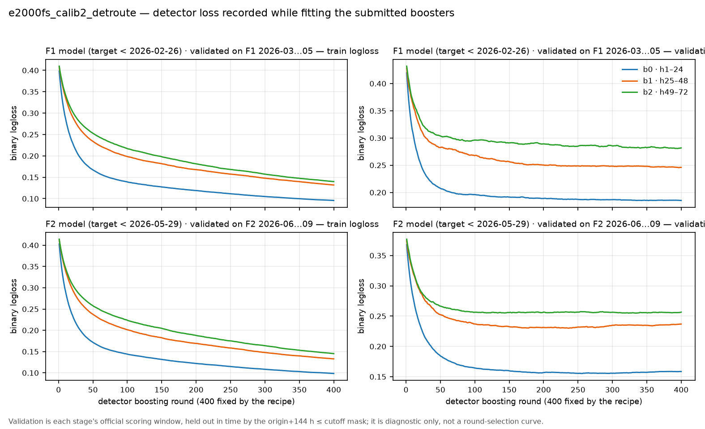
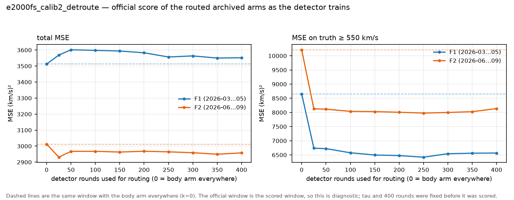
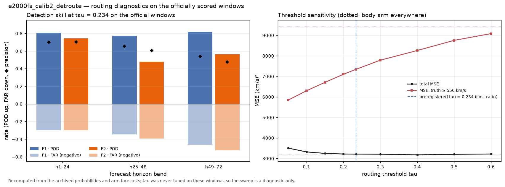
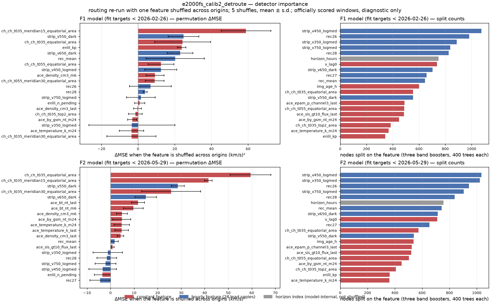

# E2000FS Calib2 DetRoute — detector 학습 loss, 라우팅 진단, permutation 중요도, F1+F2 월별 예측 GIF

**2026-10-31 게시 기준 리더보드 1위**, 작성자 **seongeun**인 `e2000fs_calib2_detroute`입니다(제출 `20261031T000632213Z`, 게시 기준 2위는 tweedie15 3227.596508). 두 archive arm 사이를 **학습한 이진 분류기로 라우팅**한 제출입니다. E2000 입력(Top30 features, ACE lag 0)을 쓰는 고정 XGBoost recipe의 `tweedie15` arm(몸통)과 `mixture2comp` arm(꼬리) 두 예측을 그대로 두고, `binary:logistic` detector가 (origin, horizon) 쌍마다 확률 `p`를 내어 `p ≥ 0.234`이면 꼬리 arm, 아니면 몸통 arm을 고릅니다. 제출 설정 SHA256은 `e2457303ad54fe568c2b239ebf6b4f9b53657e60473284c276097f14f34a2acb`이며, 재현 소스는 [scripts/seongeun/e2000fs_calib2_detroute](https://github.com/TLAB-HGU/sunrun-leaderboard/blob/main/scripts/seongeun/e2000fs_calib2_detroute/e2457303ad54fe568c2b239ebf6b4f9b53657e60473284c276097f14f34a2acb.py), 연구 기록은 [research/e2000fs_calib2-20261031](../../../research/e2000fs_calib2-20261031/)입니다.

| 지표 | 제출 (routed) | tweedie15 (몸통 arm) | mixture2comp (꼬리 arm) | oracle arm 선택 |
| --- | ---: | ---: | ---: | ---: |
| **MSE (F1 + F2, 순위 기준)** | **3213.191868** | 3227.596508 | 3745.961524 | 2679.772006 |
| F1 MSE (2026-03..05, 2,137 folds) | 3551.740118 | 3512.714922 | 4364.205501 | 2956.808503 |
| F2 MSE (2026-06..09, 2,833 folds) | 2957.816786 | 3012.524835 | 3279.605230 | 2470.796716 |
| MSE, 목표 ≥ 550 km/s (48,456 pairs) | 7343.427493 | 9426.178611 | **5380.580129** | **5380.580129** |
| F1 MSE ≥ 550 (24,480 pairs) | 6566.353653 | 8655.538480 | **5161.503135** | **5161.503135** |
| F2 MSE ≥ 550 (23,976 pairs) | 8136.836218 | 10213.018385 | **5604.262345** | **5604.262345** |
| CSI (≥ 500 km/s 이벤트) | 0.077429 | — | — | — |
| naive 대비 skill | +0.644153 | — | — | — |

라우팅은 몸통 arm 대비 **전체 −14.40, ≥550 −2082.75**로 두 지표를 동시에 개선했습니다(엄격한 Pareto 개선). 다만 F1 구간의 전체 MSE는 +39.03 나빠졌고, 사전에 적어 둔 목표(전체 < 3200, 모든 ≥550 < 6000)는 **달성하지 못했습니다**(3213.2 / 7343.4). oracle 행은 정답을 알고 (origin, horizon)마다 두 arm 중 나은 쪽을 고른 상한이며, 두 arm을 동시에 갖고도 남은 여지가 총 533.4(≥550 1962.8)라는 뜻입니다.

## 라우팅 규칙

- **detector**: `binary:logistic`, 24시간 블록마다 booster 하나(부스터 3개) × 공식 단계 2개 = **6개**. 400 rounds, depth 4, eta 0.05, subsample 0.8, colsample 0.7, min_child_weight 20, λ 5, seed 42. horizon index를 feature로 받아 한 모델이 블록 안 24개 lead를 함께 다룹니다.
- **학습 행**: 라벨 성숙 규칙 `origin + 144h ≤ cutoff`를 그대로 적용해 F1 단계는 **9,905 origins**(237,720 행/블록, cutoff 2026-02-26), F2 단계는 **10,641 origins**(255,384 행/블록, cutoff 2026-05-29)로 학습했습니다. 양성 비율은 F1 0.1591, F2 0.1175입니다.
- **threshold**: `τ = 0.234 ≈ C_fp / (C_fp + C_fn) = 1233 / (1233 + 4045)`. 놓친 고속 쌍의 비용을 4045, 오경보 비용을 1233으로 둔 Bayes 기준으로 **채점 전에 고정**했고 F1/F2에서 조정하지 않았습니다. 다른 τ의 결과는 진단으로만 남겼습니다.
- 두 arm은 모두 이미 학습·보관된 예측이고, detector만 새로 학습됩니다. 라우팅은 그 두 예측과 archived 확률만으로 재생되며, 재생 결과가 제출 `forecast.npz`와 **비트 단위로 같음**을 확인한 뒤 그림을 그렸습니다.

## Detector 학습 loss



제출 routing을 만든 6개 booster의 **학습 중 per-round loss**입니다. archive에는 booster와 확률만 남고 `evals_result`가 없어서, 같은 레시피를 eval set과 함께 한 번 더 학습해 기록했습니다. eval set은 학습을 바꾸지 않으므로(early stopping 없음, metric 가중 없음) 다시 학습한 booster가 archive booster와 **완전히 같아야** 하고, 실제로 적용 행 전체에서 최대 차이 **0.0**이었습니다. 하나라도 어긋나면 기록을 중단하도록 했습니다.

- 위 행 **F1 모델**(target < 2026-02-26), 아래 행 **F2 모델**(target < 2026-05-29)입니다. 색은 24시간 블록(b0 h1–24, b1 h25–48, b2 h49–72)입니다.
- **validation은 held-out입니다.** F1 모델은 F1 구간(2026-03..05), F2 모델은 F2 구간(2026-06..09)에서 채점했고, 두 구간 모두 `origin + 144h ≤ cutoff` 마스크 밖(학습 마지막 origin + 8일 이후)에서 시작합니다. 그래도 **이미 채점된 공개 구간**이므로 진단용이며, 400 rounds는 레시피로 고정되어 이 곡선으로 라운드를 고르지 않았습니다.
- 멀리 있는 블록일수록 train 손실이 덜 떨어지고 validation 값도 큽니다. F2 모델 b0는 256 round에서 validation 최소(0.1553)를 지나 400 round에서 0.1586으로 다시 올라가지만, 그 시점을 선택에 쓰지 않았습니다.

| 단계 | 블록 | train logloss (400 round) | validation logloss (400 round) | validation 최소 (round) | 양성 비율 | 재학습 차이 |
| --- | --- | ---: | ---: | ---: | ---: | ---: |
| F1 | b0 h1–24 | 0.095573 | 0.185249 | 0.185230 (352) | 0.1591 | 0.0 |
| F1 | b1 h25–48 | 0.131870 | 0.245999 | 0.245607 (397) | 0.1591 | 0.0 |
| F1 | b2 h49–72 | 0.139889 | 0.281763 | 0.280774 (395) | 0.1591 | 0.0 |
| F2 | b0 h1–24 | 0.098440 | 0.158556 | 0.155258 (256) | 0.1175 | 0.0 |
| F2 | b1 h25–48 | 0.132875 | 0.236872 | 0.230061 (237) | 0.1175 | 0.0 |
| F2 | b2 h49–72 | 0.145245 | 0.256545 | 0.254928 (334) | 0.1175 | 0.0 |



같은 booster를 **앞의 k round만 써서** 라우팅하면 공식 점수가 어떻게 움직이는지도 남겼습니다(k=0은 몸통 arm 단독). detector가 학습될수록 ≥550 지표는 두 구간 모두 크게 좋아지지만, F1 전체 MSE는 어떤 k에서도 몸통 arm 단독(3512.715)보다 나쁩니다(최선 3551.740). 라우팅이 F1의 보통 속도 구간을 꼬리 arm으로 보내는 비용이 그 구간의 고속 개선보다 크다는 뜻이고, F2는 반대로 두 지표가 함께 좋아집니다.

| k | F1 전체 MSE | F1 ≥550 | F2 전체 MSE | F2 ≥550 |
| ---: | ---: | ---: | ---: | ---: |
| 0 (몸통 arm만) | 3512.715 | 8655.538 | 3012.525 | 10213.018 |
| 25 | 3568.386 | 6738.184 | 2931.119 | 8128.185 |
| 100 | 3597.893 | 6575.731 | 2967.592 | 8038.371 |
| 200 | 3582.768 | 6476.581 | 2967.907 | 8006.756 |
| 300 | 3563.327 | 6541.253 | 2958.884 | 7999.613 |
| **400 (제출)** | **3551.740** | **6566.354** | **2957.817** | **8136.836** |

원본 값은 [routing_curve.csv](routing_curve.csv)입니다. 이 곡선은 공식 채점 구간을 그대로 쓰므로 **진단용**이며, τ와 400 rounds는 이 곡선을 보기 전에 정해졌습니다.

## 라우팅 진단



archived 확률과 두 arm 예측, 공식 truth만으로 다시 계산했고, `results.json`이 보고한 값과 모두 일치하는지 확인한 뒤 기록했습니다(단위: 72시간 이내 고속 쌍 검출).

| 구간 | 블록 | POD | FAR | precision |
| --- | --- | ---: | ---: | ---: |
| F1 | h1–24 | 0.8072 | 0.2995 | 0.7005 |
| F1 | h25–48 | 0.7748 | 0.3466 | 0.6534 |
| F1 | h49–72 | 0.8164 | 0.4627 | 0.5373 |
| F2 | h1–24 | 0.7437 | 0.2983 | 0.7017 |
| F2 | h25–48 | **0.4799** | 0.3939 | 0.6061 |
| F2 | h49–72 | 0.5631 | **0.5253** | 0.4747 |

전체로는 POD 0.6986, FAR 0.3929, precision 0.6071입니다(tp 33,850 / fp 21,905 / fn 14,606). 실제로 고속 쌍의 69.9%가 꼬리 arm으로, 보통 쌍의 7.1%만 꼬리 arm으로 갔습니다. **가장 약한 곳은 F2의 h25–48(POD 0.48)과 h49–72(FAR 0.53)** 이고, 놓친 고속 쌍 14,606개의 **52%**(4,157 + 3,492)가 이 두 칸에서 나옵니다.

| τ | 전체 MSE | ≥550 | F1 ≥550 | F2 ≥550 | precision | POD |
| ---: | ---: | ---: | ---: | ---: | ---: | ---: |
| 0.05 | 3506.531 | 5841.557 | 5585.022 | 6103.484 | 0.352 | 0.913 |
| 0.10 | 3319.186 | 6299.111 | 5856.516 | 6751.009 | 0.466 | 0.847 |
| 0.15 | 3246.710 | 6708.590 | 6105.684 | 7324.170 | 0.536 | 0.792 |
| **0.234 (제출)** | **3213.192** | **7343.427** | **6566.354** | **8136.836** | **0.607** | **0.699** |
| 0.30 | 3206.320 | 7789.548 | 6972.251 | 8624.026 | 0.650 | 0.632 |
| 0.40 | 3177.125 | 8260.168 | 7460.274 | 9076.877 | 0.710 | 0.551 |
| 0.50 | 3200.685 | 8755.491 | 7977.209 | 9550.132 | 0.750 | 0.472 |

전체 MSE만 보면 τ 0.40이 36.07 더 좋지만 그때 ≥550은 916.7 나빠집니다. 제출 τ는 이 표를 보기 전에 비용비로 고정된 값이고, 표는 사후 진단입니다([routing_sensitivity.csv](routing_sensitivity.csv), [routing_by_band.csv](routing_by_band.csv), 요약 [routing_diagnostics.json](routing_diagnostics.json)).

## Feature importance



왼쪽은 **permutation**(한 특징을 origin 사이에서 섞은 뒤 3개 블록 booster를 다시 예측하고, 두 arm의 archive 예측을 다시 라우팅해 공식 MSE 재계산), 오른쪽은 **split 횟수**입니다. 위 행 F1 모델, 아래 행 F2 모델, 각 상위 20개입니다.

**재현 확인.** 저장된 booster 6개로 만든 확률이 `exceedance_prob.npz`와 **최대 차이 0.0**으로 같고, 그 확률로 재라우팅한 예측이 제출 `forecast.npz`와 비트 단위로 같으며, 기본 MSE가 리더보드 값(F1 3551.740118 / F2 2957.816786)과 1e-9 이내로 일치할 때만 계산했습니다. 섞기는 5회, 평균 ± 표준편차입니다.

**계산 방법과 한계.**

- 두 arm 예측은 **고정된 archive**이므로, 이 값은 라우팅 성분의 기여만 잽니다(arm 자체의 특징 의존성은 포함하지 않음).
- 블록 설계는 상수 특징 21개 + 시간별 특징 9개 × 24 lead + horizon index = 238열입니다. 상수 특징은 1열, 시간별 특징은 24열을 **한 묶음으로** 섞었습니다. horizon index는 모델 내부 입력이라 섞지 않고 split 횟수만 표시했습니다(회색).
- 채점이 끝난 공개 구간을 쓰므로 **진단용**이며, 특징·τ·rounds 선택에 쓰지 않았습니다. 상관된 특징은 중요도를 나눠 가집니다.
- 31개 특징 중 **16개는 ΔMSE가 음수**입니다. F1의 `img_age_h` −28.1, `rec27` −19.9, F2의 `v_lag0` −21.2처럼 섞으면 오히려 MSE가 줄어드는 특징도 그대로 남겼습니다. 라우팅 신호가 약하고 잡음이 크다는 사실이 이 표에 드러납니다.

### permutation 상위 10개 — F1 모델 (2026-03..05)

| 순위 | 특징 | ΔMSE (km/s)² | ΔMSE ≥550 | split 횟수 (순위) |
| ---: | --- | ---: | ---: | ---: |
| 1 | `ch_ch_t035_meridian15_equatorial_area` | 58.9 ± 13.6 | 338.0 | 312 (22위) |
| 2 | `strip_v550_dark` | 24.8 ± 8.4 | 67.6 | 554 (13위) |
| 3 | `ch_ch_t035_equatorial_area` | 24.3 ± 15.3 | 379.6 | 555 (12위) |
| 4 | `enlil_kp` | 23.8 ± 2.3 | 101.0 | 344 (20위) |
| 5 | `strip_v650_dark` | 22.9 ± 7.0 | 109.9 | 703 (8위) |
| 6 | `rec_mean` | 20.3 ± 15.9 | 174.1 | 645 (10위) |
| 7 | `ch_ch_t055_equatorial_area` | 12.5 ± 7.0 | 119.0 | 488 (15위) |
| 8 | `strip_v450_logmed` | 12.4 ± 8.8 | 127.0 | 1,076 (1위) |
| 9 | `ace_density_cm3_m6` | 9.3 ± 4.9 | 58.0 | 250 (26위) |
| 10 | `ch_ch_t055_meridian30_equatorial_area` | 9.1 ± 5.1 | −53.2 | 283 (23위) |

### permutation 상위 10개 — F2 모델 (2026-06..09)

| 순위 | 특징 | ΔMSE (km/s)² | ΔMSE ≥550 | split 횟수 (순위) |
| ---: | --- | ---: | ---: | ---: |
| 1 | `ch_ch_t035_equatorial_area` | 59.4 ± 8.7 | 822.8 | 573 (11위) |
| 2 | `ch_ch_t035_meridian15_equatorial_area` | 41.6 ± 1.6 | 405.3 | 305 (22위) |
| 3 | `strip_v550_dark` | 28.6 ± 2.7 | 393.4 | 539 (12위) |
| 4 | `ch_ch_t035_meridian30_equatorial_area` | 25.7 ± 12.5 | 525.8 | 324 (21위) |
| 5 | `strip_v650_dark` | 14.9 ± 4.6 | 232.8 | 715 (8위) |
| 6 | `ace_bt_nt_last` | 11.7 ± 2.7 | 218.1 | 239 (26위) |
| 7 | `ace_bt_nt_m6` | 9.7 ± 4.2 | 162.9 | 301 (23위) |
| 8 | `ace_density_cm3_m6` | 4.9 ± 2.3 | 76.5 | 234 (27위) |
| 9 | `ace_by_gsm_nt_m24` | 4.8 ± 3.8 | 87.4 | 450 (17위) |
| 10 | `ace_temperature_k_m24` | 4.8 ± 3.2 | 25.4 | 361 (20위) |

split 횟수 1위는 두 단계 모두 `strip_v450_logmed`(F1 1,076 / F2 1,035)이지만 permutation ΔMSE는 12.4 / −3.4로 작습니다. 반대로 코로나홀 면적(`ch_ch_t035_*`)은 split은 적어도 섞었을 때 가장 크게 나빠져, split 횟수와 예측 기여도가 다르다는 점이 그대로 보입니다. 전체 값(31개 특징 × 2단계)은 [feature_importance.csv](feature_importance.csv), 계산 코드는 [code/detector_importance.py](code/detector_importance.py), 확인 기록은 [feature_importance_receipt.json](feature_importance_receipt.json)입니다.

## 월별 예측 GIF (F1 + F2)

| 기간 | 월 | 프레임 | GIF |
| --- | --- | ---: | --- |
| F1 | 2026-03 | 744 | [validation_2026-03.gif](validation_2026-03.gif) |
| F1 | 2026-04 | 720 | [validation_2026-04.gif](validation_2026-04.gif) |
| F1 | 2026-05 | 673 | [validation_2026-05.gif](validation_2026-05.gif) |
| F2 | 2026-06 | 720 | [validation_2026-06.gif](validation_2026-06.gif) |
| F2 | 2026-07 | 744 | [validation_2026-07.gif](validation_2026-07.gif) |
| F2 | 2026-08 | 744 | [validation_2026-08.gif](validation_2026-08.gif) |
| F2 | 2026-09 | 625 | [validation_2026-09.gif](validation_2026-09.gif) |

리더보드에 실제 제출한 예측(`runs/detroute_v1/forecast.npz`, SHA256 `e7bbdbdf…438985`)을 그대로 읽습니다. 각 프레임은 공식 평가 시작점 하나이며, 파란 선은 시작점까지 최근 **168시간 관측**, 검은 선은 이후 **72시간 실제값**, 주황 선은 제출 예측입니다. 빈 원은 입력 저장소에서 채워진 값(원 관측 없음)입니다. 제목에 전체 폴드 번호(4,970개 중), UTC 시작 시각, 해당 72시간 RMSE를 표시합니다.

첫 예측 시각(`origin+1h`)의 UTC 월로 나누고 시간순으로 재생합니다. 1000×500, **200–850 km/s 고정 Y축**, 100ms/프레임, 무한 반복입니다. 2026-05-29 ~ 05-31은 72시간 창이 F1·F2 경계에 걸쳐 어느 기간에도 속하지 않으므로 5월 프레임이 673개입니다.

## 검증 ([manifest.json](manifest.json))

[code/render_gifs.py](code/render_gifs.py)가 렌더링 전에 다음을 확인하고, 하나라도 어긋나면 멈춥니다.

- 예측 파일이 study `meta.yaml`에 고정된 자산(SHA256 `e7bbdbdf…438985`)인지
- origin 4,970개가 리더보드 folds와 **같은 순서**인지
- 예측·truth가 fold × h1..72에 1:1로 대응해 357,840쌍이 되는지
- 다시 계산한 MSE가 리더보드 값과 1e-9 이내로 일치하는지(전체 3213.191868, F1 3551.740118, F2 2957.816786, ≥550 7343.427493)
- 월별 프레임 수(744 / 720 / 673 / 720 / 744 / 744 / 625)와 GIF 디코딩, 각 프레임의 왕복 일치, 100ms·무한 반복

같은 방식으로 detector loss는 archive booster와의 예측 차이 0.0([loss_receipt.json](loss_receipt.json)), 중요도는 archived 확률·제출 예측과의 비트 단위 일치([feature_importance_receipt.json](feature_importance_receipt.json)), 라우팅 진단은 `results.json`과의 값 일치([routing_diagnostics.json](routing_diagnostics.json))를 확인합니다. 리더보드가 보관한 제출 기록은 [leaderboard-result.json](leaderboard-result.json)에 그대로 복사했고, 입력 파일과 GIF의 SHA256·렌더링 설정은 manifest에 기록했습니다. 학습이나 예측 변경은 하지 않았습니다.

## 재현

```bash
/home/t-lab01/sunrun/.venv/bin/python docs/visualizations/e2000fs_calib2_detroute/code/render_gifs.py           # 4,970프레임, 약 6분
/home/t-lab01/sunrun/.venv/bin/python docs/visualizations/e2000fs_calib2_detroute/code/detector_loss.py         # 재학습 6회, 약 3분
/home/t-lab01/sunrun/.venv/bin/python docs/visualizations/e2000fs_calib2_detroute/code/detector_importance.py   # 약 3분
/home/t-lab01/sunrun/.venv/bin/python docs/visualizations/e2000fs_calib2_detroute/code/routing_diagnostics.py  # 약 1분
```

두 arm의 제출 기록은 [research/e2000fs_calib-20261030](../../../research/e2000fs_calib-20261030/)(tweedie15)과 [research/e2000fs_calib2-20261031](../../../research/e2000fs_calib2-20261031/)(mixture2comp, detroute)에 있습니다. 이 폴더는 그 결과를 읽기만 하며, 예측을 다시 계산하는 것은 detector 손실·중요도의 재현 확인뿐이고 모두 저장된 제출 예측과 비트 단위로 같은지 확인한 뒤 계산합니다.
