# E2000FS Calib5 DetPool-All — 아카이브 arm 전부 스태킹: arm 가중치 · 재적합 궤적 · F1–F3 월별 예측 GIF

**2026-11-01 기준 리더보드 1위**, 작성자 **seongeun**인 `e2000fs_calib5_detpool_all`입니다(제출 `20261031T172348Z`, 총 MSE **4,154.15**, F1 6,007.06 / F2 3,600.17 / F3 2,876.28, ≥550 **9,641.59**).
질문은 "`e2000fs_calib4_detpool_gpd`(그 시점 1위)에 **아카이브된 모든 arm**을 동시에 붙이면 더 좋아지는가"였고, 원래 81-arm 실행의 답은 **아니오**(3,243.1 vs 기준 3,208.9)였습니다. 이 페이지는 그 판단의 근거인 **arm 가중치 분포**와 **168-origin 주기 재적합의 시간 궤적**, 그리고 리더보드에 올라간 refit 예측(arm 16개, 같은 창에서 기준 4,360.2 → 4,154.2)의 월별 GIF를 담습니다.

| 지표 | 제출 (2026-10-31 F1/F2/F3 재적합, 6,315 origins) | 같은 규칙의 legacy lane (F1+F2, 4,970 origins) |
| --- | ---: | ---: |
| **MSE (F1 + F2 + F3, 순위 기준)** | **4,154.152633** | 3,243.137790 |
| F1 MSE (2026-01..03, 2,089 folds) | 6,007.057035 | 3,645.650152 |
| F2 MSE (2026-04..06, 2,113 folds) | 3,600.168706 | 2,939.513040 |
| F3 MSE (2026-07..09, 2,113 folds) | 2,876.277924 | — |
| MSE, 목표 ≥ 550 km/s (78,379 pairs) | 9,641.590820 | 7,072.849047 |
| F1 / F2 / F3 ≥ 550 | 12,097.99 / 7,055.64 / 6,311.41 | 6,479.95 / 7,678.22 / — |
| CSI (≥ 500 km/s 이벤트) | 0.078393 | 0.077932 |
| timing MAE (h) | 5.85 | 5.84 |
| naive 대비 skill | +0.6078 | — |

같은 재적합 창에서 기준 `e2000fs_calib4_detpool_gpd`는 총 **4,360.21**(F1 6,659.84 / F2 3,616.99 / F3 2,829.92, ≥550 10,502.33)이므로, 스태킹이 총 **−206.1**, ≥550 **−860.7**을 벌었지만 **F3는 +46.4 나빠졌습니다**. 개선은 거의 전부 F1에서 나옵니다.

## 규칙

`pred = base + Σ_j β_j (arm_j − base)`, `β ≥ 0`, `Σβ ≤ 1`입니다. `base`는 `e2000fs_calib4_detpool_gpd`이고, `β`는 **168 origin마다** 그 시점에 72시간 목표가 모두 성숙한 **직전 2,160 origin**만으로 적합합니다(표준화 NNLS, ridge `1e-3`). 적합값은 (1) `Σβ ≤ 1`이 되도록 축소 사다리(1.0 → 0.75 → 0.5 → 0.25)를 거치고, (2) 직전 창의 **≥550 MSE가 base를 넘지 않을 때까지** 줄이며, 어떤 단계에서도 통과하지 못하면 **β = 0**(= base 그대로)입니다. arm 집합, 창, 주기, ridge, 사다리는 [preregistration.md](../../../research/e2000fs_calib5-20261031/preregistration.md)에 실행 전에 고정했습니다.

이 페이지가 다루는 제출 예측은 2026-10-31 F1/F2/F3 재적합 lane(`research/e2000fs_f123-20261031/runs/poolall_v1`)이며 **16개 arm**을 씁니다. 리더보드 레코드의 `config_sha256`(`13376adb…`)은 실험 정체성을 유지하기 위해 남아 있는 **원래 81-arm 재생 스크립트**이고([publish_f123.py](../../../research/e2000fs_f123-20261031/publish_f123.py)가 점수·cutoff만 교체), 저장된 예측은 아래 검증대로 16-arm 재적합 스택과 **비트 단위로 같습니다**. legacy 행은 그 81-arm lane의 원래 수치입니다.

## arm 가중치

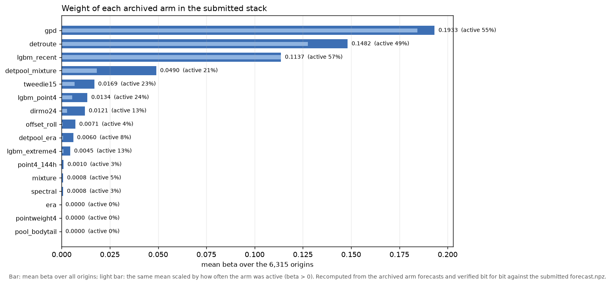

16개 arm의 평균 β입니다. 값은 [weights_by_arm.csv](weights_by_arm.csv)에 있고, 각 arm은 `e2000fs_f123-20261031/runs/<arm>_v1`의 재적합 예측입니다.

| arm | 평균 β | 전체 가중치 비중 | β > 0 인 origin | 활성 시 평균 β | 최대 β |
| --- | ---: | ---: | ---: | ---: | ---: |
| `gpd` (`calib3` gpd) | 0.1933 | 34.1% | 54.8% | 0.3528 | 0.5673 |
| `detroute` (`calib2`) | 0.1482 | 26.2% | 49.5% | 0.2997 | 0.6793 |
| `lgbm_recent` | 0.1137 | 20.1% | 57.4% | 0.1980 | 0.7603 |
| `detpool_mixture` | 0.0490 | 8.7% | 21.3% | 0.2304 | 0.4285 |
| `tweedie15` | 0.0169 | 3.0% | 22.9% | 0.0741 | 0.2397 |
| `lgbm_point4` | 0.0134 | 2.4% | 23.9% | 0.0558 | 0.0903 |
| `dirmo24` | 0.0121 | 2.1% | 13.3% | 0.0907 | 0.1186 |
| `offset_roll` | 0.0071 | 1.3% | 4.2% | 0.1687 | 0.1894 |
| `detpool_era` | 0.0060 | 1.1% | 8.0% | 0.0753 | 0.1281 |
| `lgbm_extreme4` | 0.0045 | 0.8% | 13.3% | 0.0337 | 0.0777 |
| `point4_144h` / `mixture` / `spectral` | 0.0010 / 0.0008 / 0.0008 | 0.5% | ≤5% | ≤0.04 | ≤0.04 |
| `pointweight4` / `era` / `pool_bodytail` | 0.0 | 0.0% | 0% | — | — |

앞의 세 arm이 전체 가중치의 **80.4%**를 차지합니다. gpd·mixture·era·detroute처럼 서로 상관이 높은 arm을 한꺼번에 넣어도, 목적함수가 trailing **총 MSE**인 이상 가중치는 몸통에 유리한 쪽으로 몰립니다.

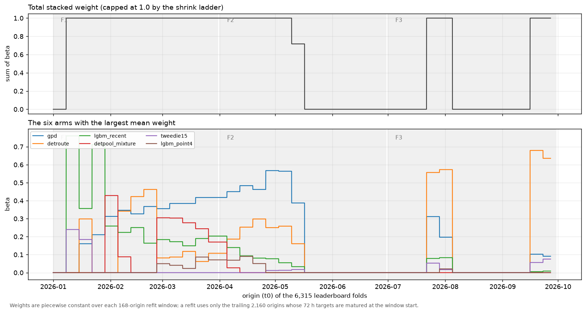

시간 궤적([weights_by_refit.csv](weights_by_refit.csv), [weights_by_origin.csv](weights_by_origin.csv))에서 드러나는 사실은 세 가지입니다.

- **37번의 재적합 중 15번이 β = 0으로 끝납니다**(첫 창은 성숙 표본 부족으로 건너뜀). 즉 절반 가까운 구간에서 이 스택은 **base와 완전히 같은 예측**을 냅니다. 가중치가 실제로 실린 origin은 6,315개 중 **3,627개(57.4%)**입니다.
- 살아남은 22개 창 대부분에서 `Σβ`가 **1.0**(축소 상한)에 붙습니다. 즉 잔차를 base에 얹을 여지가 늘 상한까지 찼습니다.
- 활성 창은 **F1(1–3월)과 7월 말·9월 중순**에 몰립니다. 반대로 5월 중순~8월 중순은 거의 전부 base 단독이며, 이 구간이 F3 악화(+46.4)와 겹칩니다.

## legacy 81-arm lane: "전부 붙이기"의 원래 결과

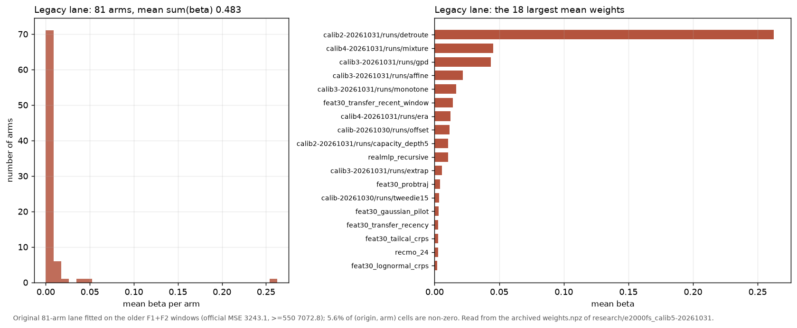

원래 실행은 F1+F2 창에서 **81개 arm**을 모두 붙였습니다([legacy_81arm_weights.csv](legacy_81arm_weights.csv), archive `research/e2000fs_calib5-20261031/runs/poolall_v1/weights.npz`). 평균 `Σβ`는 **0.483**, 가중치가 0이 아닌 origin은 **50.7%**, (origin, arm) 칸 기준으로는 **5.6%**만 0이 아닙니다. 최대 가중치는 `calib2 detroute` **0.263**, 그 다음이 `calib4 mixture` 0.045, `calib3 gpd` 0.044로, 81개 중 3개가 가중치의 72%를 차지했습니다. 그 결과 legacy 총 MSE 3,243.14로, 기준 `calib4_detpool_gpd`(3,208.9)보다 **34.2 나빠졌습니다**(F2 ≥ 550만 5.5 개선). 이 실패가 "arm을 줄이거나 목적을 꼬리로 바꾸자"는 후속 판단의 근거입니다.

## 검증

그림과 표는 모두 **제출된 예측을 다시 계산해서** 만들었고, 재계산이 archive와 어긋나면 스크립트가 멈춥니다.

- `pool_weights.py`는 16개 arm 예측에서 β를 **다시 적합**해 `base + Σβ(arm − base)`를 만들고, 그것이 제출 `forecast.npz`와 **최대 차이 0.0**(float32 비트 단위)임을 확인한 뒤에만 표·그림을 씁니다([weights_receipt.json](weights_receipt.json)).
- 같은 예측을 리더보드 `folds.parquet`/`truth.parquet`(pinned sha256)에 조인해 다시 채점하면 총 4,154.152633 / F1 6,007.057035 / F2 3,600.168706 / F3 2,876.277924 / ≥550 9,641.590820으로, 리더보드 레코드와 **1e-9 이내**로 일치합니다([leaderboard-result.json](leaderboard-result.json)).
- GIF는 이 제출 예측을 그대로 그립니다(재학습·재후처리 없음), `manifest.json`에 입력 sha256과 월별 프레임 수가 남아 있습니다.

## 월별 예측 GIF

공식 구간(대상 2026-01-01 ~ 2026-09-29)의 6,315개 시작점 전체입니다. 각 프레임은 시작점까지의 168시간 관측, 이후 72시간 실제값과 제출 예측을 같은 200–850 km/s 축에 그립니다.

README에서 바로 재생되도록 **4 origin 간격 · 720×360 미리보기**(`preview_*.gif`)를 아래에 넣었습니다. 미리보기는 전체 GIF와 같은 그림을 줄인 것이고 재생 속도(시간당 진행)도 같습니다. 전체 해상도(1000×500, 1 origin 간격)는 표의 파일 링크를 쓰세요.

| 월 | period | folds | 전체 프레임 | 크기 | 전체 GIF |
| --- | --- | ---: | ---: | ---: | --- |
| 2026-01 | F1 | 1–744 | 744 | 17.0 MB | [validation_2026-01.gif](validation_2026-01.gif) |
| 2026-02 | F1 | 745–1416 | 672 | 14.7 MB | [validation_2026-02.gif](validation_2026-02.gif) |
| 2026-03 | F1 | 1417–2089 | 673 | 14.8 MB | [validation_2026-03.gif](validation_2026-03.gif) |
| 2026-04 | F2 | 2090–2809 | 720 | 16.4 MB | [validation_2026-04.gif](validation_2026-04.gif) |
| 2026-05 | F2 | 2810–3553 | 744 | 16.6 MB | [validation_2026-05.gif](validation_2026-05.gif) |
| 2026-06 | F2 | 3554–4202 | 649 | 14.2 MB | [validation_2026-06.gif](validation_2026-06.gif) |
| 2026-07 | F3 | 4203–4946 | 744 | 17.3 MB | [validation_2026-07.gif](validation_2026-07.gif) |
| 2026-08 | F3 | 4947–5690 | 744 | 16.7 MB | [validation_2026-08.gif](validation_2026-08.gif) |
| 2026-09 | F3 | 5691–6315 | 625 | 14.7 MB | [validation_2026-09.gif](validation_2026-09.gif) |
| **합계** | F1–F3 | 1–6,315 | **6,315** | 142 MB | 9개 GIF |

### 2026-01 (F1)

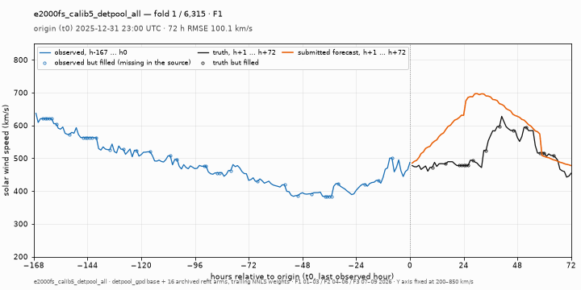

### 2026-02 (F1)

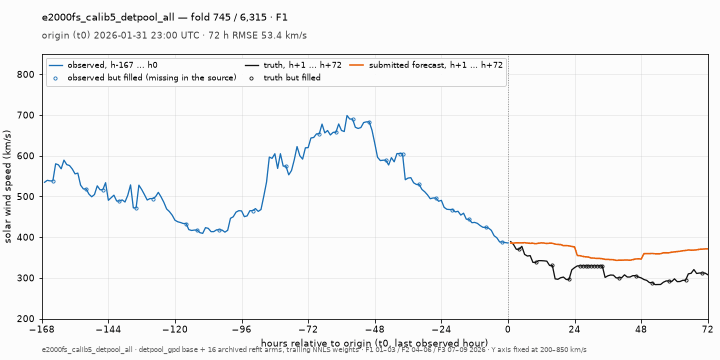

### 2026-03 (F1)

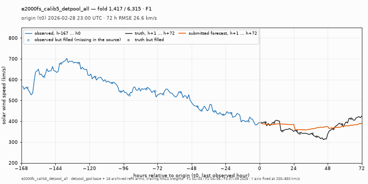

### 2026-04 (F2)

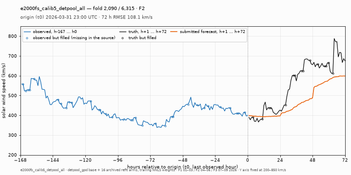

### 2026-05 (F2)

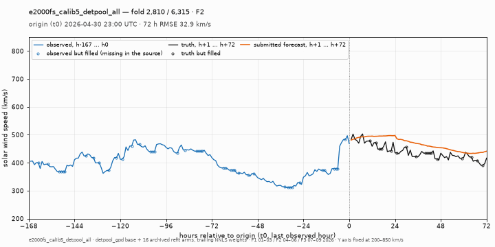

### 2026-06 (F2)

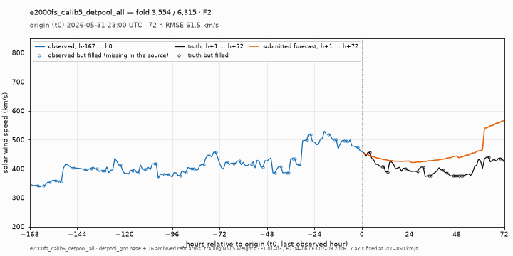

### 2026-07 (F3)

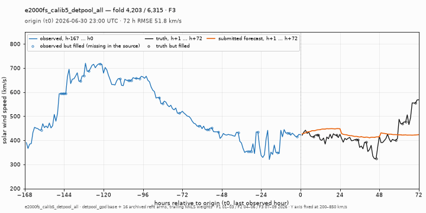

### 2026-08 (F3)

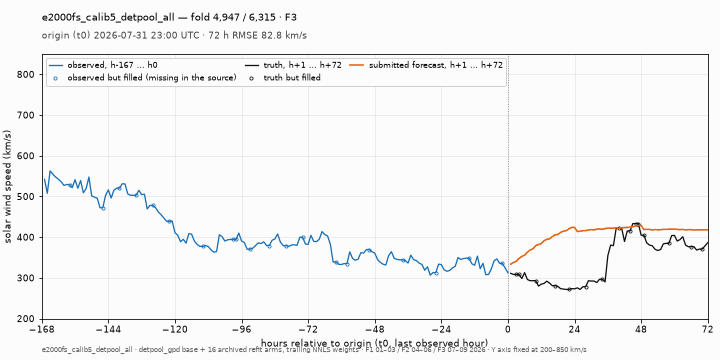

### 2026-09 (F3)

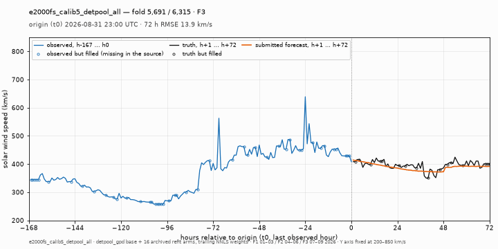

## 재현

```bash
cd /home/t-lab01/sunrun
PY=/home/t-lab01/sunrun/.venv/bin/python
$PY docs/visualizations/e2000fs_calib5_detpool_all/code/pool_weights.py     # 가중치 재계산·검증·그림
$PY docs/visualizations/e2000fs_calib5_detpool_all/code/render_gifs.py      # 9개월 GIF + manifest.json
```

입력은 모두 archive입니다: 제출 예측 `research/e2000fs_f123-20261031/runs/poolall_v1/forecast.npz`, base와 16개 arm의 `forecast.npz`, legacy 가중치 `research/e2000fs_calib5-20261031/runs/poolall_v1/weights.npz`, 리더보드 `folds.parquet`·`truth.parquet`, 입력 이력 `data-v2/model-inputs/leaderboard-store/ch-v1/ace.parquet`. 학습은 일어나지 않습니다.
