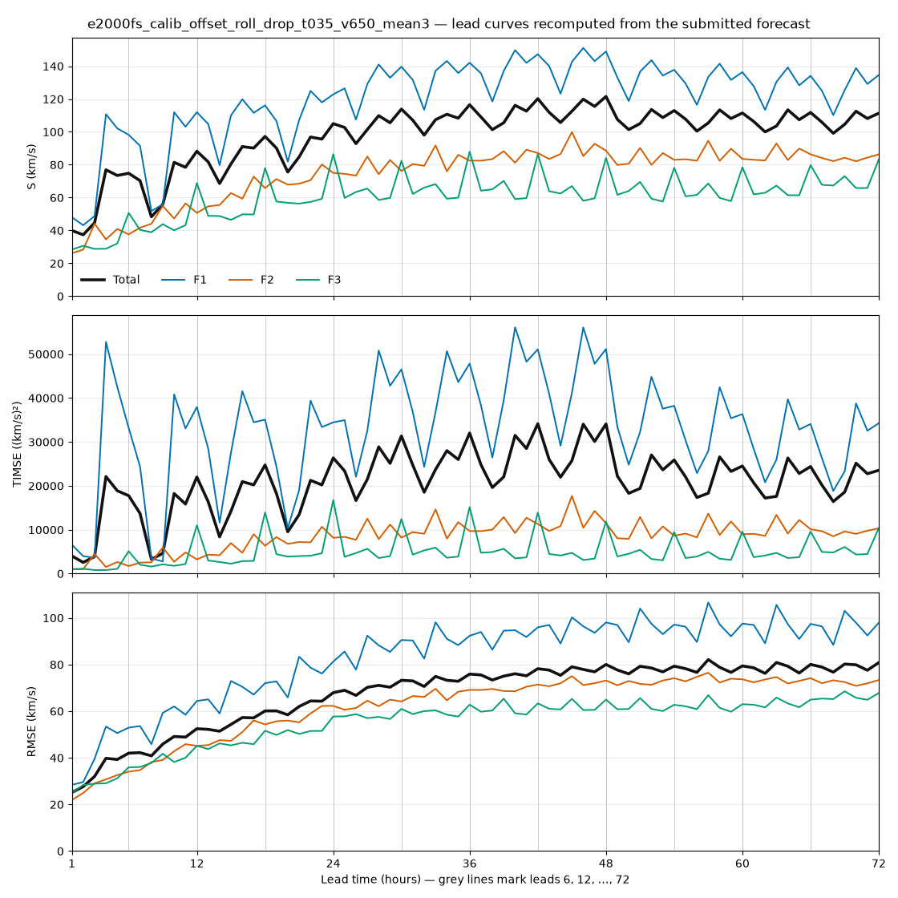
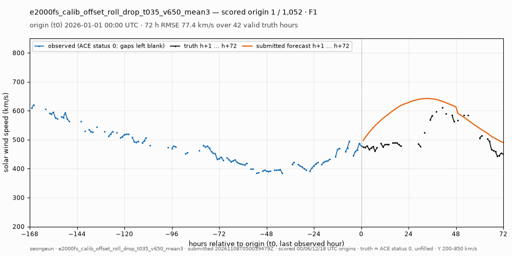
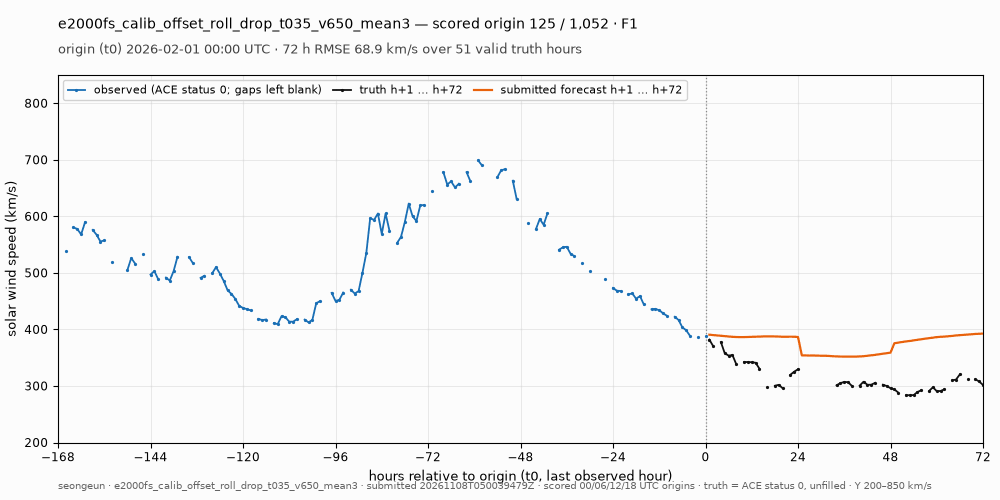
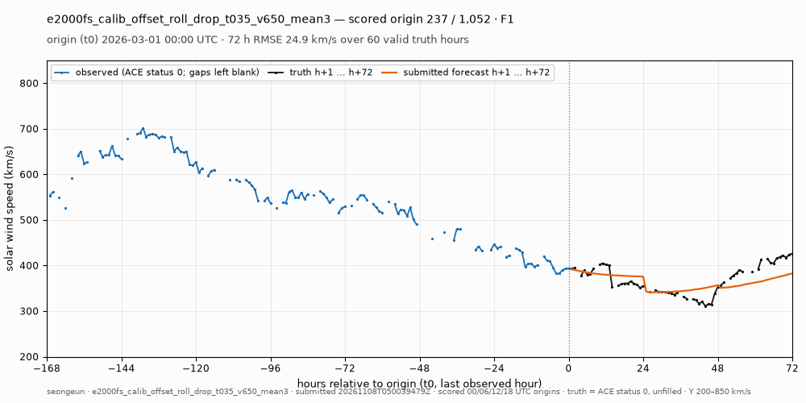
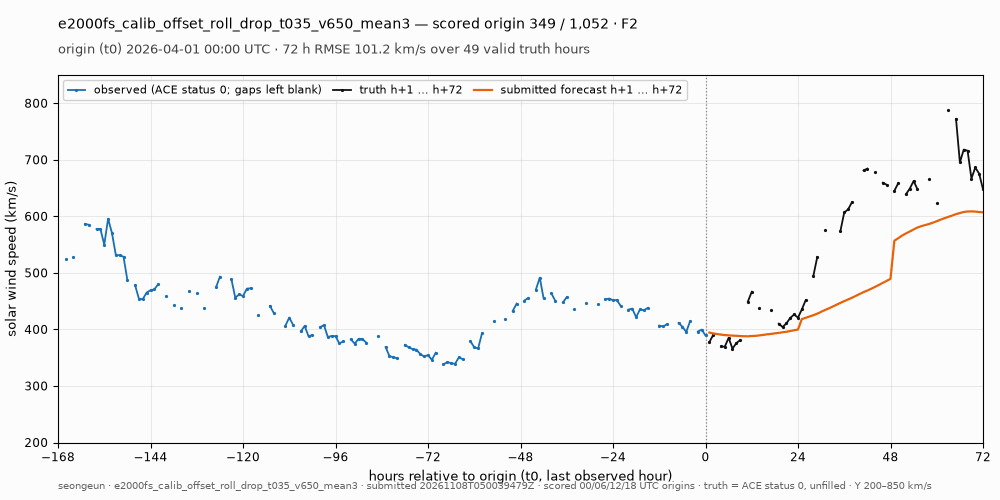
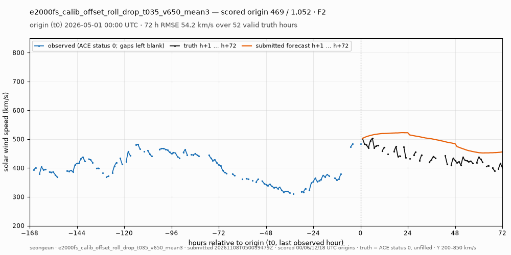
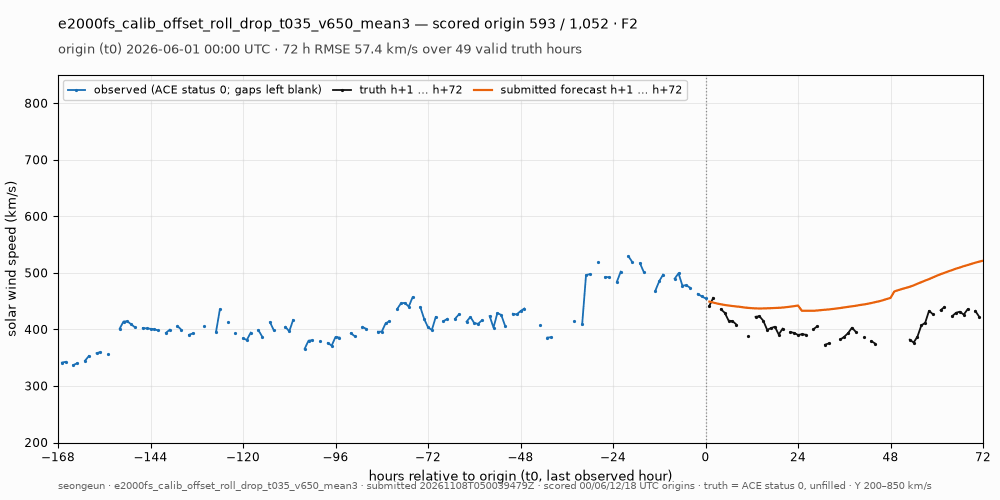
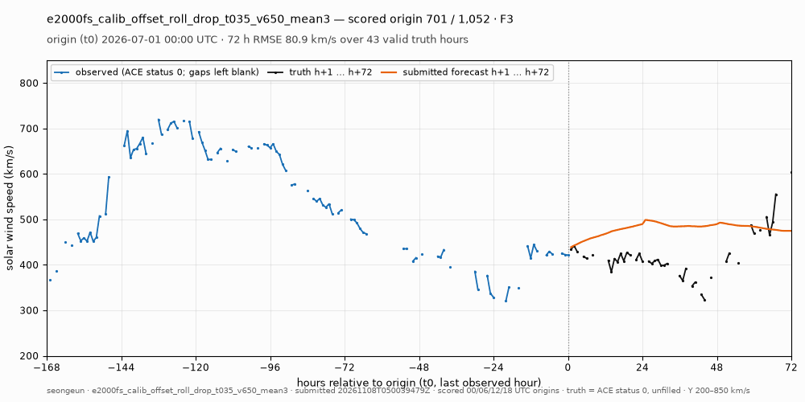
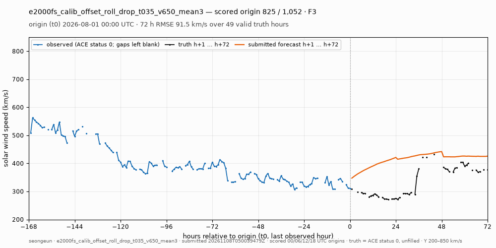
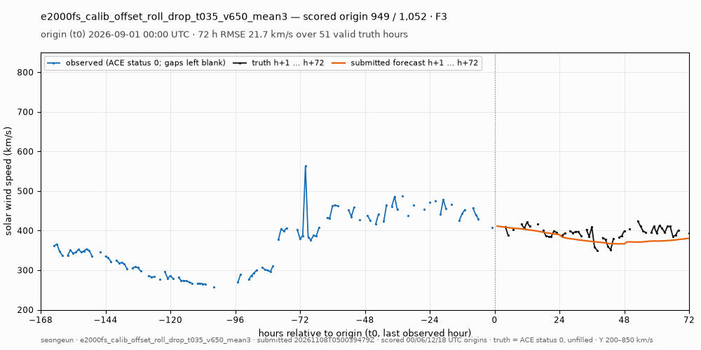

# e2000fs_calib_offset_roll_drop_t035_v650_mean3 — lead 곡선 · F1–F3 월별 예측 GIF

작성자 **seongeun**의 `e2000fs_calib_offset_roll_drop_t035_v650_mean3`입니다(제출 `20261108T050039479Z`). Total S **97.69**입니다.

이 페이지는 리더보드 dataset에 저장된 **제출 예측 자체**를 리더보드 채점기(`leaderboard/scorer/competition.py`, `lead-timse-6h-v1`)로 다시 채점해 그렸습니다. 관측은 기록이 채점된 dataset revision `80fb76082a`의 `competition-observations.parquet`입니다. Total/F1/F2/F3의 S·TIMSE·RMSE·tRMSE·bias가 저장 기록과 **1e-9 이내로 같을 때만** 그림을 그립니다([manifest.json](manifest.json)). 재학습이나 후처리는 하지 않았습니다.

| 구간 | S | TIMSE | RMSE | tRMSE | bias | 채점 origin | 유효 pair | persistence 대체 |
| --- | ---: | ---: | ---: | ---: | ---: | ---: | ---: | ---: |
| **Total** | 97.69 | 21,075.4 | 67.52 | 142.29 | +16.4 | 1,052 | 52,619 | 0.00% |
| F1 (2026-01..03) | 120.42 | 33,091.5 | 82.89 | 177.16 | +20.1 | 348 | 17,674 | 0.00% |
| F2 (2026-04..06) | 74.44 | 8,519.6 | 61.90 | 89.80 | +13.3 | 352 | 17,473 | 0.00% |
| F3 (2026-07..09) | 60.54 | 4,991.5 | 55.26 | 67.29 | +15.7 | 352 | 17,472 | 0.00% |

단위는 km/s(TIMSE는 (km/s)²)입니다. 채점 origin은 00/06/12/18 UTC이고, 정답은 ACE status 0 관측을 채우지 않고 씁니다. 그래서 1,052 × 72 = 75,744 pair 중 69.5%만 유효합니다.

## 제출 설명 (제출자 작성, 원문)

> Exploratory combination of two independently 3/3-seed improving removals: ch_ch_t035_equatorial_area and strip_v650_dark. Original A otherwise unchanged, alpha=.25, full spectral term, no B1. Fixed arithmetic mean of fresh seeds 42/43/44; equal 1/3 weights, no label-fitted weights. Official F1/F2/F3, training-only calibration and 144h maturity. Selected after prior official LOCO scores; no independent confirmation claim.

- 모델 정의 코드: [architecture](https://github.com/TLAB-HGU/sunrun-leaderboard/blob/eab16a07c492e1c44039fec4f5bda4724e46519b/research/drop035_v650_confirm_20261108/published/ensemble.py)
- 학습 데이터 종료: F1 2025-12-29T00:00:00Z, F2 2026-03-29T00:00:00Z, F3 2026-06-29T00:00:00Z

## Lead 곡선



리더보드 lead curves 열과 같은 값을 이 페이지에서 직접 다시 채점해 그렸습니다([lead_metrics.csv](lead_metrics.csv), lead를 6으로 나눈 나머지별 평균은 [lead_residue.csv](lead_residue.csv)).

F3 TIMSE는 lead 6의 배수(6, 12, …, 72)에서 평균 **11,591.4**이고, 그 밖의 lead에서는 3,162.1–4,365.3입니다. 채점 origin이 00/06/12/18 UTC라서, lead 6·k의 목표 시각도 00/06/12/18 UTC에만 놓입니다. F3에서 가장 빠른 관측 두 개(743.4 km/s, 2026-09-15 18:00 UTC · 690.0 km/s, 2026-07-23 18:00 UTC)도 이 시각에 있어서, lead 6·k의 정답 모집단에만 들어갑니다. 두 관측을 정답에서 빼고 다시 계산하면(점수가 아닌 진단값) F3 lead 6·k TIMSE는 **5,089.3**입니다.

## 월별 예측 GIF

GIF 한 장의 프레임은 채점 origin 하나입니다. 각 프레임은 origin 직전 168시간의 관측(파랑), 이후 72시간의 정답(검정), 제출 예측(주황)을 Y축 200–850 km/s로 고정해 보여 줍니다. 관측과 정답은 ACE status 0 값만 쓰고, 결측은 **채우지 않고 비워 둡니다**. 제출 예측이 없거나 유효하지 않은 lead는 채점기와 같은 persistence 값으로 그리고, 제목에 그 개수를 표시합니다. 프레임 간격은 250 ms이며, 9개월 합계 1,052 프레임으로 채점 origin 전체입니다.

| 월 | 기간 | 프레임 | GIF |
| --- | --- | ---: | --- |
| 2026-01 | F1 | 124 |  |
| 2026-02 | F1 | 112 |  |
| 2026-03 | F1 | 112 |  |
| 2026-04 | F2 | 120 |  |
| 2026-05 | F2 | 124 |  |
| 2026-06 | F2 | 108 |  |
| 2026-07 | F3 | 124 |  |
| 2026-08 | F3 | 124 |  |
| 2026-09 | F3 | 104 |  |

## 재현

```bash
/home/t-lab01/sunrun/.venv/bin/python docs/visualizations/code/submission_viz.py --member seongeun \
    --experiment e2000fs_calib_offset_roll_drop_t035_v650_mean3 --submitted-utc 20261108T050039479Z --out /home/t-lab01/sunrun/docs/visualizations/e2000fs_calib_offset_roll_drop_t035_v650_mean3
```

CPU만 씁니다. 입력은 리더보드 dataset `tlabtlab/sunrun-lb-store`에 저장된 이 제출의 결과 기록·예측 parquet과 `competition-observations.parquet`뿐입니다. [leaderboard-result.json](leaderboard-result.json)은 저장 기록에서 제출 키와 그 키를 담은 URL을 뺀 사본입니다.
