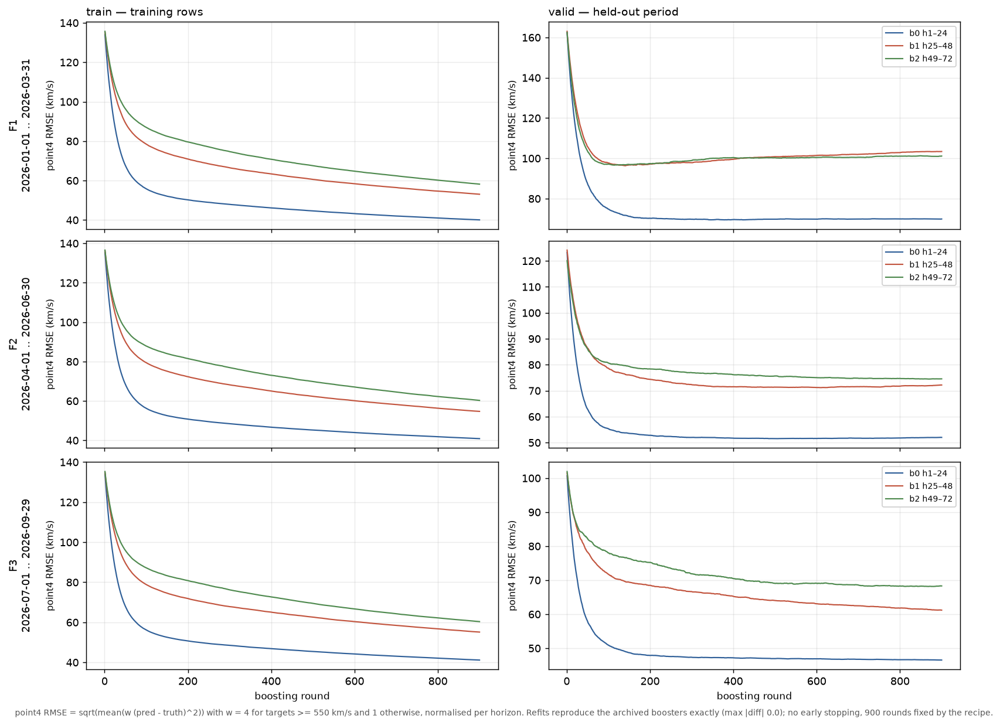
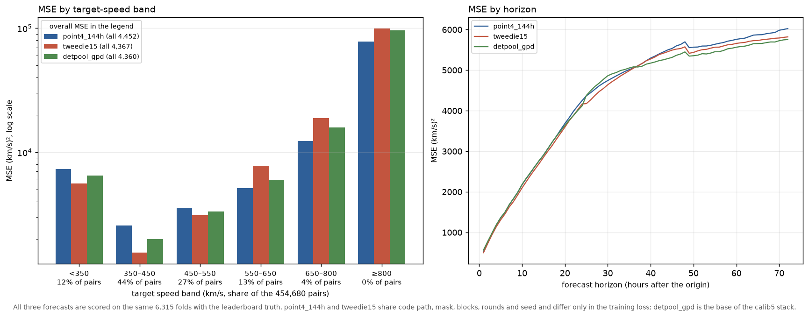

# E2000FS Calib Point4 144h — 학습 loss · 밴드별 오차 · F1–F3 월별 예측 GIF

작성자 **seongeun**인 `e2000fs_calib_point4_144h`입니다(제출 `20261031T165951Z`, 총 MSE **4,452.15**, F1 6,426.86 / F2 3,896.40 / F3 3,055.62, ≥550 **8,597.82**, 게시 기준 10위). `e2000fs_calib_tweedie15` lane의 **paired control arm**으로, 같은 코드 경로·같은 학습 행 마스크(`origin + 144 h ≤ cutoff`)·같은 블록·라운드·seed에서 **손실만** point4(목표 ≥ 550 km/s에 4배 가중)로 둔 모델입니다. 이 페이지는 그 **학습 곡선**, 같은 folds에서의 **밴드별 오차**, 그리고 제출 예측의 월별 GIF를 담습니다.

| 지표 | 제출 (2026-10-31 F1/F2/F3 재적합, 6,315 origins) | legacy lane (F1+F2, 4,970 origins) |
| --- | ---: | ---: |
| **MSE (F1 + F2 + F3, 순위 기준)** | **4,452.152081** | 3,490.995635 |
| F1 MSE (2026-01..03, 2,089 folds) | 6,426.862105 | 4,049.452299 |
| F2 MSE (2026-04..06, 2,113 folds) | 3,896.401803 | 3,069.738349 |
| F3 MSE (2026-07..09, 2,113 folds) | 3,055.621600 | — |
| MSE, 목표 ≥ 550 km/s (78,379 pairs) | 8,597.815344 | 5,763.521168 |
| F1 / F2 / F3 ≥ 550 | 11,169.05 / 5,758.81 / 5,345.66 | — |
| CSI (≥ 500 km/s 이벤트) | 0.077307 | — |
| timing MAE (h) | 5.86 | — |
| naive 대비 skill | +0.5797 | — |

## 규칙

- **손실**: `reg:squarederror`에 목표 ≥ 550 km/s 행 가중치 4, horizon별 배치 평균으로 정규화(`point_weights`).
- **모델**: 24시간 블록마다 `multi_output_tree` booster 하나(24개 출력), 블록 3개 × 단계 3개 = **9개**. depth 3, eta 0.03, subsample 0.8, colsample 0.7, min_child_weight 20, λ 5, **900 rounds, seed 42**, 스레드 1.
- **학습 행**: `origin + 144 h ≤ cutoff`(72시간 목표가 모두 성숙한 행만). cutoff는 F1 2025-12-29, F2 2026-03-29, F3 2026-06-29이고 학습 행은 각각 9,433 / 10,153 / 10,889개입니다.
- 예측은 `clip(pred, 1, 3000)`.

훈련 recipe·특징 30개는 `e2000fs_dirmo_24_feat30_pointweight4`의 동결 설정을 그대로 씁니다(특징 선택 자체가 이전 단계에서 공식 구간을 보고 정해진, 문서화된 한계입니다).

## 학습 loss



위 행부터 F1/F2/F3, 왼쪽이 학습 행, 오른쪽이 **held-out 기간**의 per-round loss입니다. 값은 objective와 같은 가중(4×/1×, horizon별 정규화)의 RMSE(km/s)입니다. archive에는 예측만 남고 `evals_result`가 없어서, 동일한 fit을 eval set과 함께 다시 실행해 기록했고 — early stopping도 metric 가중도 쓰지 않으므로 — **재학습 booster가 archive 예측을 비트 단위로 재현**할 때만(9개 모두 최대 차이 0.0) 표·그림을 씁니다([loss_receipt.json](loss_receipt.json), [loss_history.csv](loss_history.csv)).

곡선에서 읽히는 것은 세 가지입니다.

- **F1 모델은 900 round보다 이른 지점에서 held-out 최소**를 지납니다(b1 141, b2 114, b0 377 round). 900 round 고정값에서의 valid loss는 최소보다 b1 7.1 / b2 4.5 / b0 0.4 km/s 높습니다. 학습 행이 2025년 12월까지뿐이라 2026년 1–3월의 변동성을 담지 못하는, 데이터 양의 한계입니다(라운드는 recipe로 고정되어 이 곡선으로 고르지 않았습니다).
- **F2는 최소가 508–870 round로 늦고, F3는 b0·b1이 900 round에서도 계속 내려갑니다.** 학습 행이 늘어날수록(9,433 → 10,153 → 10,889) 과적합 신호가 사라집니다.
- F1의 held-out loss(69.9 / 103.4 / 101.2)가 F2·F3보다 훨씬 큽니다. 같은 모델·같은 라운드에서 기간만 바뀌므로, 이는 모델이 아니라 **2026년 1–3월 구간이 어렵다**는 뜻이고, 총 MSE에서 F1이 6,426.9로 가장 큰 이유와 같은 방향입니다.

validation은 각 단계의 공식 period 창(F1 2026-01..03, F2 04..06, F3 07..09)이며 학습 마스크 밖이지만 **이미 공개·채점된 구간**이므로 진단용입니다. 900 rounds는 recipe로 고정되어 이 곡선으로 라운드를 고르지 않았습니다.

| period | block | 학습 행 | train point4 RMSE (900) | valid point4 RMSE (900) | valid 최소 (round) | 검증 |
| --- | --- | ---: | ---: | ---: | ---: | --- |
| F1 | b0 h1–24 | 9,433 | 40.08 | 69.90 | 69.46 (377) | 재현 0.0 |
| F1 | b1 h25–48 | 9,433 | 53.08 | 103.40 | 96.33 (141) | 재현 0.0 |
| F1 | b2 h49–72 | 9,433 | 58.21 | 101.15 | 96.63 (114) | 재현 0.0 |
| F2 | b0 h1–24 | 10,153 | 40.91 | 52.01 | 51.54 (508) | 재현 0.0 |
| F2 | b1 h25–48 | 10,153 | 54.73 | 72.20 | 71.18 (611) | 재현 0.0 |
| F2 | b2 h49–72 | 10,153 | 60.30 | 74.57 | 74.49 (870) | 재현 0.0 |
| F3 | b0 h1–24 | 10,889 | 41.16 | 46.53 | 46.53 (900) | 재현 0.0 |
| F3 | b1 h25–48 | 10,889 | 55.14 | 61.20 | 61.20 (900) | 재현 0.0 |
| F3 | b2 h49–72 | 10,889 | 60.36 | 68.32 | 68.15 (868) | 재현 0.0 |

## 밴드별 오차: 4배 가중이 산 것과 잃은 것



같은 6,315 folds에서 세 예측을 비교했습니다([error_by_band.csv](error_by_band.csv)). `tweedie15`는 **코드 경로·마스크·블록·라운드·seed가 같고 손실만 Tweedie**인 paired arm이고, `detpool_gpd`는 calib5 스택의 base입니다.

| 목표 속도 (km/s) | pairs | point4_144h | tweedie15 | detpool_gpd |
| --- | ---: | ---: | ---: | ---: |
| < 350 | 55,125 (12.1%) | 7,318.9 | **5,585.9** | 6,481.3 |
| 350–450 | 199,322 (43.8%) | 2,576.5 | **1,549.9** | 1,990.2 |
| 450–550 | 121,854 (26.8%) | 3,556.8 | **3,118.8** | 3,326.7 |
| 550–650 | 57,902 (12.7%) | **5,147.9** | 7,806.0 | 6,028.2 |
| 650–800 | 18,605 (4.1%) | **12,336.6** | 18,853.6 | 15,837.5 |
| ≥ 800 | 1,872 (0.4%) | **78,146.5** | 99,315.0 | 95,864.5 |
| **전체** | 454,680 | 4,452.2 | **4,366.9** | **4,360.2** |
| **≥ 550** | 78,379 | **8,597.8** | 11,169.1 | 10,502.3 |

4배 가중은 의도대로 **꼬리에서만** 이깁니다. ≥550 MSE는 tweedie15보다 **2,571.3**, detpool_gpd보다 **1,904.5** 좋고 밴드가 높을수록 격차가 커집니다(≥800에서 −21,168). 그 대가로 보통 속도(특히 350–450, 전체 pair의 43.8%)에서 1,026.6 나빠지고, 총 MSE는 tweedie15 대비 **+85.3**이 됩니다. 즉 이 arm은 **단독 제출용이 아니라 꼬리 성분 부품**이고, 스스로는 1위가 되지 못합니다. 실제로 calib5의 16-arm 스택에도 들어가지만 가중치는 평균 0.001로 거의 쓰이지 않습니다([calib5 문서](../e2000fs_calib5_detpool_all/) 참조).

기간별로 보면 같은 패턴이 F1에서 가장 크게 나타납니다([error_by_horizon.csv](error_by_horizon.csv)에 horizon별 곡선도 있습니다).

| period | point4_144h | ≥550 | tweedie15 | ≥550 | detpool_gpd | ≥550 |
| --- | ---: | ---: | ---: | ---: | ---: | ---: |
| F1 2026-01..03 | 6,426.9 | 11,169.1 | 6,766.9 | 15,178.9 | **6,659.8** | 13,702.3 |
| F2 2026-04..06 | 3,896.4 | 5,758.8 | **3,595.6** | 10,438.7 | 3,617.0 | 7,055.8 |
| F3 2026-07..09 | 3,055.6 | 5,345.7 | **2,765.6** | 8,208.5 | 2,829.9 | 6,301.7 |

## 월별 예측 GIF

공식 구간(대상 2026-01-01 ~ 2026-09-29)의 6,315개 시작점 전체입니다. 각 프레임은 시작점까지의 168시간 관측, 이후 72시간 실제값과 제출 예측을 같은 200–850 km/s 축에 그립니다.

| 월 | period | folds | 프레임 | 크기 | 파일 |
| --- | --- | ---: | ---: | ---: | --- |
| 2026-01 | F1 | 1–744 | 744 | 16.9 MB | [validation_2026-01.gif](validation_2026-01.gif) |
| 2026-02 | F1 | 745–1416 | 672 | 14.6 MB | [validation_2026-02.gif](validation_2026-02.gif) |
| 2026-03 | F1 | 1417–2089 | 673 | 14.7 MB | [validation_2026-03.gif](validation_2026-03.gif) |
| 2026-04 | F2 | 2090–2809 | 720 | 16.3 MB | [validation_2026-04.gif](validation_2026-04.gif) |
| 2026-05 | F2 | 2810–3553 | 744 | 16.6 MB | [validation_2026-05.gif](validation_2026-05.gif) |
| 2026-06 | F2 | 3554–4202 | 649 | 14.2 MB | [validation_2026-06.gif](validation_2026-06.gif) |
| 2026-07 | F3 | 4203–4946 | 744 | 17.4 MB | [validation_2026-07.gif](validation_2026-07.gif) |
| 2026-08 | F3 | 4947–5690 | 744 | 16.7 MB | [validation_2026-08.gif](validation_2026-08.gif) |
| 2026-09 | F3 | 5691–6315 | 625 | 14.7 MB | [validation_2026-09.gif](validation_2026-09.gif) |
| **합계** | F1–F3 | 1–6,315 | **6,315** | 142 MB | 9개 GIF |

## 검증

- 채점 재현: 제출 예측을 리더보드 `folds.parquet`/`truth.parquet`(pinned sha256)에 조인해 다시 채점하면 4,452.152081 / F1 6,426.862105 / F2 3,896.401803 / F3 3,055.621600 / ≥550 8,597.815344로 리더보드 레코드와 **1e-9 이내**로 일치합니다([leaderboard-result.json](leaderboard-result.json)).
- loss 재현: 9개 booster 재학습 예측이 archive `F*_part{b}.npz`와 **최대 차이 0.0**([loss_receipt.json](loss_receipt.json)의 `max_abs_difference_kms`).
- 밴드 표의 세 예측은 모두 같은 folds에서 채점했고, `point4_144h`는 레코드 값과, `detpool_gpd`는 `runs/detpool_gpd_v1/results.json`(총 4,360.208035)과 일치함을 확인했습니다(float32 저장 오차 1e-3 허용).
- GIF는 제출 예측을 그대로 그립니다(재학습 없음), `manifest.json`에 입력 sha256과 월별 프레임 수가 남아 있습니다.

## 재현

```bash
cd /home/t-lab01/sunrun
PY=/home/t-lab01/sunrun/.venv/bin/python
bash docs/visualizations/e2000fs_calib_point4_144h/code/run_loss.sh   # 9 refit(검증 포함) + 집계, 약 20분
$PY docs/visualizations/e2000fs_calib_point4_144h/code/error_by_bands.py
$PY docs/visualizations/e2000fs_calib_point4_144h/code/render_gifs.py
```

loss 재현은 CPU 9코어를 쓰고(각 1 스레드), 나머지는 수 분입니다. 학습·예측 변경은 없으며 archive 예측을 검증용으로 다시 계산할 뿐입니다.
