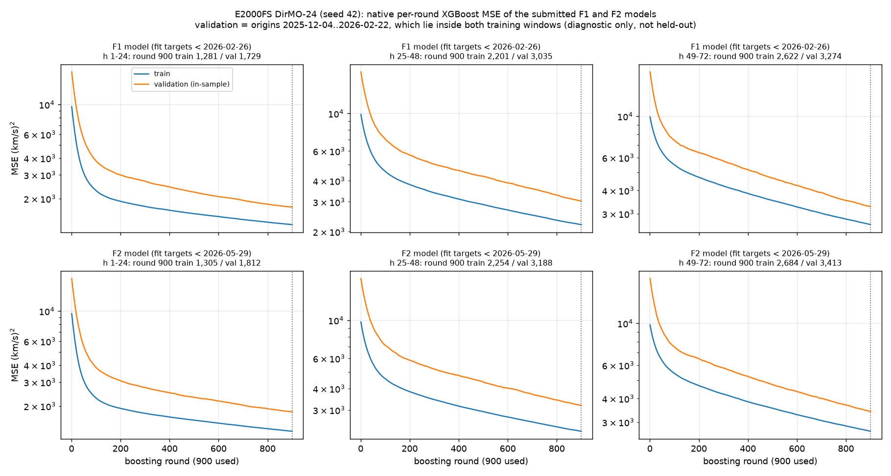
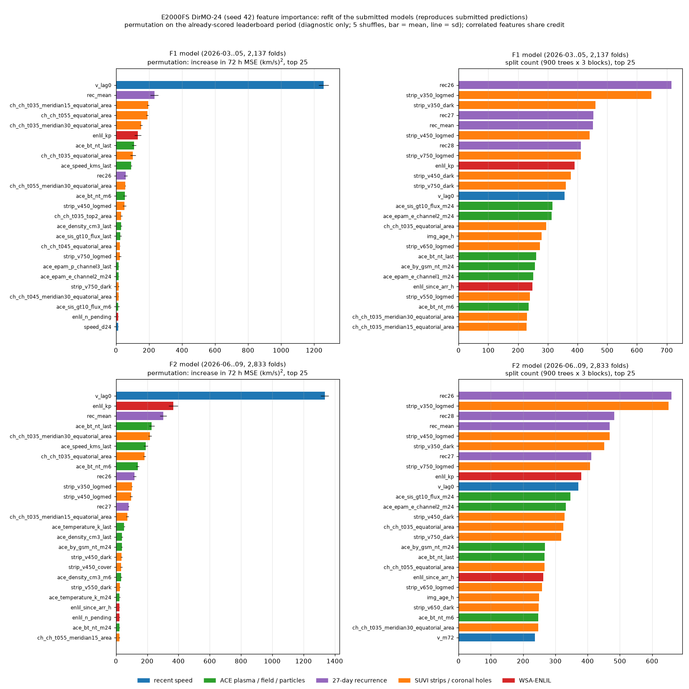

# E2000FS DirMO-24 — train·validation loss와 F1+F2 월별 예측 GIF

2026-10-27 기준 리더보드 **1위**, 작성자 **seongeun**인 `e2000fs_dirmo_24`입니다. E2000 입력(111 features, ACE lag 0)과 고정 XGBoost recipe(900 rounds, depth 3, lr 0.03, seed 42)로 24시간 블록별 독립 multi-output 모델 3개(h1–24 / h25–48 / h49–72)를 학습한 DirMO(σ=24) 전략입니다. 제출 설정 SHA256은 `6fc76b1836f3a22669108823c6bf6833082b4d9a74bedf80edd8199f66183037`이며, 재현 소스는 [releases/e2000fs/dirmo_24](../../../releases/e2000fs/dirmo_24/)에 있습니다.

| 지표 | 값 |
| --- | ---: |
| MSE (F1 + F2, 순위 기준) | **3480.270151** |
| F1 MSE (2026-03..05, 2,137 folds) | 3878.876144 |
| F2 MSE (2026-06..09, 2,833 folds) | 3179.592068 |

## Train·validation loss

실제 제출 예측을 만든 두 모델의 **학습 중 기록한 XGBoost per-round loss**(`evals_result`)입니다. 사후 재구성이 아니며, smoothing 없이 원래 값을 표시합니다.

- 위 행 **F1 모델**: target 시점 < 2026-02-26 데이터로 학습 → F1 예측.
- 아래 행 **F2 모델**: target 시점 < 2026-05-29 데이터로 학습 → F2 예측.
- 열은 24시간 블록(h1–24 / h25–48 / h49–72), 파란색은 train MSE, 주황색은 validation MSE, 점선은 사용한 900 round입니다.
- **주의: validation은 held-out이 아닙니다.** validation 구간(origin 2025-12-04 ~ 2026-02-22, 타깃은 ffill된 ACE 속도)은 두 모델의 학습 구간 안에 들어 있습니다. 학습 데이터 일부를 따로 평가한 **진단용 곡선**이므로 일반화 성능이나 조기 종료 근거로 읽으면 안 됩니다. 900 rounds는 고정 recipe이며 이 곡선으로 고르지 않았습니다.

| 모델 | 블록 | train MSE (900) | validation MSE (900) |
| --- | --- | ---: | ---: |
| F1 | h1–24 | 1280.7 | 1728.8 |
| F1 | h25–48 | 2201.0 | 3035.0 |
| F1 | h49–72 | 2622.5 | 3274.2 |
| F2 | h1–24 | 1304.6 | 1812.5 |
| F2 | h25–48 | 2253.9 | 3188.2 |
| F2 | h49–72 | 2683.9 | 3413.4 |

원본 CSV(`step,train_mse,validation_mse`, (km/s)²)는 [loss_history/](loss_history/)에 있고, `analysis/forecast_strategies_e2000/outputs/loss_history/{f1,final}/DirMO-24/`와 바이트 단위로 같습니다. 그림은 [code/plot_loss.py](code/plot_loss.py)로 다시 만들 수 있습니다.

## Feature importance

제출 F1·F2 모델의 특징 중요도입니다. 위 행은 F1 모델, 아래 행은 F2 모델이고, 왼쪽은 permutation 중요도, 오른쪽은 split 횟수(각 상위 25개)입니다. 색은 특징 계열입니다.

**모델 재학습과 재현 확인.** 원래 학습한 booster는 저장되지 않아, 같은 recipe(seed 42, 900 rounds)로 F1·F2 단계의 블록 모델 6개를 다시 학습했습니다. 다시 학습한 예측은 저장된 제출 예측과 **완전히 같고(최대 차이 0 km/s)**, MSE도 리더보드 값(F1 3878.876144, F2 3179.592068)과 일치합니다. 일치하지 않으면 계산을 멈추도록 했습니다. 기록은 [feature_importance_receipt.json](feature_importance_receipt.json)에 있습니다.

- 2026-10-27 14:44 이후 작업 공간의 `leaderboard/experiments/e2000` 등 소스가 깨진 링크로 바뀌어, 재학습은 2026-10-26에 컴파일된 `.pyc`로 `experiments.e2000`과 `experiments.cumulative_20261024`를 불러왔습니다(`--pyc-shim`). 사용한 `.pyc`의 SHA256은 receipt에 있습니다. 결과가 제출 예측과 바이트 단위로 일치하므로 원 코드와 같은 모델입니다.

**계산 방법.** XGBoost 2.1.4는 multi-output tree에서 gain 중요도(`get_score`)와 SHAP(`pred_contribs`)을 계산하면 segfault가 나서 직접 계산했습니다.

- **split 횟수**: booster JSON의 내부 노드가 어느 특징으로 나뉘었는지 세어, 블록 3개(h1–24 / h25–48 / h49–72)를 합쳤습니다. 모델 안에서 얼마나 자주 쓰였는지를 보여 줄 뿐, 예측 기여도와는 다릅니다.
- **permutation**: 각 모델의 리더보드 구간(F1 모델은 F1 2,137 folds, F2 모델은 F2 2,833 folds)에서 한 특징을 origin 사이에 섞었을 때 72시간 MSE가 늘어난 양입니다. 5번 섞은 평균 ± 표준편차입니다. 이미 채점·공개된 구간이므로 **진단용**이며 모델 선택에 쓰지 않았습니다.
- 블록 모델 입력 594열은 origin 특징 90개, 최근 24시간 속도(`speed_t-0`..`speed_t-23`), horizon 특징 20개 × 24 horizon입니다. horizon 특징의 24개 복사본은 한 특징으로 묶어 함께 세고 함께 섞었습니다. 총 134개 특징입니다.
- 서로 상관된 특징은 중요도를 나눠 가집니다. 예를 들어 `v_lag0`과 `speed_t-0`은 완전히 같은 값(origin 시각 속도)입니다. 모델은 주로 `v_lag0`으로 분할하고(F2 371회 대 30회), 하나만 섞으면 다른 하나가 일부를 대신하므로 둘 다 실제보다 작게 나옵니다. 리더보드 구간 안에서도 계절성이 달라 F1과 F2의 순위가 조금 다릅니다.

### permutation 상위 10개 — F1 모델 (2026-03..05)

| 순위 | 특징 | ΔMSE (km/s)² | split 횟수 (순위) |
| ---: | --- | ---: | ---: |
| 1 | `v_lag0` | 1,257.8 ± 31.4 | 356 (12위) |
| 2 | `rec_mean` | 232.7 ± 24.0 | 452 (5위) |
| 3 | `ch_ch_t035_meridian15_equatorial_area` | 194.9 ± 5.9 | 228 (25위) |
| 4 | `ch_ch_t055_equatorial_area` | 189.5 ± 6.1 | 200 (32위) |
| 5 | `ch_ch_t035_meridian30_equatorial_area` | 152.5 ± 7.0 | 230 (24위) |
| 6 | `enlil_kp` | 132.1 ± 19.6 | 390 (9위) |
| 7 | `ace_bt_nt_last` | 109.4 ± 13.5 | 261 (18위) |
| 8 | `ch_ch_t035_equatorial_area` | 102.2 ± 16.8 | 294 (15위) |
| 9 | `ace_speed_kms_last` | 92.4 ± 4.4 | 105 (67위) |
| 10 | `rec26` | 58.5 ± 10.4 | 716 (1위) |

### permutation 상위 10개 — F2 모델 (2026-06..09)

| 순위 | 특징 | ΔMSE (km/s)² | split 횟수 (순위) |
| ---: | --- | ---: | ---: |
| 1 | `v_lag0` | 1,336.3 ± 25.7 | 371 (10위) |
| 2 | `enlil_kp` | 366.1 ± 29.1 | 380 (9위) |
| 3 | `rec_mean` | 302.6 ± 21.9 | 469 (4위) |
| 4 | `ace_bt_nt_last` | 229.1 ± 16.6 | 266 (17위) |
| 5 | `ch_ch_t035_meridian30_equatorial_area` | 217.6 ± 11.3 | 247 (23위) |
| 6 | `ace_speed_kms_last` | 190.2 ± 13.3 | 108 (66위) |
| 7 | `ch_ch_t035_equatorial_area` | 181.9 ± 7.4 | 325 (14위) |
| 8 | `ace_bt_nt_m6` | 138.8 ± 9.0 | 247 (23위) |
| 9 | `rec26` | 119.6 ± 9.8 | 660 (1위) |
| 10 | `strip_v350_logmed` | 101.9 ± 3.1 | 651 (2위) |

최근 속도(`v_lag0`)가 가장 크고, 27일 재귀 평균(`rec_mean`), 적도 부근 coronal hole 면적, WSA-ENLIL의 Kp(`enlil_kp`), IMF 세기(`ace_bt_nt_last`)가 뒤를 잇습니다. split 횟수는 27일 재귀(`rec26`)와 SUVI strip이 가장 많지만, 이 특징들을 섞었을 때 MSE 증가는 상대적으로 작습니다.

전체 값(134개 × 2 모델)은 [feature_importance.csv](feature_importance.csv), 계산 코드는 [code/feature_importance.py](code/feature_importance.py)에 있습니다.

## 월별 예측 GIF (F1 + F2)

| 기간 | 월 | 프레임 | GIF |
| --- | --- | ---: | --- |
| F1 | 2026-03 | 744 | [validation_2026-03.gif](validation_2026-03.gif) |
| F1 | 2026-04 | 720 | [validation_2026-04.gif](validation_2026-04.gif) |
| F1 | 2026-05 | 673 | [validation_2026-05.gif](validation_2026-05.gif) |
| F2 | 2026-06 | 720 | [validation_2026-06.gif](validation_2026-06.gif) |
| F2 | 2026-07 | 744 | [validation_2026-07.gif](validation_2026-07.gif) |
| F2 | 2026-08 | 744 | [validation_2026-08.gif](validation_2026-08.gif) |
| F2 | 2026-09 | 625 | [validation_2026-09.gif](validation_2026-09.gif) |

리더보드에 실제 제출한 예측 파일(단일 seed 42)을 그대로 읽습니다. 각 프레임은 공식 평가 시작점 하나이며, 파란 선은 시작점까지 최근 **168시간 관측**, 검은 선은 이후 **72시간 실제값**, 주황 선은 제출 예측입니다. 빈 원은 원 관측이 없어 채워진 지점입니다. 제목에 전체 폴드 번호(4,970개 중), UTC 시작 시각, 해당 72시간 RMSE를 표시합니다. h24·h48 경계의 계단은 블록별 독립 모델(DirMO-24)이기 때문입니다.

첫 예측 시각(`origin+1h`)의 UTC 월로 나누고 시간순으로 재생합니다. 1000×500, 200~850 km/s 고정 Y축, 100ms/프레임, 무한 반복입니다. 2026-05-29 ~ 05-31은 72시간 창이 F1·F2 경계에 걸쳐 어느 기간에도 속하지 않으므로 5월 프레임이 673개입니다. 관측 7일은 표시 구간일 뿐 모델의 전체 입력 특성을 나타내지는 않습니다.

## 검증 ([manifest.json](manifest.json))

`scripts/visualize_enlil_validation.py --experiment E2000FS_DIRMO24`로 렌더링했습니다. 렌더러는 예측·truth가 4,970 origin × h1..72에 정확히 1:1로 대응하는지, 다시 계산한 MSE가 리더보드 값 3480.2701508981454와 1e-7 이내로 일치하는지, 월별 프레임 수와 GIF 디코딩이 맞는지 확인하며, 하나라도 어긋나면 멈춥니다. 입력 파일과 GIF의 SHA256은 manifest에 기록했습니다. 학습이나 예측 변경은 하지 않았습니다.
