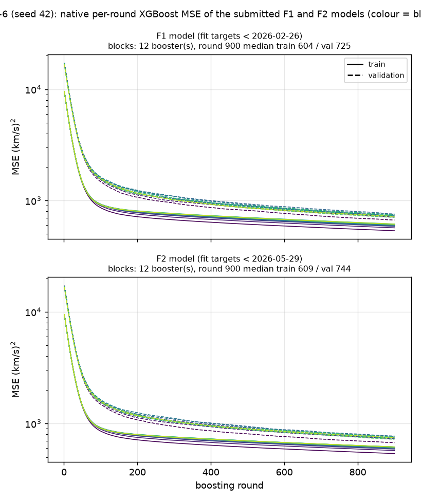
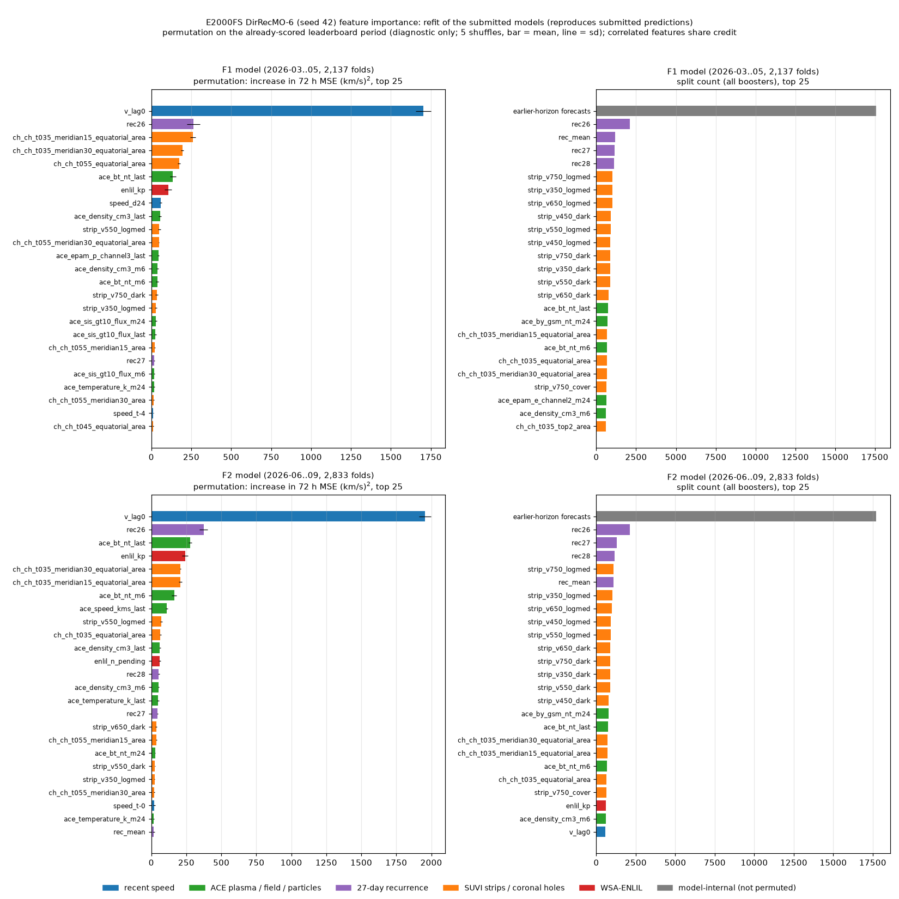

# E2000FS DirRecMO-6 — Train·validation loss, feature importance, F1+F2 월별 예측 GIF

2026-10-27 게시 기준 리더보드 **10위**, 작성자 **seongeun**인 `e2000fs_dirrecmo_6`입니다. E2000 입력(111 features, ACE lag 0)과 고정 XGBoost recipe(900 rounds, depth 3, lr 0.03, seed 42)로 학습한 72시간을 6시간 블록으로 나눠 블록마다 모델을 두고 앞선 블록의 예측을 입력에 넣는 DirRecMO(σ=6) 전략입니다. 제출 설정 SHA256은 `c9dd83a2ebd684551c60c551951f4f98188c6effd0984666fe00882738498c50`이며, 재현 소스는 [releases/e2000fs/dirrecmo_6](../../../releases/e2000fs/dirrecmo_6/)에 있습니다.

| 지표 | 값 |
| --- | ---: |
| MSE (F1 + F2, 순위 기준) | **3606.352259** |
| F1 MSE (2026-03..05, 2,137 folds) | 3925.123783 |
| F2 MSE (2026-06..09, 2,833 folds) | 3365.895236 |

## Train·validation loss

실제 제출 예측을 만든 F1·F2 모델의 **학습 중 기록한 XGBoost per-round loss**(`evals_result`)입니다. 사후 재구성이 아니며, smoothing 없이 원래 값을 표시합니다. 실선은 train, 점선은 validation이고 색은 블록·horizon 순서입니다.

- 위 행 **F1 모델**: target 시점 < 2026-02-26 데이터로 학습 → F1 예측.
- 아래 행 **F2 모델**: target 시점 < 2026-05-29 데이터로 학습 → F2 예측.
- **주의: validation은 held-out이 아닙니다.** validation 구간(origin 2025-12-04 ~ 2026-02-22, 타깃은 ffill된 ACE 속도)은 두 모델의 학습 구간 안에 들어 있습니다. 진단용 곡선이며 900 rounds는 고정 recipe로, 이 곡선으로 고르지 않았습니다.

| 모델 | 역할 | booster 수 | train MSE 중앙값 (최소–최대) | validation MSE 중앙값 (최소–최대) |
| --- | --- | ---: | ---: | ---: |
| F1 | blocks | 12 | 604.4 (535.5–616.3) | 725.2 (668.0–755.8) |
| F2 | blocks | 12 | 609.4 (538.4–617.3) | 743.8 (673.2–771.4) |

값은 마지막 round 기준이며 단위는 (km/s)²입니다. 원본 CSV(`step,train_mse,validation_mse`)는 [loss_history/](loss_history/)에 있고 study 출력과 바이트 단위로 같습니다. 그림은 [code/plot_loss.py](code/plot_loss.py)로 다시 만들 수 있습니다.

## Feature importance

제출 F1·F2 모델의 특징 중요도입니다. 위 행은 F1 모델, 아래 행은 F2 모델이고, 왼쪽은 permutation 중요도, 오른쪽은 split 횟수(각 상위 25개)입니다. 색은 특징 계열입니다.

**모델 재학습과 재현 확인.** 원래 학습한 booster는 저장되지 않아, 같은 recipe(seed 42, 900 rounds)로 F1·F2 단계 모델(booster F1 12개, F2 12개)을 다시 학습했습니다. 다시 학습한 예측은 저장된 제출 예측과 최대 차이 0.0e+00 km/s로 같고, MSE도 리더보드 값(F1 3925.123783, F2 3365.895236)과 일치합니다. 일치하지 않으면 계산을 멈추도록 했습니다. 기록은 [feature_importance_receipt.json](feature_importance_receipt.json)에 있습니다.

**계산 방법.**

- **split 횟수**: 제출 예측을 만드는 모든 booster의 내부 노드가 어느 입력으로 나뉘었는지 셌습니다. 모델 안에서 얼마나 자주 쓰였는지를 보여 줄 뿐, 예측 기여도와는 다릅니다.
- **permutation**: 각 모델의 리더보드 구간(F1 모델은 F1 2,137 folds, F2 모델은 F2 2,833 folds)에서 한 특징을 origin 사이에 섞었을 때 72시간 MSE가 늘어난 양입니다. 5번 섞은 평균 ± 표준편차입니다. **전략 전체를 다시 실행**하므로 반복·residual 경로로 퍼지는 영향까지 포함합니다. 이미 채점·공개된 구간이므로 **진단용**이며 모델 선택에 쓰지 않았습니다.
- 서로 상관된 특징은 중요도를 나눠 가집니다(예: `v_lag0`과 `speed_t-0`은 같은 값).
- 회색 막대는 모델 내부 입력(자기 예측 궤적, 앞선 horizon 예측, lead, base 예측)입니다. 원 입력이 아니어서 섞지 않았고 split 횟수만 표시합니다.

### permutation 상위 10개 — F1 모델 (2026-03..05)

| 순위 | 특징 | ΔMSE (km/s)² | split 횟수 (순위) |
| ---: | --- | ---: | ---: |
| 1 | `v_lag0` | 1,703.0 ± 48.1 | 587 (28위) |
| 2 | `rec26` | 263.4 ± 39.8 | 2,121 (2위) |
| 3 | `ch_ch_t035_meridian15_equatorial_area` | 260.6 ± 15.8 | 685 (18위) |
| 4 | `ch_ch_t035_meridian30_equatorial_area` | 194.3 ± 9.1 | 654 (21위) |
| 5 | `ch_ch_t055_equatorial_area` | 173.3 ± 8.1 | 456 (51위) |
| 6 | `ace_bt_nt_last` | 135.3 ± 17.5 | 753 (16위) |
| 7 | `enlil_kp` | 105.1 ± 20.9 | 580 (29위) |
| 8 | `speed_d24` | 59.8 ± 7.6 | 492 (44위) |
| 9 | `ace_density_cm3_last` | 53.8 ± 7.4 | 515 (40위) |
| 10 | `strip_v550_logmed` | 49.1 ± 8.7 | 908 (10위) |

### permutation 상위 10개 — F2 모델 (2026-06..09)

| 순위 | 특징 | ΔMSE (km/s)² | split 횟수 (순위) |
| ---: | --- | ---: | ---: |
| 1 | `v_lag0` | 1,955.4 ± 42.8 | 584 (25위) |
| 2 | `rec26` | 373.6 ± 29.7 | 2,127 (2위) |
| 3 | `ace_bt_nt_last` | 276.7 ± 10.9 | 739 (17위) |
| 4 | `enlil_kp` | 241.4 ± 20.9 | 606 (23위) |
| 5 | `ch_ch_t035_meridian30_equatorial_area` | 208.6 ± 3.6 | 710 (18위) |
| 6 | `ch_ch_t035_meridian15_equatorial_area` | 206.5 ± 12.5 | 702 (19위) |
| 7 | `ace_bt_nt_m6` | 164.0 ± 17.1 | 672 (20위) |
| 8 | `ace_speed_kms_last` | 109.2 ± 7.0 | 146 (103위) |
| 9 | `strip_v550_logmed` | 70.8 ± 9.0 | 901 (10위) |
| 10 | `ch_ch_t035_equatorial_area` | 65.1 ± 5.3 | 654 (21위) |

전체 값은 [feature_importance.csv](feature_importance.csv), 계산 코드는 [code/feature_importance.py](code/feature_importance.py)에 있습니다.

## 월별 예측 GIF (F1 + F2)

| 기간 | 월 | 프레임 | GIF |
| --- | --- | ---: | --- |
| F1 | 2026-03 | 744 | [validation_2026-03.gif](validation_2026-03.gif) |
| F1 | 2026-04 | 720 | [validation_2026-04.gif](validation_2026-04.gif) |
| F1 | 2026-05 | 673 | [validation_2026-05.gif](validation_2026-05.gif) |
| F2 | 2026-06 | 720 | [validation_2026-06.gif](validation_2026-06.gif) |
| F2 | 2026-07 | 744 | [validation_2026-07.gif](validation_2026-07.gif) |
| F2 | 2026-08 | 744 | [validation_2026-08.gif](validation_2026-08.gif) |
| F2 | 2026-09 | 625 | [validation_2026-09.gif](validation_2026-09.gif) |

리더보드에 실제 제출한 예측 파일(단일 seed 42)을 그대로 읽습니다. 각 프레임은 공식 평가 시작점 하나이며, 파란 선은 시작점까지 최근 **168시간 관측**, 검은 선은 이후 **72시간 실제값**, 주황 선은 제출 예측입니다. 빈 원은 원 관측이 없어 채워진 지점입니다. 제목에 전체 폴드 번호(4,970개 중), UTC 시작 시각, 해당 72시간 RMSE를 표시합니다.

첫 예측 시각(`origin+1h`)의 UTC 월로 나누고 시간순으로 재생합니다. 1000×500, 200~850 km/s 고정 Y축, 100ms/프레임, 무한 반복입니다. 2026-05-29 ~ 05-31은 72시간 창이 F1·F2 경계에 걸쳐 어느 기간에도 속하지 않으므로 5월 프레임이 673개입니다.

## 검증 ([manifest.json](manifest.json))

`scripts/visualize_enlil_validation.py --experiment E2000FS_DIRRECMO_6`로 렌더링했습니다. 렌더러는 예측·truth가 4,970 origin × h1..72에 정확히 1:1로 대응하는지, 다시 계산한 MSE가 리더보드 값 3606.352259102138와 1e-7 이내로 일치하는지, 월별 프레임 수와 GIF 디코딩이 맞는지 확인하며, 하나라도 어긋나면 멈춥니다. 입력 파일과 GIF의 SHA256은 manifest에 기록했습니다. 학습이나 예측 변경은 하지 않았습니다.
