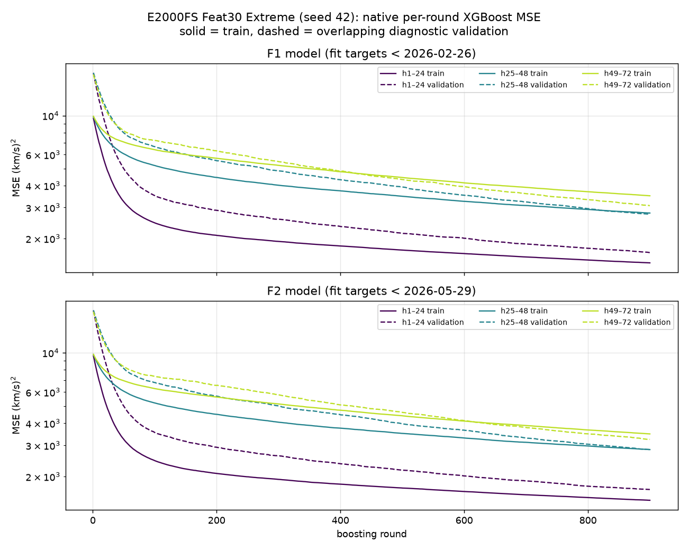
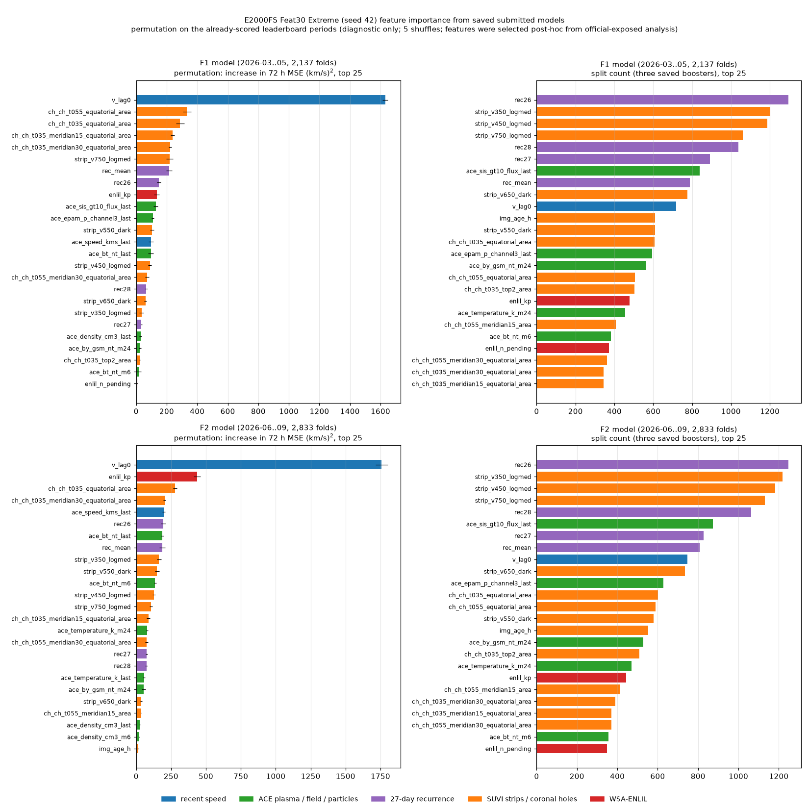

# E2000FS Feat30 Extreme — train·validation loss, feature importance, F1+F2 월별 예측 GIF

2026-10-28 게시 기준 리더보드 **14위**, 작성자 **seongeun**인 `e2000fs_feat30_extreme`입니다. E2000FS DirMO-24의 30개 선택 특징과 고정 XGBoost recipe(900 rounds, depth 3, lr 0.03, seed 42)를 쓰되, 고속 태양풍 또는 급상승 trajectory에 4배 sample weight를 주는 모델입니다. 24시간 블록별 multi-output booster 3개가 h1–24 / h25–48 / h49–72를 예측합니다. 제출 설정 SHA256은 `b9ec31f54e3f29e5260937bb77ed4215650e592e8021129e920ab64aa4e46cb1`이며, 공개 재현 소스는 [제출 스크립트](../../../scripts/seongeun/e2000fs_feat30_extreme/b9ec31f54e3f29e5260937bb77ed4215650e592e8021129e920ab64aa4e46cb1.py)와 [release](../../../releases/e2000fs_followups_20261028/extreme/)에 있습니다.

> **공개 평가 노출 주의.** 30개 특징은 이미 채점된 공식 F1/F2 permutation importance를 이용해 사후 선택했습니다. 이 결과는 fresh holdout 성능이 아닙니다. `extreme_4.0` arm 자체는 공식 점수가 아니라 2025-12-04~2026-02-22 내부 validation에서 `extreme_2.0`과 비교해 선택했습니다.

| 지표 | 값 |
| --- | ---: |
| MSE (F1 + F2, 순위 기준) | **3585.635750** |
| F1 MSE (2026-03..05, 2,137 folds) | 4025.011233 |
| F2 MSE (2026-06..09, 2,833 folds) | 3254.204262 |
| MSE, 실제값 ≥550 km/s | 6811.733771 |
| CSI, 550 km/s event | 0.082627 |

## Train·validation loss

실제 제출 예측을 만든 저장 booster 6개의 **학습 중 기록한 XGBoost per-round loss**입니다. smoothing이나 사후 재구성 없이 원래 로그를 표시했습니다. 실선은 train, 점선은 validation이고 색은 24시간 블록입니다.

- 위 행 **F1 모델**: target 시점 < 2026-02-26 데이터로 학습 → F1 예측.
- 아래 행 **F2 모델**: target 시점 < 2026-05-29 데이터로 학습 → F2 예측.
- **주의: 이 validation은 held-out이 아닙니다.** 2025-12-04~2026-02-22 구간은 F1·F2 모델 학습 구간과 겹칩니다. 제출 모델의 학습 진단용이며 일반화 성능이나 early stopping 근거로 읽으면 안 됩니다. 900 rounds는 고정 recipe입니다.

| 모델 | 블록 | train MSE (round 900) | validation MSE (round 900) |
| --- | --- | ---: | ---: |
| F1 | h1–24 | 1452.3 | 1661.5 |
| F1 | h25–48 | 2789.3 | 2746.8 |
| F1 | h49–72 | 3497.3 | 3072.5 |
| F2 | h1–24 | 1467.3 | 1688.0 |
| F2 | h25–48 | 2838.0 | 2838.4 |
| F2 | h49–72 | 3479.2 | 3239.1 |

요약 값은 [loss_summary.csv](loss_summary.csv), 원본 로그는 [loss_history/](loss_history/)에 있습니다. 그림은 [code/plot_loss.py](code/plot_loss.py)로 다시 만들 수 있습니다.

## Feature importance

제출 F1·F2 모델의 특징 중요도입니다. 위 행은 F1, 아래 행은 F2이고, 왼쪽은 permutation 중요도, 오른쪽은 split 횟수(각 상위 25개)입니다.

**저장된 제출 모델 검증.** 원 학습에서 저장한 booster 6개를 그대로 사용했습니다. booster 예측은 제출 예측과 최대 차이 **0 km/s**로 같고, 재계산 MSE도 F1 `4025.011233`, F2 `3254.204262`로 리더보드 값과 일치한 뒤에만 중요도를 계산했습니다. 모델 SHA256과 검증 값은 [feature_importance_receipt.json](feature_importance_receipt.json)에 있습니다.

**계산 방법.** 30개 특징은 이미 공식 평가를 본 뒤 고른 집합이므로 아래 값 역시 **진단용**입니다.

- **split 횟수**: 세 block booster의 내부 노드가 어느 특징으로 분기했는지 합산했습니다.
- **permutation**: F1/F2 각 공식 구간에서 한 특징을 origin 사이에 섞고 전체 72시간 예측 MSE가 증가한 양입니다. 5번 섞은 평균 ± 표준편차입니다. horizon-varying 특징은 해당 block의 24개 복사본을 함께 섞었습니다.
- 상관된 특징은 중요도를 나눠 가집니다. 특히 `v_lag0`과 `ace_speed_kms_last`는 같은 시각의 속도 정보를 중복해서 담습니다.

### permutation 상위 10개 — F1 모델 (2026-03..05)

| 순위 | 특징 | ΔMSE (km/s)² | split 횟수 (순위) |
| ---: | --- | ---: | ---: |
| 1 | `v_lag0` | 1,630.3 ± 17.9 | 717 (10위) |
| 2 | `ch_ch_t055_equatorial_area` | 332.8 ± 26.5 | 506 (16위) |
| 3 | `ch_ch_t035_equatorial_area` | 287.1 ± 27.5 | 607 (13위) |
| 4 | `ch_ch_t035_meridian15_equatorial_area` | 237.5 ± 13.0 | 344 (24위) |
| 5 | `ch_ch_t035_meridian30_equatorial_area` | 222.2 ± 9.2 | 344 (24위) |
| 6 | `strip_v750_logmed` | 218.0 ± 22.4 | 1,061 (4위) |
| 7 | `rec_mean` | 215.8 ± 20.0 | 789 (8위) |
| 8 | `rec26` | 149.0 ± 13.9 | 1,295 (1위) |
| 9 | `enlil_kp` | 134.4 ± 16.4 | 477 (18위) |
| 10 | `ace_sis_gt10_flux_last` | 127.8 ± 13.9 | 840 (7위) |

### permutation 상위 10개 — F2 모델 (2026-06..09)

| 순위 | 특징 | ΔMSE (km/s)² | split 횟수 (순위) |
| ---: | --- | ---: | ---: |
| 1 | `v_lag0` | 1,758.5 ± 44.5 | 747 (9위) |
| 2 | `enlil_kp` | 438.1 ± 24.5 | 444 (19위) |
| 3 | `ch_ch_t035_equatorial_area` | 277.0 ± 13.8 | 601 (12위) |
| 4 | `ch_ch_t035_meridian30_equatorial_area` | 204.3 ± 8.7 | 390 (21위) |
| 5 | `ace_speed_kms_last` | 198.6 ± 11.2 | 240 (30위) |
| 6 | `rec26` | 193.1 ± 17.0 | 1,247 (1위) |
| 7 | `ace_bt_nt_last` | 187.9 ± 10.4 | 345 (26위) |
| 8 | `rec_mean` | 186.2 ± 20.9 | 808 (8위) |
| 9 | `strip_v350_logmed` | 163.9 ± 15.8 | 1,218 (2위) |
| 10 | `strip_v550_dark` | 149.8 ± 14.8 | 579 (14위) |

전체 값은 [feature_importance.csv](feature_importance.csv), 계산 코드는 [code/feature_importance.py](code/feature_importance.py)에 있습니다.

## 월별 예측 GIF (F1 + F2)

| 기간 | 월 | 프레임 | GIF |
| --- | --- | ---: | --- |
| F1 | 2026-03 | 744 | [validation_2026-03.gif](validation_2026-03.gif) |
| F1 | 2026-04 | 720 | [validation_2026-04.gif](validation_2026-04.gif) |
| F1 | 2026-05 | 673 | [validation_2026-05.gif](validation_2026-05.gif) |
| F2 | 2026-06 | 720 | [validation_2026-06.gif](validation_2026-06.gif) |
| F2 | 2026-07 | 744 | [validation_2026-07.gif](validation_2026-07.gif) |
| F2 | 2026-08 | 744 | [validation_2026-08.gif](validation_2026-08.gif) |
| F2 | 2026-09 | 625 | [validation_2026-09.gif](validation_2026-09.gif) |

리더보드에 실제 제출한 예측 파일(단일 seed 42)을 그대로 읽습니다. 각 프레임은 공식 평가 시작점 하나이며, 파란 선은 시작점까지 최근 **168시간 관측**, 검은 선은 이후 **72시간 실제값**, 주황 선은 제출 예측입니다. 빈 원은 원 관측이 없어 채워진 지점입니다. 제목에는 전체 fold 번호, UTC origin과 해당 72시간 RMSE를 표시합니다.

첫 예측 시각(`origin+1h`)의 UTC 월로 나누고 시간순으로 재생합니다. 1000×500, 200~850 km/s 고정 Y축, 100ms/프레임, 무한 반복입니다. 2026-05-29~31은 72시간 창이 F1·F2 경계에 걸쳐 어느 기간에도 속하지 않아 5월이 673프레임입니다. 표시한 168시간은 모델 입력 전체가 아니라 시계열 문맥을 확인하기 위한 공통 시각화 창입니다.

## 검증 ([manifest.json](manifest.json))

`scripts/visualize_enlil_validation.py --experiment E2000FS_FEAT30_EXTREME`로 렌더링했습니다. 렌더러는 예측·truth가 **4,970 origins × h1..72 = 357,840쌍**에 정확히 1:1 대응하는지, 재계산 MSE가 리더보드 값 `3585.6357500367762`와 1e-7 이내로 일치하는지, 월별 프레임 수와 모든 GIF 디코딩·크기·100ms duration·무한 반복 설정을 확인합니다. 입력 파일과 GIF SHA256은 manifest에 기록했습니다. 학습이나 예측 변경은 하지 않았습니다.
