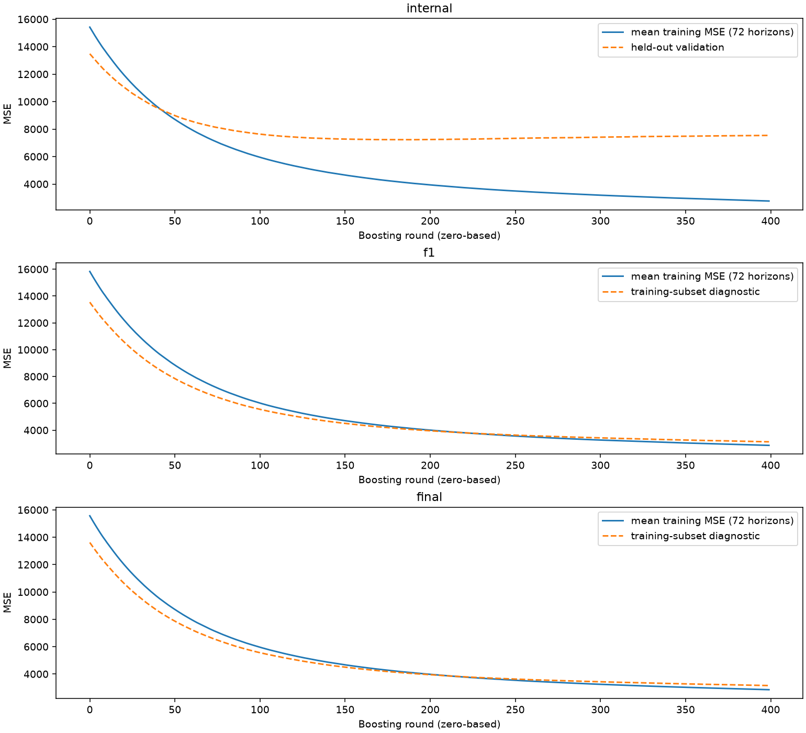
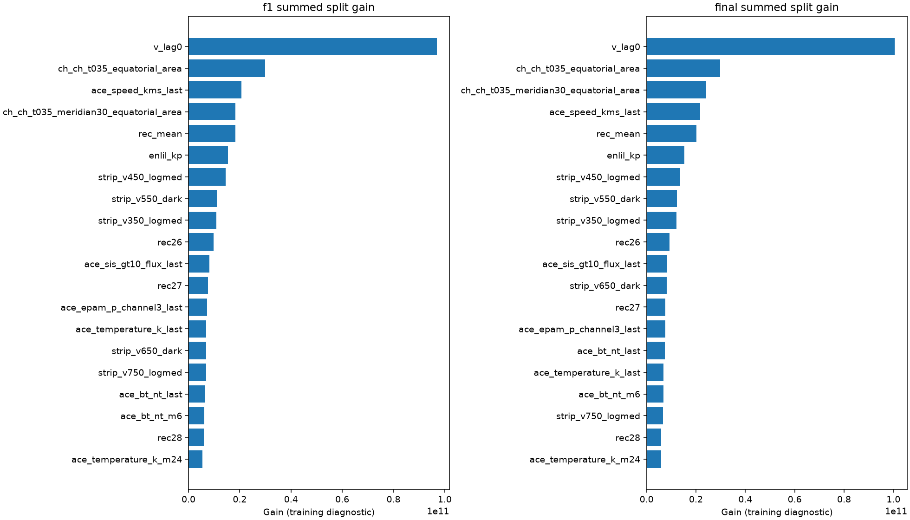
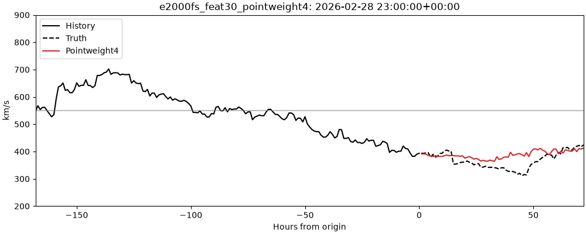
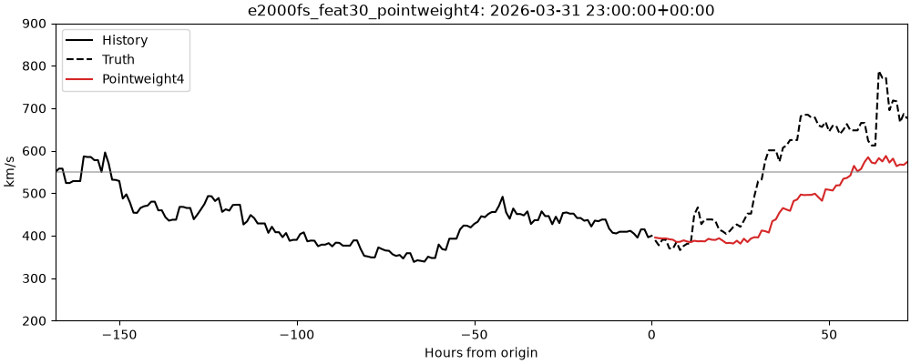
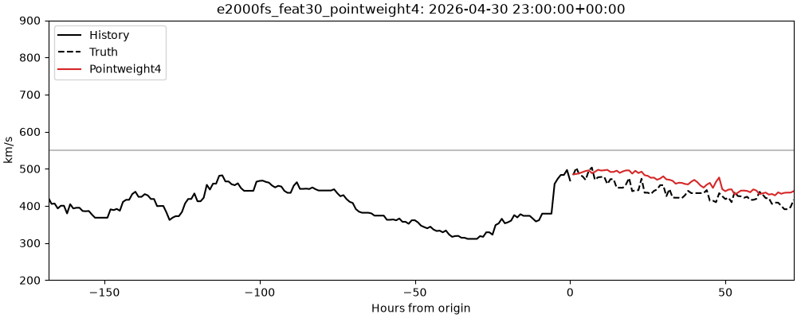
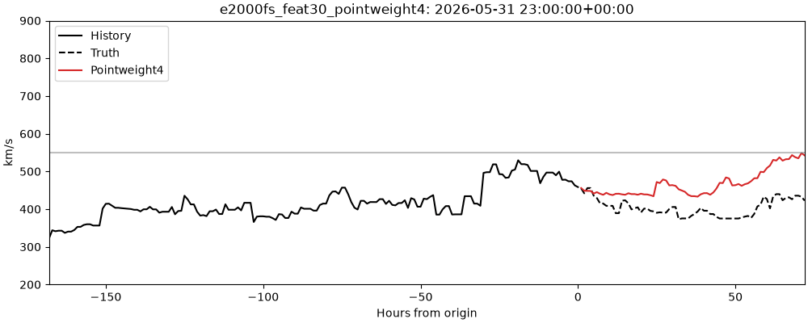
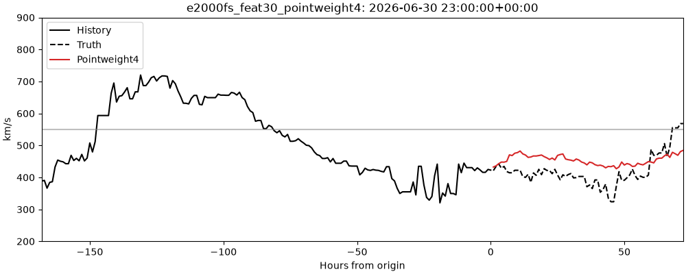
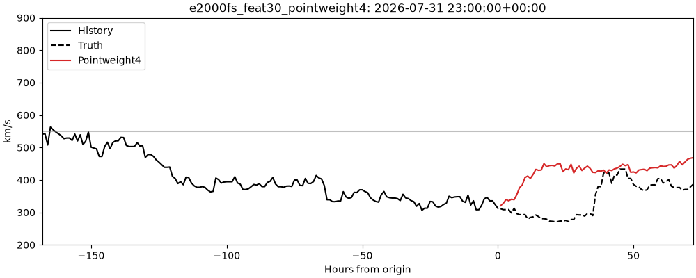
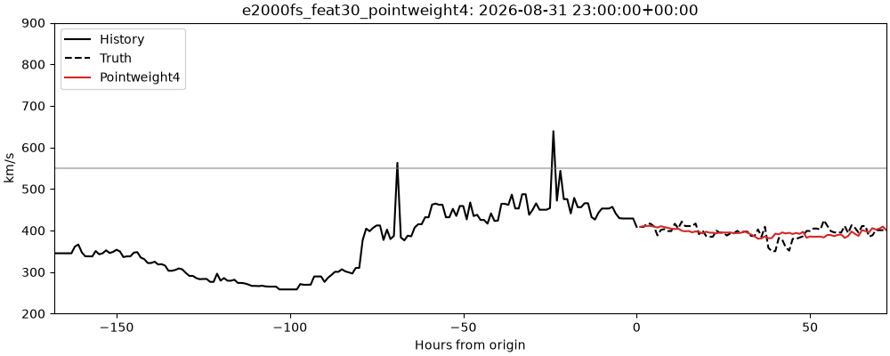

# E2000FS Feat30 Pointweight4

Pointwise extreme weighting: independent LightGBM horizons; training weight4 if this target >=550, else1, mean normalized. Same frozen HPO as distribution controls. Removes the previous block-wide ramp trigger. Both-region acceptance failed. Inherited Top30 features were selected using previously scored official periods; this is official-exposed post-hoc research, not a fresh holdout. Targets mature72h before cutoff; F1 cutoff2026-02-26, F2 cutoff2026-05-29. Published script replays hash-pinned forecasts, training source archived. Inference timing: saved CPU models, two threads, median3 batches of32 origins; excludes feature assembly, loading and I/O.

| Method | Overall MSE | <550 MSE | >=550 MSE |
|---|---:|---:|---:|
| L2 | 3296.694696 | 2340.519770 | 9401.722419 |
| Block extreme4 | 3728.771320 | 3256.817244 | 6742.124462 |
| Pointwise extreme4 | 3732.268939 | 3365.965969 | 6071.056247 |

High-speed MSE improved, but ordinary MSE worsened. Both-region acceptance failed. These are point estimates.

## Loss history

Internal validation is chronologically held out with a72h purge. F1/F2 dashed lines are training-subset diagnostics, not held-out validation. Curves average72 horizon models.

## Feature importance

Native LightGBM gain and split counts summed over72 models, grouped by feature. These are training diagnostics, not permutation or causal importance. Saved models reproduced all submitted predictions exactly.

## Monthly forecast GIFs

One frame per24 available origins within each month (daily sampling); full4970-origin forecasts are in the release. Y-axis200–900km/s.

### 2026-03

### 2026-04

### 2026-05

### 2026-06

### 2026-07

### 2026-08

### 2026-09

[Release](../../../releases/e2000fs_feat30_pointweight4/)
[Replay script](../../../scripts/seongeun/e2000fs_feat30_pointweight4/748016d3b57ae92ce90a989dfb038ae41deec4703a9282cc4498181a1d4a8def.py)

Reproduce publication diagnostics with code/publish.py in the original workspace; private input data and model weights are not published.
