# E2000FS Feat30 PointWeight4 TCN lb120 — lead 곡선 · 학습 loss · F1–F3 월별 예측 GIF

작성자 **seongeun**의 `e2000fs_feat30_pointweight4_tcn_lb120`입니다. 새 raw-only `df.parquet` + causal ffill 재실행(`research/rerun_df_ffill_20261103`)으로 제출됐습니다(제출 `20261103T063059846Z`). 게시 시점(2026-11-04) 리더보드 **1위 / 41**, Total S **100.00**입니다.

이 페이지의 모든 그림은 저장된 제출 예측(`predictions.parquet`)을 리더보드 채점기(`leaderboard/scorer/competition.py`, `lead-timse-6h-v1`)로 다시 채점한 값을 씁니다. 채점에 쓴 관측은 기록이 채점된 dataset revision `abfec4370b`의 `competition-observations.parquet`입니다. Total/F1/F2/F3의 S·TIMSE·RMSE·tRMSE·bias가 저장 기록과 **1e-9 이내로 같을 때만** 그림을 그립니다([manifest.json](manifest.json)). 재학습이나 후처리는 하지 않았습니다.

| 구간 | S | TIMSE | RMSE | tRMSE | bias | 채점 origin | 유효 pair |
| --- | ---: | ---: | ---: | ---: | ---: | ---: | ---: |
| **Total** | **100.00** | 16,565.4 | 78.57 | 127.50 | +24.1 | 1,052 | 52,619 |
| F1 (2026-01..03) | 107.32 | 16,874.3 | 91.78 | 126.52 | +33.9 | 348 | 17,674 |
| F2 (2026-04..06) | 96.61 | 13,882.1 | 80.11 | 116.76 | +20.1 | 352 | 17,473 |
| F3 (2026-07..09) | 67.63 | 6,131.3 | 61.30 | 75.45 | +18.3 | 352 | 17,472 |

단위는 km/s(TIMSE는 (km/s)²)입니다. 채점 origin은 00/06/12/18 UTC이며, 정답은 ACE status 0 관측을 채우지 않고 씁니다. 그래서 1,052 × 72 = 75,744 pair 중 69.5%만 유효합니다.

## 모델

- **구조**: TCN. 입력은 origin까지의 120시간 hourly 스냅샷(feat30 특징 30개)과 미래 특징 9개(`rec26–28`, `rec_mean`, `strip_v*`)입니다. width 64, kernel 3, dilations 1·2·4·8·16·32, dropout 0, 72개 lead를 직접 출력합니다.
- **손실**: point4. 목표 ≥ 550 km/s에 4배 가중을 주고, horizon별 유효 라벨로 정규화합니다. 남은 결측 라벨은 loss 0입니다.
- **학습**: Adam(lr 1e-3), batch 256, seed 42, CUDA FP32. 기간별 학습 cutoff는 F1 2025-12-29, F2 2026-03-29, F3 2026-06-29이고, 144시간 성숙 마스크를 씁니다. 학습 origin은 각각 26,908 / 29,068 / 31,276개입니다.
- **입력 규칙**: 관측은 causal ffill만, 이미지는 24시간 이내, ENLIL은 쓰지 않습니다. 학습 y는 target_time 기준으로 ffill하고, 공식 평가 정답은 바꾸지 않습니다.
- 원본 코드는 [architecture](https://github.com/TLAB-HGU/sunrun-leaderboard/blob/ddc45e4e0856fb8950d2d4a9f5c0bae2048a3d32/research/rerun_df_ffill_20261103/e2000fs_feat30_pointweight4_tcn_lb120/experiment.py)에 있습니다.

## 학습 loss — 세 기간 모두 1 epoch에서 멈춤

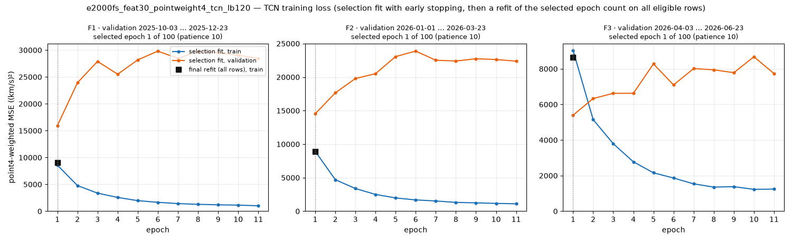

각 기간은 두 단계로 학습합니다.

1. **선택 학습**: 학습 구간 마지막 약 12주를 validation으로 떼고 최대 100 epoch, patience 10으로 학습합니다.
2. **최종 재학습**: 고른 epoch 수만큼 전체 학습 행으로 다시 학습합니다. 제출 예측은 이 재학습 모델에서 나왔습니다.

validation 구간은 F1 2025-10-03..12-23, F2 2026-01-01..03-23, F3 2026-04-03..06-23입니다. 모두 각 기간의 학습 cutoff보다 앞서므로 평가 구간의 정답은 쓰지 않습니다. 다만 F2·F3의 validation은 이미 공개된 앞 기간(F1·F2)과 겹칩니다.

곡선에서 읽히는 것:

- **세 기간 모두 validation loss가 1 epoch에서 가장 낮고, 2 epoch부터 오릅니다.**
  - F1: 15,922 → 23,928
  - F2: 14,528 → 17,655
  - F3: 5,399 → 6,330
  - 같은 구간에서 train loss는 1/8 수준까지 계속 내려갑니다. 그래서 제출 모델은 **모두 1 epoch만 학습한 TCN**입니다([loss_history.csv](loss_history.csv)).
- 1 epoch 이후 validation이 바로 나빠진다는 것은, 이 recipe(lr 1e-3, dropout 0, weight decay 0)에서는 두 번째 epoch부터 학습 구간에 과적합한다는 뜻입니다. 정규화를 바꾸면 더 좋아질지는 이 기록만으로 판단할 수 없습니다. 따로 통제 실험이 필요합니다.
- 1 epoch 모델이라 출력이 매끄럽고 수준은 높게 잡혀 있습니다. 전체 bias는 +24.1 km/s(과대예측)이고, F1이 +33.9로 가장 큽니다.

## Lead 곡선

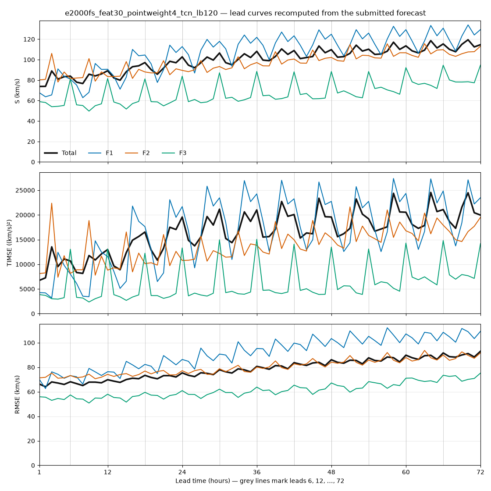

리더보드 lead curves 열과 같은 값입니다. 저장 기록을 쓰지 않고, 이 페이지에서 직접 다시 채점해 그렸습니다([lead_metrics.csv](lead_metrics.csv)).

- RMSE는 lead에 따라 매끄럽게 오릅니다. Total 기준 lead 1h 약 66 → 72h 약 93입니다.
- S와 TIMSE에는 **6시간 주기의 톱니**가 보입니다. F3에서 가장 뚜렷합니다([lead_residue.csv](lead_residue.csv)).

  | F3 lead | TIMSE 평균 | RMSE 평균 |
  | --- | ---: | ---: |
  | 6의 배수 (6, 12, …, 72) | 13,804.5 | 65.2 |
  | 그 밖의 lead | 4,322.8–4,865.1 | 57.8–61.7 |

  **톱니는 주로 정답 표본에서 생깁니다.** 채점 origin이 00/06/12/18 UTC라서, lead가 6의 배수이면 목표 시각도 00/06/12/18 UTC에만 놓입니다. F3에서 가장 빠른 관측 두 개가 바로 이 시각에 있습니다.
  - 743.4 km/s, 2026-09-15 18:00 UTC
  - 690.0 km/s, 2026-07-23 18:00 UTC

  그래서 이 두 값은 lead 6·k의 정답 모집단에만 들어갑니다. TIMSE는 정답 분포의 위쪽 꼬리를 무겁게 보는 지표라, 이 시점들의 큰 과소예측이 lead 6·k의 TIMSE를 끌어올립니다. 743.4 km/s 시점의 오차는 12개 origin에서 −225 ~ −312 km/s입니다. RMSE에는 거의 안 보입니다.

  두 관측을 빼고 다시 채점한 진단값(점수가 아님)은 다음과 같습니다. 대부분이 이 두 시점으로 설명됩니다.

  | 조건 | F3 lead 6·k TIMSE 평균 |
  | --- | ---: |
  | 원래 | 13,804.5 |
  | 743.4 제외 | 7,088 |
  | 두 관측 모두 제외 | 5,738 (다른 lead 4,323–4,865) |

  같은 채점 격자를 쓰는 모든 제출이 같은 영향을 받습니다. F1·F2의 톱니도 같은 구조인지는 이 페이지에서 따로 확인하지 않았습니다.

## 월별 예측 GIF

GIF 한 장의 프레임은 채점 origin 하나입니다. 각 프레임은 origin 직전 168시간의 관측(파랑), 이후 72시간의 정답(검정), 제출 예측(주황)을 Y축 200–850 km/s로 고정해 보여 줍니다. 관측과 정답은 ACE status 0 값만 쓰고, 결측은 **채우지 않고 비워 둡니다**. 그래서 끊긴 선과 점이 보입니다. 제목의 72h RMSE는 그 origin의 유효 정답 시간만으로 계산합니다. 프레임 간격은 250 ms이고, 9개월 합계 1,052 프레임으로 채점 origin 전체입니다.

| 월 | 기간 | 프레임 | GIF |
| --- | --- | ---: | --- |
| 2026-01 | F1 | 124 | 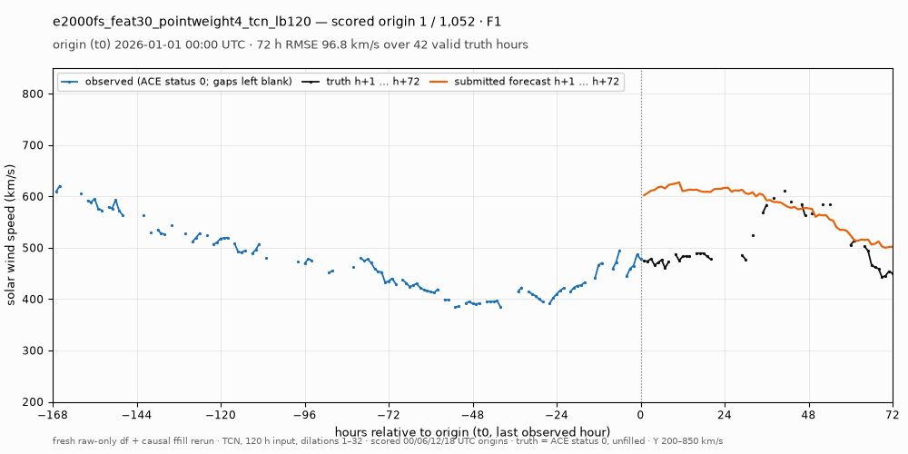 |
| 2026-02 | F1 | 112 | 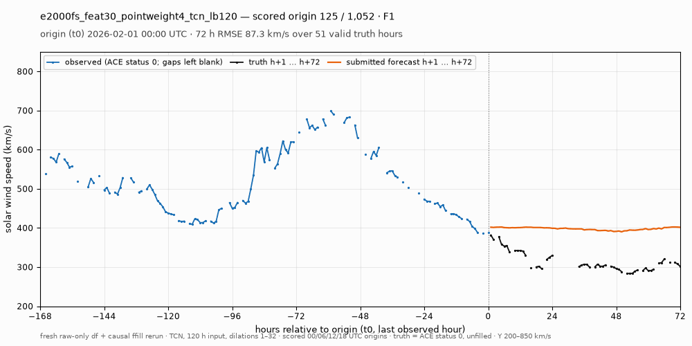 |
| 2026-03 | F1 | 112 | 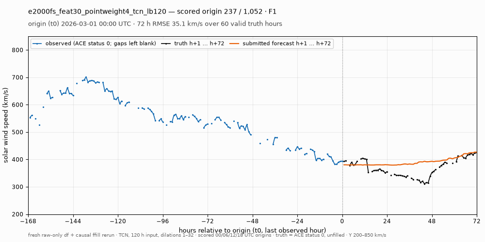 |
| 2026-04 | F2 | 120 | 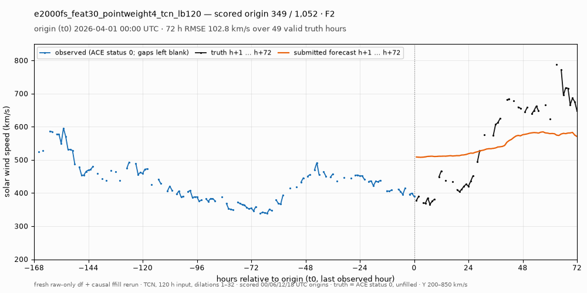 |
| 2026-05 | F2 | 124 | 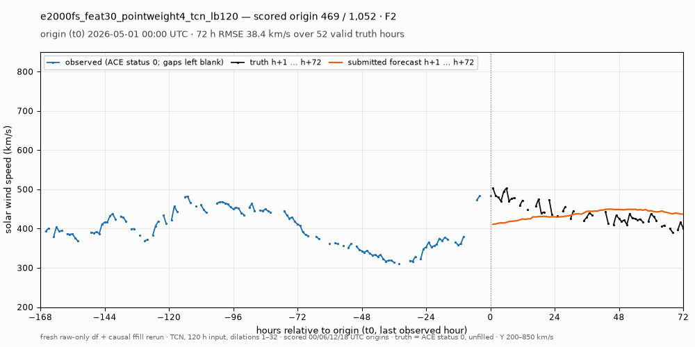 |
| 2026-06 | F2 | 108 | 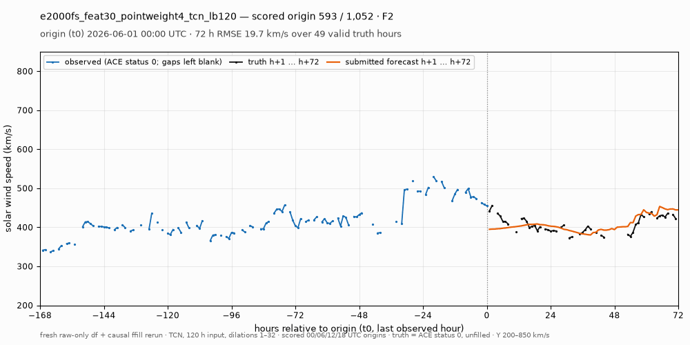 |
| 2026-07 | F3 | 124 | 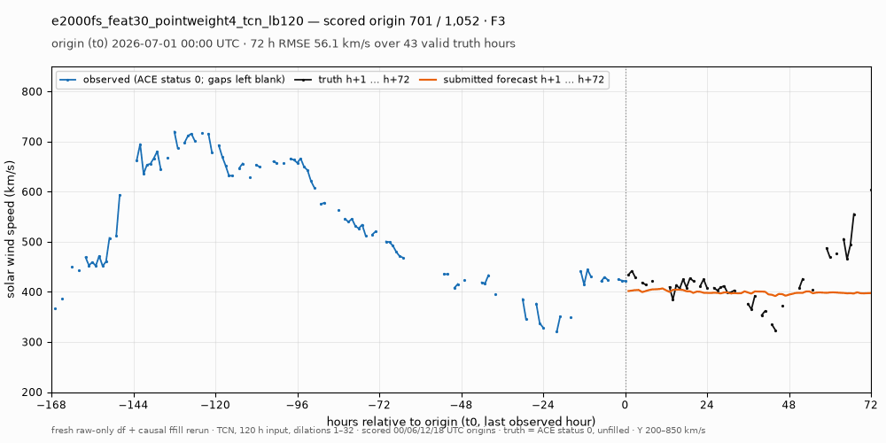 |
| 2026-08 | F3 | 124 | 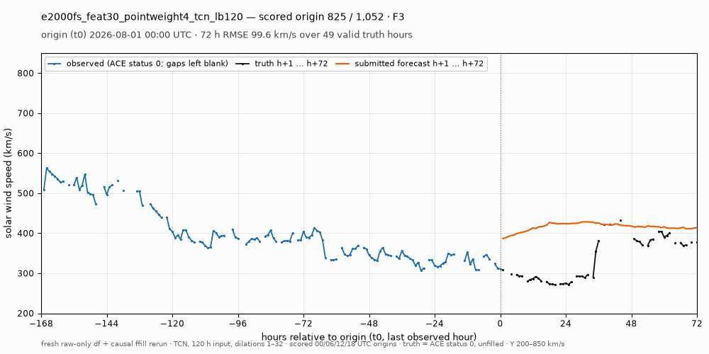 |
| 2026-09 | F3 | 104 | 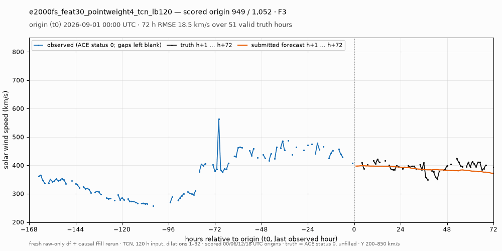 |

## 재현

```bash
/home/t-lab01/sunrun/.venv/bin/python docs/visualizations/e2000fs_feat30_pointweight4_tcn_lb120/code/render.py
```

CPU만 쓰며 약 3분 걸립니다. 입력은 `research/rerun_df_ffill_20261103/runs/e2000fs_feat30_pointweight4_tcn_lb120`의 `predictions.parquet`, `submission.json`, `F*_metadata.json`, `F*_selection_loss.csv`, `F*_train_loss.csv`와 리더보드 dataset의 `competition-observations.parquet`(revision `abfec4370bff2fc5d4b791c23fda1fc2931f5cab`)입니다. [leaderboard-result.json](leaderboard-result.json)은 저장 기록에서 제출 키와 그 키를 담은 URL을 뺀 사본입니다.
