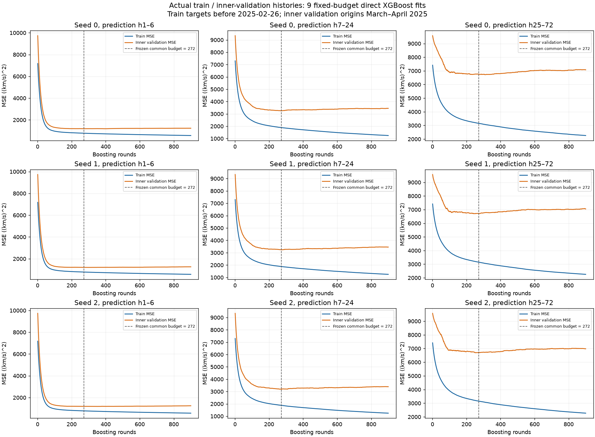
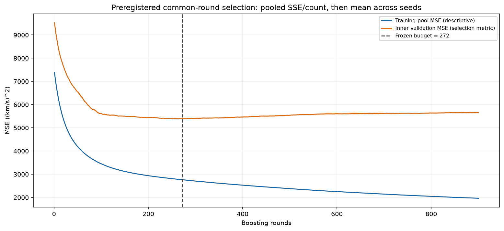
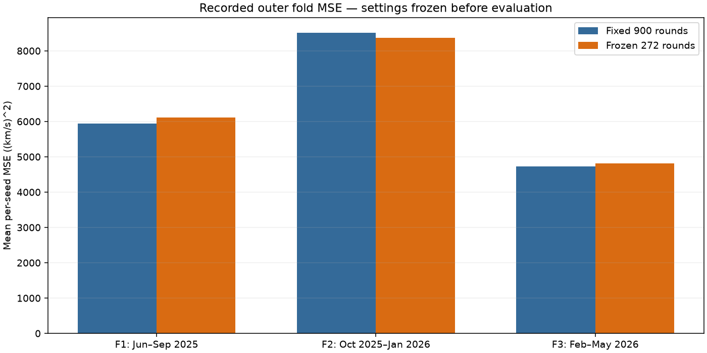

# Exa 기반 학습 횟수 선택 — 실제 train · validation 곡선

이번 E1901 실험에서 **학습 도중 실제 기록한 train·validation loss**입니다. 저장 모델의 사후 재평가였던 이전 E1725·E1711 곡선과 구별합니다. 세 head × 세 seed, 총 **9개 직접 예측 XGBoost 모델을 각 900회** 학습했습니다.

## Head·seed별 두 곡선

파란색은 train MSE, 주황색은 내부 validation MSE입니다. 점선은 내부 검증에서 한 번 선택해 고정한 **272회**입니다. 곡선은 smoothing이나 누적 최솟값 변환 없이 원래 값을 표시합니다.



Train target은 **2025-02-26 UTC 이전**, 내부 validation origin은 **2025년 3~4월**입니다. 72시간 target 경계를 적용하고 train·validation target이 겹치지 않는지 확인했습니다. Train 394,753행, validation 28,645행입니다. 각 head는 h1–6, h7–24, h25–72를 예측합니다. 원래 recipe와 같이 long head는 전체 horizon을 학습합니다.

## 공통 학습 횟수 선택

Validation SSE와 표본 수를 서로 겹치지 않는 head 예측 구간별로 합치고, 세 seed의 MSE를 평균해 공통 횟수 하나를 골랐습니다. Train 통합선은 설명용입니다. Long head의 학습 pool이 short·middle pool과 겹치므로 두 통합선의 표본 구성이 같다는 뜻은 아닙니다.



내부 검증 MSE는 900회 **5652.679707**에서 272회 **5388.826755**로 **4.66775% 낮았습니다**. 단, validation은 매 단계 단조 감소하지 않습니다. 이 수치는 횟수 선택에 사용한 내부 구간의 결과이며 이후 예측 성능의 증거와 구분합니다.

원본: [통합 CSV](calibration/pooled_curves.csv), [선택 영수증](calibration/selection.json), [선택값 동결 기록](selected-round-frozen.json). 아홉 head·seed의 900개 train/validation RMSE 배열은 [원본 curve JSON](calibration/checkpoints/)에 있습니다. 그림의 MSE는 원본 RMSE의 제곱입니다.

## 이후 구간 비교 결과 — 개선 입증 실패

272회를 고정한 뒤, 기존 900회 모델과 입력·깊이·학습률·정규화·seed를 동일하게 두고 보호 ROLL3 평가를 수행했습니다. 바꾼 항목은 `n_estimators` 하나뿐입니다.

| 실험 | 학습 횟수 | 외부 ROLL3 MSE: 시드 평균 예측 채점 | 사건 F1: 시드별 평균 |
| --- | ---: | ---: | ---: |
| E1900 기준 | 900 | **6436.496679** | 0.375342 |
| E1904 후보 | 272 | 6479.004079 | 0.410847 |

외부 MSE는 **+0.6604%**, 72시간 블록 bootstrap95% CI **[−2.1513%, +3.4680%]**, 개선 fold **1/3**로 보호 게이트에 미달했습니다. **내부 검증 개선이 외부 전체 MSE 개선으로 전이되지 않아 후보를 채택하지 않았습니다.** F1 개선만으로 이 판정을 바꾸지 않았습니다.



위 막대의 절대값은 원본 요약의 **시드별 MSE 평균**입니다. 보호 판정의 **평균 예측 MSE**와 집계가 다릅니다. [Fold CSV](outer_fold_metrics.csv)는 두 집계의 상대 변화를 별도 열로 보존합니다. [Seed CSV](outer_seed_metrics.csv), [보호 평가 원본](protected-roll3-record.json), [완료 검증](FINAL-VERIFICATION.json)도 함께 게시했습니다.

## 재현 및 범위

아홉 원본 이력과 CSV만으로 내부 곡선을 다시 그릴 수 있습니다. 모델 학습이나 추론은 하지 않습니다.

```bash
python scripts/plot_exa_earlystop.py \
  --calibration docs/visualizations/exa_earlystop_20261025/calibration \
  --output /tmp/exa-earlystop-plots
```

[manifest.json](manifest.json)에 원본 파일 SHA256과 실제 학습 이력 여부를 기록했습니다. 모델 가중치와 원본 관측·target 행은 게시하지 않았습니다. 외부 ROLL3는 이미 연구에 노출된 역사적 개발 구간이며, 공식 리더보드 전체 기간 점수나 독립 holdout 인증이 아닙니다. 원천 가용성 증거는 기존 동결 입력을 상속하며 이번 곡선으로 새로 인증하지 않습니다.

Exa로 조회한 근거: [XGBoost2.1 early stopping 안내](https://xgboost.readthedocs.io/en/release_2.1.0/python/sklearn_estimator.html), [sklearn 내부 선택과 외부 평가 분리](https://scikit-learn.org/stable/auto_examples/model_selection/plot_nested_cross_validation_iris.html), [FPP3 시계열 검증](https://otexts.com/fpp3/tscv.html).
