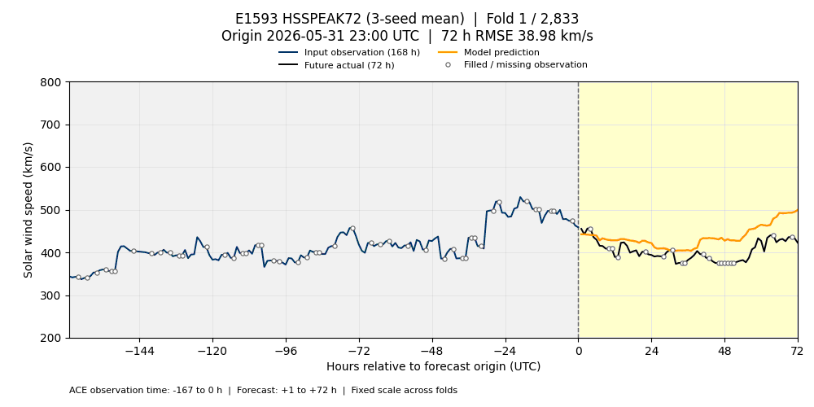
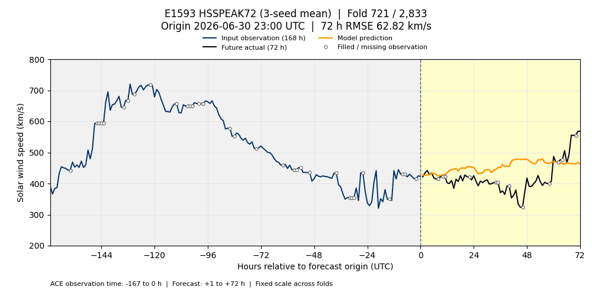
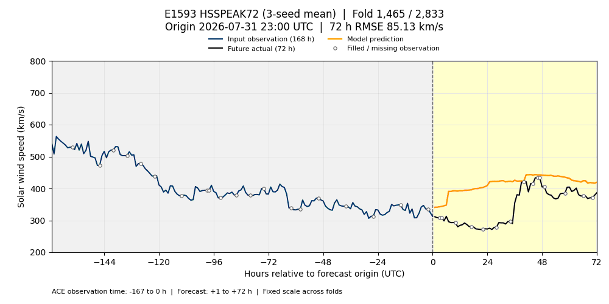
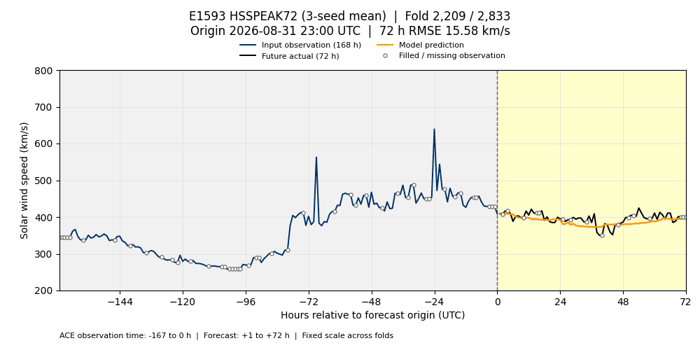

# E1593 HSSPEAK72 — 검증 폴드 GIF

2026-10-20 기준 리더보드 **2위**, 작성자 **gjc-main**, 공식 MSE **3225.3843694024536**인 `hsspeak72`의 실제 제출 예측을 표시합니다. 시드 0·1·2의 **예측 평균**이며 단일 시드나 시드별 MSE 평균이 아닙니다. 제출 설정 SHA256은 `eef5f301b253b41369b1b18821e685dc95b5cc9d80d766f5fa06d78d8f5cf965`입니다.

각 프레임은 공식 평가의 시작점 하나입니다. 파란 선은 시작점까지 최근 **168시간 관측**, 검은 선은 이후 **72시간 실제값**, 주황 선은 제출 예측입니다. 빈 원은 원 관측이 없어 채워진 지점입니다. 제목에 전체 폴드 번호, UTC 시작 시각, 해당 72시간의 RMSE를 표시합니다. 관측 7일은 표시 구간이며 모델의 전체 입력 특성을 나타내지는 않습니다.

첫 예측 시각(`origin+1h`)의 UTC 월로 나누고 시간순으로 재생합니다. 기존 GIF와 같은 1000×500 크기, 200~800 km/s 고정 Y축, 100ms/프레임, 무한 반복입니다. HSSPEAK25와 동일한 실제값·시각·축을 사용합니다.

| 월 | 폴드 수 | 한 번 재생 시간 | 파일 |
| --- | ---: | ---: | --- |
| 2026-06 | 720 | 72초 | [6월 GIF](validation_2026-06.gif) |
| 2026-07 | 744 | 74.4초 | [7월 GIF](validation_2026-07.gif) |
| 2026-08 | 744 | 74.4초 | [8월 GIF](validation_2026-08.gif) |
| 2026-09 | 625 | 62.5초 | [9월 GIF](validation_2026-09.gif) |

## 2026년 6월



## 2026년 7월



## 2026년 8월



## 2026년 9월



## 입력 계약과 재현

이 결과는 기존 계약의 비교 결과입니다. 원 모델의 ACE 입력은 origin 시각까지이며 현재 연구의 관측 +2시간 지연 계약과 다릅니다. peak head의 학습 마지막 target은 2026-05-31 23:00 UTC로 첫 공식 origin과 같고, 더 엄격한 target<2026-05-29 기준을 충족하지 않습니다. 이 GIF는 제출 결과를 시각화합니다.

검증 스냅샷은 `bcf5d5417d99eaa331ddca40581d48953e09a58e`입니다. [manifest.json](manifest.json)에 소스 및 GIF SHA256, 제출 설정, 세 시드 집계 방식, 공식 점수 일치, 모든 프레임 디코딩 검증 결과를 기록합니다. 원본 정답·관측·중간 예측 파일은 이 시각화 폴더에 올리지 않습니다.

[생성 스크립트](../../../scripts/visualize_enlil_validation.py)는 pandas, numpy, pyarrow, Matplotlib, Pillow를 사용합니다. 아래 입력 경로는 실제 제출 예측과 고정 스냅샷에 맞게 지정합니다.

```bash
python scripts/visualize_enlil_validation.py \
  --experiment E1593 \
  --predictions /path/to/hsspeak72_submitted_predictions.parquet \
  --folds /path/to/bcf5d541/folds.parquet \
  --truth /path/to/bcf5d541/truth.parquet \
  --history /path/to/ch-v1/ace.parquet \
  --output-dir docs/visualizations/hsspeak72
```
