# offset_roll_quantile / q50_pinball — q10·q50·q90 분위수 예측 (리더보드 미제출 ablation)

`e2000fs_calib_offset_roll`(현재 SOTA, Total S 98.76)에서 **calibration 경로를 빼고**, 학습 목적함수와 점 readout을 바꾼 **replacement ablation**입니다. 누적 개선 후보가 아니고 **리더보드에 제출하지 않았습니다**.

- 기준선 목적함수: point4 가중 L2 + spectral 0.1 → 조건부 꼬리 쪽으로 기울인 평균.
- 이번 목적함수: Gaussian smoothed pinball(h = 0.5, 표준화 단위). 블록당 24 h × 3 level을 하나의 multi-output booster로 학습합니다. 점예측은 **q50**입니다.
- 유지한 것: 30개 특징과 블록당 237열, XGBoost 파라미터, 900 rounds × 3 블록, F1/F2/F3 학습 cutoff(144 h maturity), 입력 df. 기준선과 같은지는 실험 쪽 `test_experiment.py`가 검사합니다.
- 주 대조군 **A − offset**은 같은 기준선 모형에서 offset만 뺀 예측입니다. calibration 제거가 두 arm에 공통이라 주 대조에서 상쇄됩니다.
- seed는 42/43/44입니다. 판정 기준은 실행 전에 고정했습니다(연구 폴더 `research/offset_roll_quantile_20261105/strategy.md` §5).

## 결과 — 점 모형이 낫다

공식 채점기(`leaderboard/scorer/competition.py`, `lead-timse-6h-v1`)로 F1/F2/F3을 채점했습니다. 관측은 revision `920588c2a7`의 ACE status 0이며 채우지 않았습니다. 내부 검증은 없습니다.

| seed | S q50 | S A − offset | S A (SOTA arm) | ΔS vs A − offset | ΔRMSE | ΔTRMSE | ΔMAE | bias q50 (A − offset) |
| ---: | ---: | ---: | ---: | ---: | ---: | ---: | ---: | ---: |
| 42 | 105.58 | 99.75 | 98.76 | **+5.83** | −1.24 | +20.89 | −3.64 | −3.9 (+14.3) |
| 43 | 105.44 | 100.91 | 99.93 | **+4.53** | −1.27 | +16.89 | −3.46 | −3.7 (+14.4) |
| 44 | 105.10 | 101.31 | 100.21 | **+3.80** | −1.78 | +15.94 | −4.02 | −3.8 (+14.1) |

- 3-seed 평균 ΔS는 **+4.72**, 95 % CI는 **[+0.97, +8.55]**입니다. CI는 168시간 circular block bootstrap 2000회로 구했고, 모든 arm·seed에 같은 draw를 썼습니다. 3 seed 모두 ΔS > 0이고 CI 하한도 0보다 커서, 사전 기준의 **"점 모형이 낫다"**에 해당합니다.
- 원래 기준선 A와 비교하면 평균 ΔS는 +5.74, CI는 [+1.85, +9.30]입니다. 제출 후보가 아닙니다.
- RMSE와 MAE는 오히려 좋아졌습니다. 그런데 정답 순위 가중 오차(TRMSE)가 +16 ~ +21 나빠졌고, S는 이 오차를 통해 고속풍 오차를 크게 봅니다.
  - bias는 +14 km/s에서 −3.8 km/s로 18 km/s 내려갔습니다. 태양풍 속도는 우측으로 치우쳐 있어서 median이 mean보다 낮습니다.
  - 기준선의 꼬리 가중 평균이 일부러 올려 두었던 예측이 사라진 것입니다.
- 기간별 ΔS는 F1 +3.4 ~ +7.4, F2 +8.6 ~ +9.0, F3 +1.7 ~ +2.0입니다.

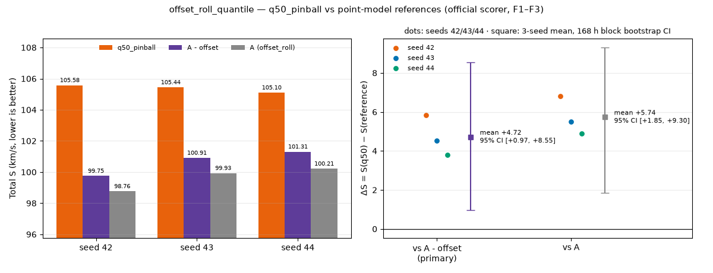

수치: [seed_comparison.csv](seed_comparison.csv). seed 42 채점 기록: [run-result.json](run-result.json).

## 분위수 구간 진단 (기술통계, 판정 조건 아님)

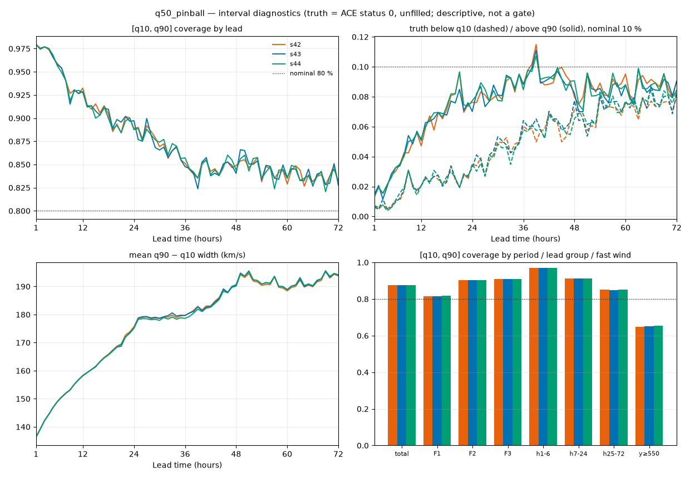

- [q10, q90] coverage는 **0.876**으로 명목 80 %보다 높습니다. q10 아래가 4.8 %, q90 위가 7.6 %이고 평균 폭은 177 km/s입니다.
  - 고정 bandwidth smoothed pinball의 최소점은 Y + h·ε의 분위수이므로, 구간이 넓어진다고 **실행 전에 예측한 방향**과 같습니다.
- lead별 coverage는 h1–6 0.97 → h7–24 0.91 → h25–72 0.85입니다. 기간별로는 F1 0.82 / F2 0.90 / F3 0.91입니다.
- 구간 전체는 넓은데 **고속풍(y ≥ 550 km/s, 9,099 pair)에서는 정답이 q90보다 위에 있는 비율이 34 %**입니다(명목 10 %). 넓어진 구간도 우측 꼬리를 따라가지 못했고, 이것이 TRMSE 악화와 같은 현상입니다.
- 분위수 순서가 뒤집힌 비율(정렬 전)은 9개 블록 × 3 seed 모두 0.0이었습니다.

## Lead 곡선

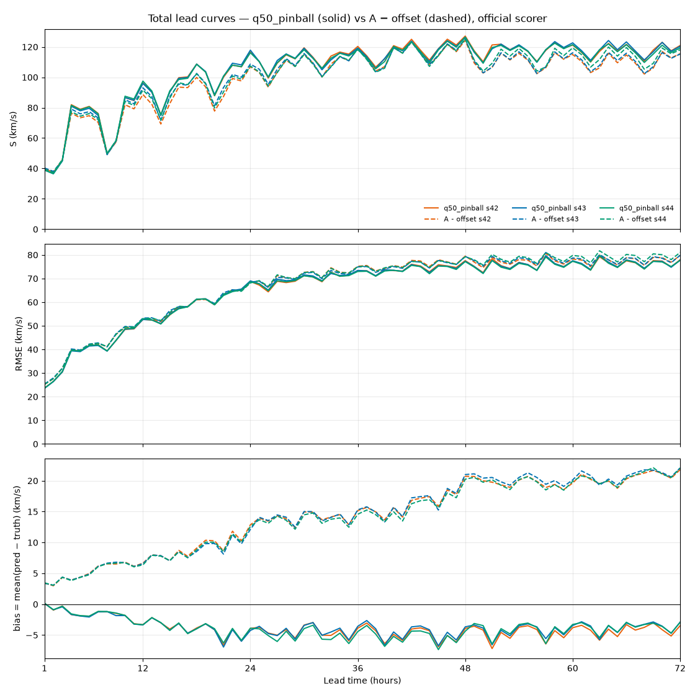

Total 기준 S·RMSE·bias를 lead별로 그렸습니다. 실선은 q50, 점선은 A − offset이고, 색은 seed를 나타냅니다. 세 기간 각각의 값은 [lead_metrics.csv](lead_metrics.csv)에 있습니다(`scope` = total/f1/f2/f3).

## 월별 예측 GIF (seed 42)

GIF는 **seed 42**로 그렸습니다. 리더보드 SOTA arm과 같은 seed라서 결과를 보기 전에 정했고, 세 seed 중 가장 좋은 seed를 고른 것이 아닙니다.

한 프레임은 채점 origin 하나이며, 다음을 함께 보여 줍니다:
- origin 직전 168시간 관측(파랑)
- 이후 72시간 정답(검정)
- q50(주황)과 q10–q90 구간(주황 음영)
- 대조군 A − offset 점예측(보라 점선)

Y축은 200–850 km/s로 고정했습니다. 관측과 정답은 ACE status 0 값만 쓰고 결측은 비워 둡니다. 부제에는 그 origin의 72 h q50 RMSE와, 유효한 정답 시간 중 구간 안에 든 비율을 표시합니다. 프레임 간격은 250 ms입니다.

| 월 | 기간 | 프레임 | GIF |
| --- | --- | ---: | --- |
| 2026-01 | F1 | 124 | 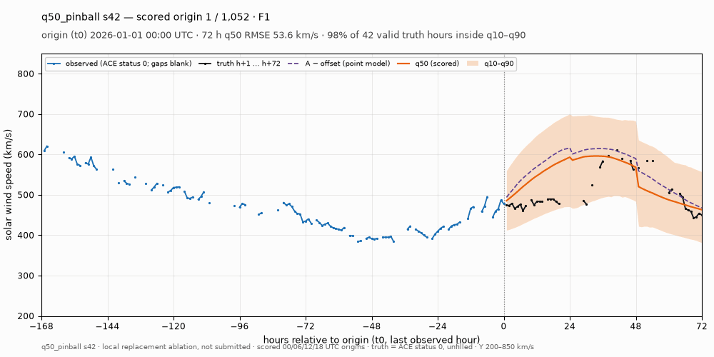 |
| 2026-02 | F1 | 112 | 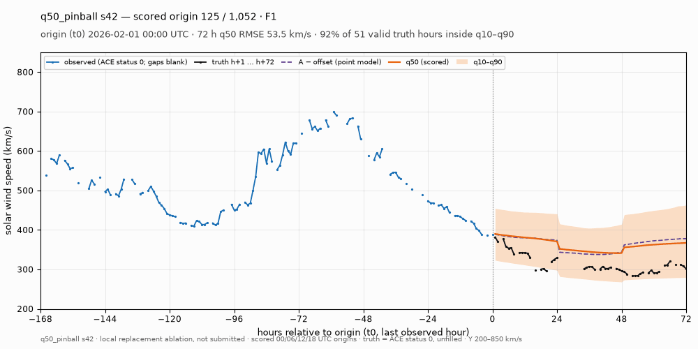 |
| 2026-03 | F1 | 112 | 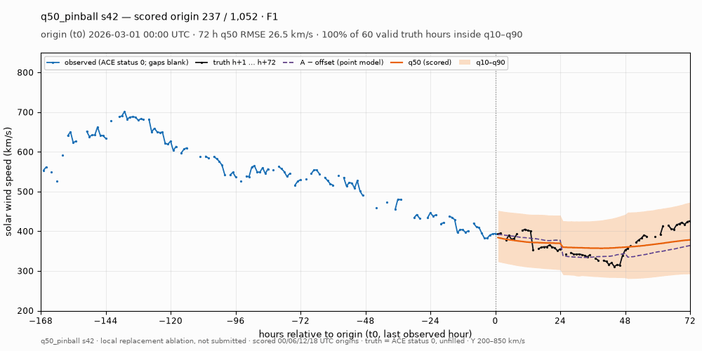 |
| 2026-04 | F2 | 120 | 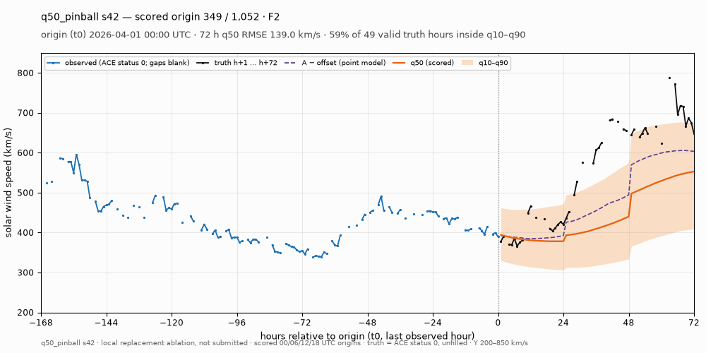 |
| 2026-05 | F2 | 124 | 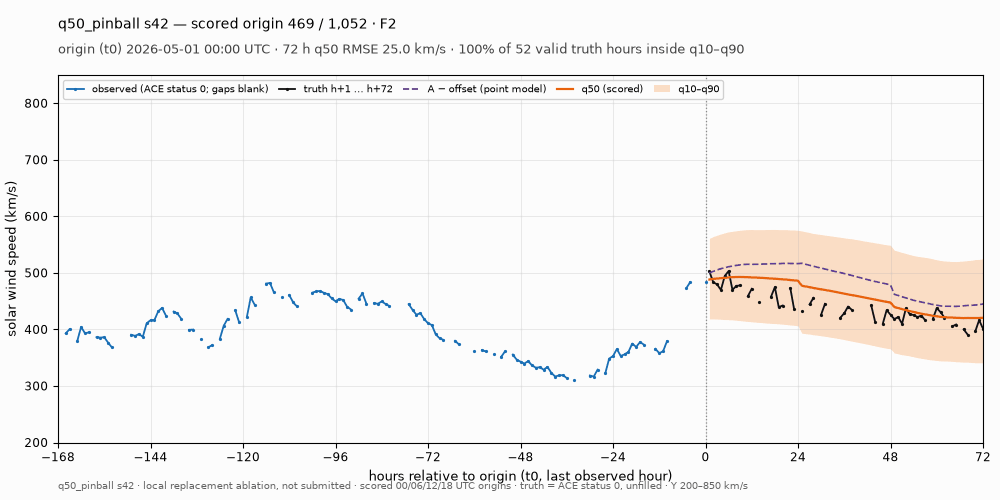 |
| 2026-06 | F2 | 108 | 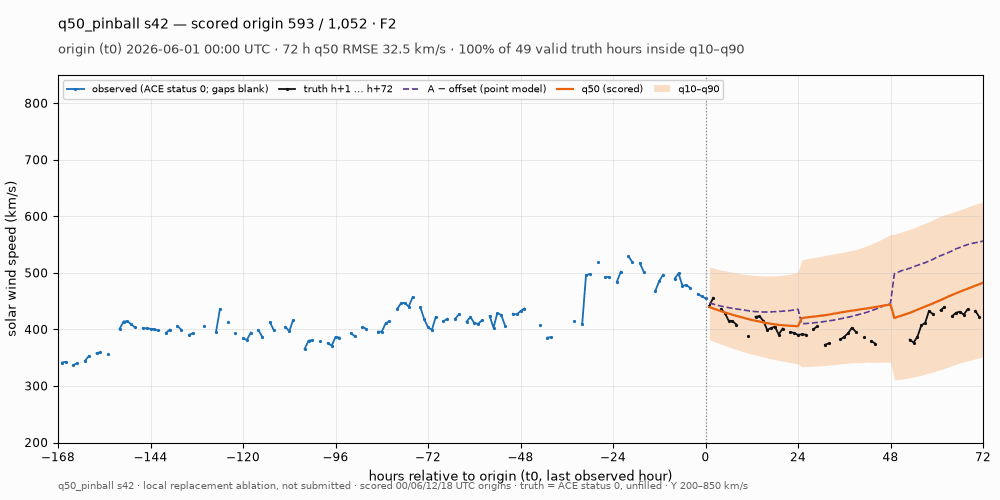 |
| 2026-07 | F3 | 124 | 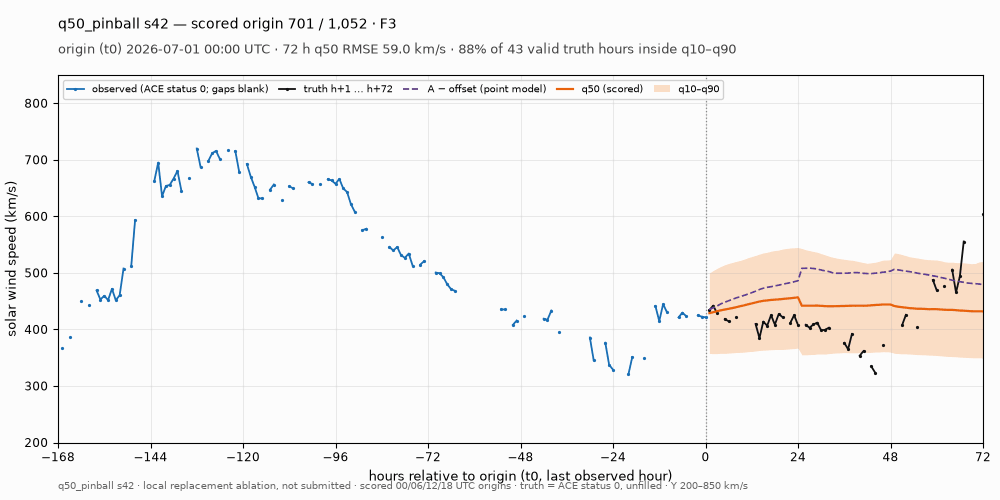 |
| 2026-08 | F3 | 124 | 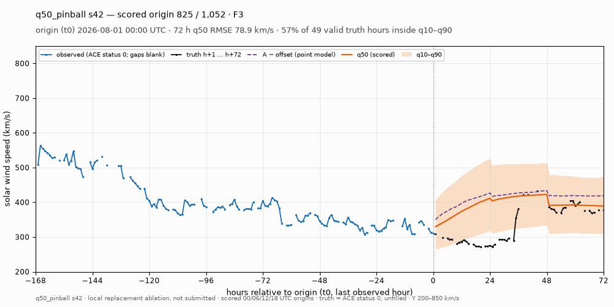 |
| 2026-09 | F3 | 104 | 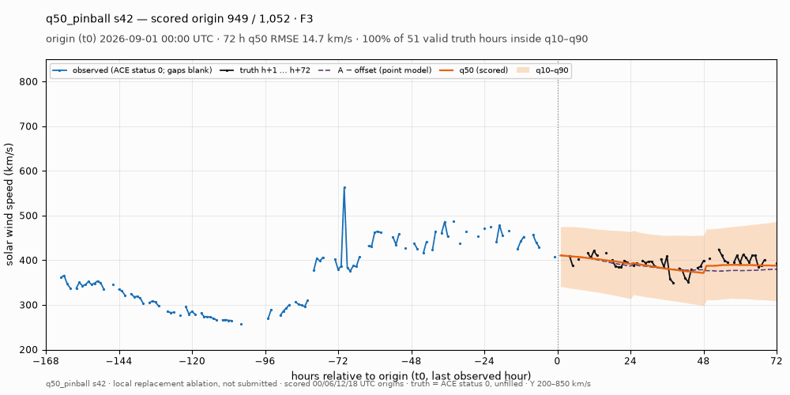 |

9개월 합계 1,052 프레임으로, 채점 origin 전체입니다.

## 검증과 재현

[code/render.py](code/render.py)는 저장된 산출물만 읽고, 재학습이나 후처리는 하지 않습니다.
- 그리기 전에 세 seed의 q50 예측을 공식 채점기로 다시 채점합니다. Total/F1/F2/F3의 S·TIMSE·RMSE·tRMSE·bias·n_pairs가 각 run의 채점 기록과 1e-9 이내로 같아야 그립니다.
- 대조군도 저장된 paired 점수와 같은 방식으로 확인합니다.
- 그 밖에 `pred_kms`가 q50과 같은지, q10 ≤ q50 ≤ q90인지를 확인합니다([manifest.json](manifest.json)).

```bash
CUDA_VISIBLE_DEVICES='' /home/t-lab01/sunrun/.venv/bin/python \
    docs/visualizations/offset_roll_quantile_q50_pinball/code/render.py
```

입력은 모두 로컬 연구 폴더 `research/offset_roll_quantile_20261105/`에 있습니다:
- `runs/q50_pinball_s{42,43,44}/`
- `reference/baseline_s{42,43,44}/`
- `analysis/results.json`
- `competition-observations.parquet`

학습 코드 commit은 `d64c40339`이고, CPU만 썼습니다.
