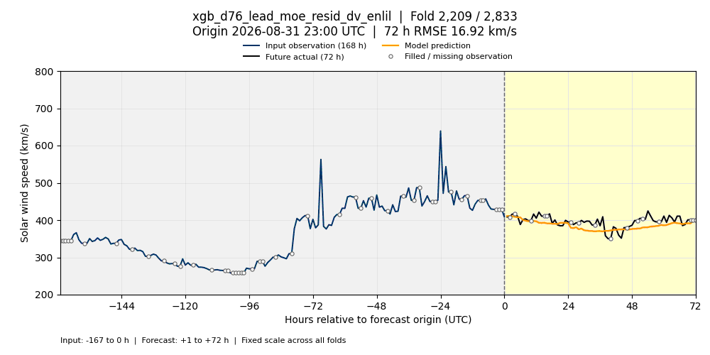
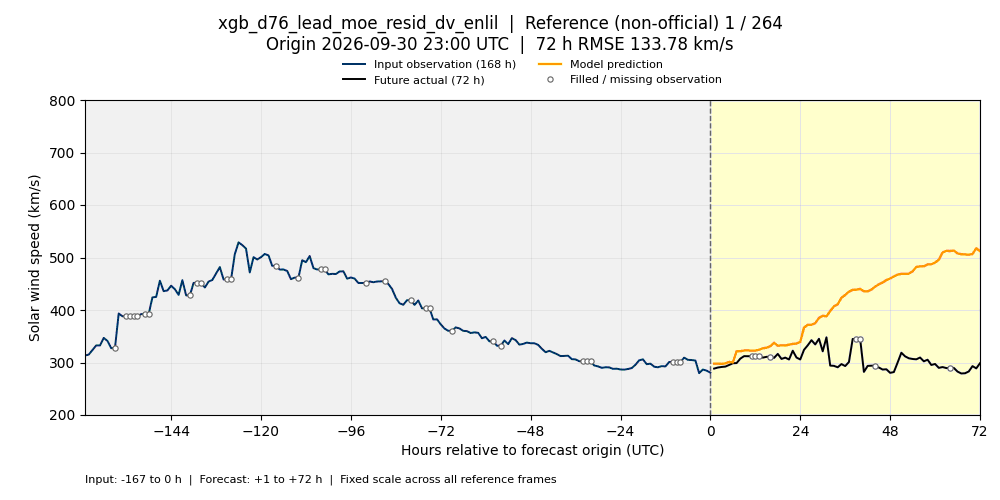

# xgb_d76_lead_moe_resid_dv_enlil — 검증 폴드 GIF

리더보드에 제출된 **E0472 (D148), seed cell 0**의 저장 예측을 표시합니다. 재학습 없이 고정 검증 스냅샷의 2,833개 폴드를 모두 포함하며, 전체 MSE는 **3248.6812422215053**입니다.

제출 설정 SHA256: `b8ae672fdb6ff9a6dc85bc5c3f2d8b2acbc9207c98126d39ad1913f24581962c`. 검증 스냅샷: `bcf5d5417d99eaa331ddca40581d48953e09a58e`.

각 프레임은 하나의 검증 폴드입니다. 파란 선은 예측 시작점까지의 최근 **168시간 관측**, 검은 선은 이후 **72시간 실제값**, 주황 선은 모델 예측입니다. 시작점의 세로선과 배경색으로 두 영역을 구분합니다. 빈 원은 원 관측이 누락되어 이전 값으로 채워진 지점입니다. 제목에는 전체 폴드 번호, UTC 시작 시각, 해당 예측 구간의 RMSE가 표시됩니다.

최근 7일은 보기 위한 표시 구간입니다. 모델은 26~28일 전 회귀 입력, ACE plasma/IMF/EPAM, CH, SUVI, DONKI WSA-Enlil 특성도 사용하므로 이 그림이 전체 입력 특성을 나타내지는 않습니다.

첫 예측 시각(`origin + 1h`)의 UTC 월로 구분하며 시간순으로 재생합니다. 모든 GIF는 동일한 Y축 범위를 사용하고, 프레임당 100ms (기존 대비 2배속)로 반복 재생합니다.

| 월 | 폴드 수 | 한 번 재생 시간 | 파일 |
| --- | ---: | ---: | --- |
| 2026-06 | 720 | 1분 12초 | [6월 GIF](validation_2026-06.gif) |
| 2026-07 | 744 | 약 1분 14초 | [7월 GIF](validation_2026-07.gif) |
| 2026-08 | 744 | 약 1분 14초 | [8월 GIF](validation_2026-08.gif) |
| 2026-09 | 625 | 1분 2.5초 | [9월 GIF](validation_2026-09.gif) |
| 2026-10 (참고 추론) | 264 | 26.4초 | [10월 GIF](validation_2026-10.gif) |

10월은 아래 설명과 같이 공식 검증 폴드와 별도로 생성한 참고 결과입니다.

## 2026년 6월


## 2026년 7월


## 2026년 8월


## 2026년 9월



## 2026년 10월 — 최신 로컬 입력 참고 추론



같은 제출 모델 **E0472 seed 0**의 고정 PKL을 재학습 없이 사용했습니다. 첫 예측 시각은 **10월 1일 00:00~10월 11일 23:00 UTC**이며, 시작점(origin)은 9월 30일 23:00~10월 11일 22:00 UTC입니다. 이후 72시간 실제값이 모두 확보된 264개 시작점만 포함하므로, 마지막 실제값은 **10월 14일 22:00 UTC**입니다. 크기·재생 속도·Y축(200~800 km/s)은 기존 GIF와 같습니다.

입력은 로컬 v2 ACE·CH·SUVI·DONKI 스냅샷입니다. v2의 공식 전환 검증은 아직 대기 상태이며, **공식 리더보드 평가가 아닌 10월 참고 추론**입니다. 입력 시각은 기존 제출 모델의 계약을 따르며, 이후 연구에 도입된 ACE 관측 +2시간 지연 계약과 다릅니다. SUVI는 원 모델의 가용성 대리 조건(관측 종료 ≤ 시작점−1시간, S3 수정 시각 ≤ 시작점, 로컬 파일 존재)을 적용했습니다. 264개 시작점 모두 신선도 조건을 충족했습니다.

10월 참고 MSE는 **11614.98739983904**입니다. 기존 공식 MSE에는 합산하지 않습니다. 19,008개 시작점×예측시간 실제값 중 2,559개는 원본의 결측 채움 표시가 있는 값이며, 같은 관측이 겹치는 예측 구간에서 반복 집계됩니다. 기존과 동일하게 이 값도 RMSE에 포함하고 빈 원으로 표시하며, 추가 보간이나 채움은 하지 않았습니다.

[manifest_2026-10.json](manifest_2026-10.json)에 모델·입력 스냅샷·예측·GIF의 해시, 실제 기간과 인코딩 검증 결과를 기록했습니다. 기존 6~9월 GIF와 `manifest.json`은 유지합니다.

## 재현

생성 스크립트: [visualize_enlil_validation.py](../../../scripts/visualize_enlil_validation.py). pandas, numpy, pyarrow, Matplotlib, Pillow가 설치된 Python 환경을 사용합니다. 아래 경로는 생성 시 사용한 로컬 환경 기준이며 각자의 입력 파일 경로로 바꿀 수 있습니다.

```bash
/home/t-lab01/neuralforecast/.venv/bin/python scripts/visualize_enlil_validation.py \
  --experiment E0472 \
  --predictions /home/t-lab01/sunrun/research/expos/runs/E0472/predictions_official_s0.parquet \
  --folds /home/t-lab01/.cache/huggingface/hub/datasets--tlabtlab--sunrun-lb-store/snapshots/bcf5d5417d99eaa331ddca40581d48953e09a58e/folds.parquet \
  --truth /home/t-lab01/.cache/huggingface/hub/datasets--tlabtlab--sunrun-lb-store/snapshots/bcf5d5417d99eaa331ddca40581d48953e09a58e/truth.parquet \
  --history /home/t-lab01/sunrun/leaderboard/store/ch-v1/ace.parquet \
  --output-dir docs/visualizations/xgb_d76_lead_moe_resid_dv_enlil
```

[manifest.json](manifest.json)에 입력 파일의 SHA256, 모델 식별자, 점수, 프레임 수 및 인코딩 설정을 기록합니다. 검증 정답과 입력 원본 파일은 이 폴더에 업로드하지 않습니다.

10월 참고 추론은 [predict_reference_month.py](../../../scripts/predict_reference_month.py)로 로컬 v2 입력의 생성 영수증을 확인하고 별도 작업 폴더에 복사한 뒤 생성합니다. 추론은 `model_release/requirements.txt`의 고정 버전 환경을 사용했습니다. 원시 데이터·PKL·중간 예측은 Git에 올리지 않습니다. 작업 폴더는 실행할 때 존재하지 않는 새 경로를 지정합니다.

```bash
/home/t-lab01/sunrun/leaderboard/.venv-fusion/bin/python scripts/predict_reference_month.py \
  --month 2026-10 \
  --v2-root /home/t-lab01/sunrun/leaderboard/store/v2 \
  --images-root /home/t-lab01/sunrun/sun-img \
  --model /home/t-lab01/sunrun/model-release-20261010/xgb_d76_lead_moe_resid_dv_enlil_seongeun.pkl \
  --output-dir /home/t-lab01/sunrun/visualization-reference-20261017

/home/t-lab01/neuralforecast/.venv/bin/python scripts/visualize_enlil_validation.py \
  --experiment E0472 --reference-month 2026-10 \
  --predictions /home/t-lab01/sunrun/visualization-reference-20261017/predictions.parquet \
  --history /home/t-lab01/sunrun/visualization-reference-20261017/inputs/ch/ace.parquet \
  --model-file /home/t-lab01/sunrun/visualization-reference-20261017/xgb_d76_lead_moe_resid_dv_enlil_seongeun.pkl \
  --provenance /home/t-lab01/sunrun/visualization-reference-20261017/provenance.json \
  --output-dir docs/visualizations/xgb_d76_lead_moe_resid_dv_enlil
```

참고 모드는 같은 월의 기존 GIF·manifest를 덮어쓰지 않습니다. 재생성할 때는 별도 출력 폴더를 지정합니다.
